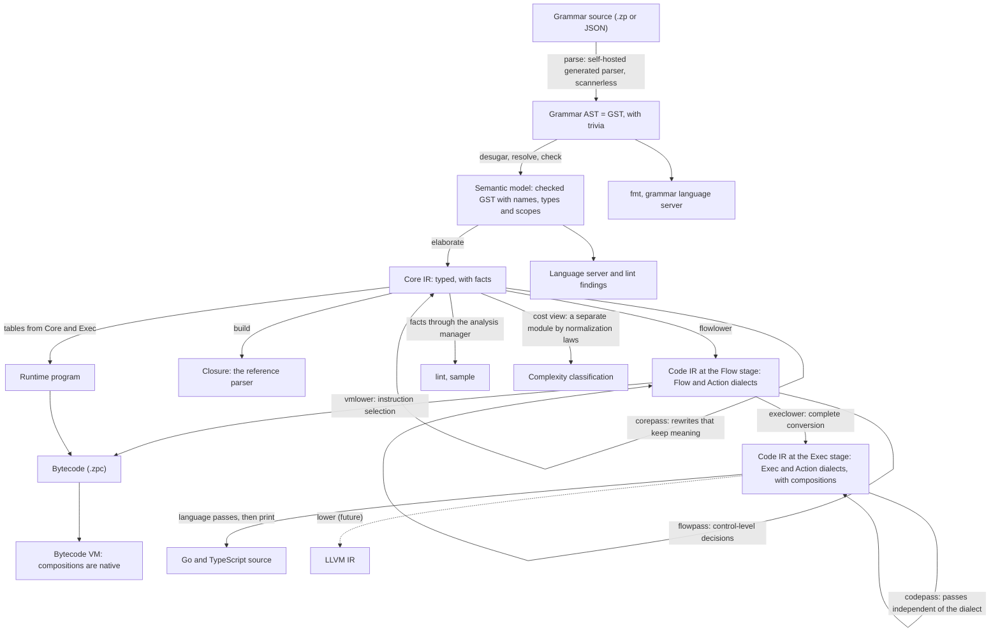
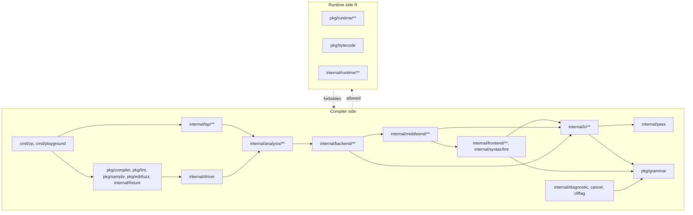
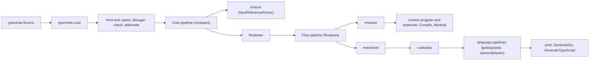

# Architecture

ZeroParse is a parser compiler: it turns a grammar written in an extended PEG language into parsers for several
backends, and every backend gives the same parse result for the same grammar and input. This page is the architecture
of the system as a whole: the execution model, the intermediate representations and the pipeline between them, the
backends, the tools and the command line, and then the Go package layout that implements them, with its public API,
its import rules, the pass model and the driver. Read it before you work in any part of the compiler or the runtime.

> [!WARNING]
> The package layout is being migrated to the architecture this page describes, so parts of the current code still
> differ from it: some packages have not moved to the paths named here, and some mechanisms (the Code IR dialects, the
> analysis manager, bytecode selected from the Flow stage) are not implemented yet. [Migration](#migration) lists the
> stages that reach the target, in order. The package comments describe the code as it is.

The contracts that every backend must keep are in the [specification](../../spec/README.md); the representations are
explained in more depth in [Core IR and Code IR](intermediate-representations.md), the pass model in
[the optimization pipeline](optimization-pipeline.md), and the decision behind the layout, with its alternatives, in
[record 072](records/072-release-package-layout.md).

## What ZeroParse Provides

One pipeline of intermediate representations carries every feature, so a grammar has one meaning wherever it is used.

- **Development support**: a formatter, a linter, complexity classification and a language server for grammars.
- **Run-time observation**: traces, profiles and explanations of syntax errors.
- **Automated testing**: sampling of accepted inputs and edit fuzzing of incremental parsing.
- **Execution**: the bytecode VM, generated Go and TypeScript, and, in the future, native code.

## Execution Model

### The Grammar Language

A grammar is written in an extended PEG: PEG with types, actions, predicates, expectations, recovery, Operators Rules
and pragmas. Grammar sources use the extension `.zp`. A grammar can also be written as JSON, and that JSON form is a
public contract that the specification defines.

### Parsers and Parse Values

- A **parser** reads input by the rules of a grammar and builds a parse value. The details of the API may differ
  between backends; the meaning of the result does not.
- A **parse value** is a concrete syntax tree by default. When the grammar declares types and actions, the parser
  builds typed values directly.
- A **structural query** matches patterns against parse values. Its core is a programmatic pattern that is type-checked
  against the output schema (`Pattern` of the query package: categories, types, rules, fields, elements and captures),
  so a wrong pattern is reported when it compiles. A text syntax for patterns is a later front end that produces
  `Pattern` values.

### Modes of Execution

- **Recognition** decides, without building a tree, whether the input matches the grammar, and returns the same success
  and the same syntax errors (recovered ones included) as a parse. Predicates, and the actions that predicates read,
  run; the runtime errors of other actions and the conversion to typed values are not checked, so a recognition can
  succeed where a parse fails. "Recognize" is the one term for this mode in the command line, the API, the
  specification and the documents. "Validate" and "validation" mean only the structural check of an artifact: a grammar
  AST, a schema or a module.
- **Document mode** keeps the input and the parse state between edits and parses again only what an edit changed. It
  serves editors and other real-time analysis.
- **Stream mode** commits the result at each unit of the top-level repetition and drops what has been processed, so a
  large input is parsed in nearly constant memory.

## Intermediate Representations and the Pipeline

There are two intermediate representations.

- **Core IR** holds the meaning of a grammar as trees and facts. It is the minimal, typed form after desugaring and knows
  nothing of the mode: budgets, Documents, observation and the target are not part of it.
- **Code IR** is the shared base of structured code: modules, functions, statements and expressions, the machinery that
  declares operations, a verifier, a printer and a reference interpreter. Its dialects are tables of operations, which
  are data. There are three.
  - The **Flow** dialect has the operations of grammar control: matching, mark and restore for backtracking,
    expectations, captures, rule calls under a policy, charging for budgets and recovery.
  - The **Action** dialect has the operations that evaluate action expressions: Value Actions, Predicate Actions and
    bindings. It is valid both at the Flow stage and at the Exec stage.
  - The **Exec** dialect has the operations of the abstract machine and the compositions built on them.

The terms are fixed. A set of operations is a dialect: the Flow dialect, the Action dialect, the Exec dialect. A state
of a program is a stage: Code IR at the Flow stage and Code IR at the Exec stage, or the Flow stage and the Exec stage
where the context is clear. Neither stage is a representation of its own. "The abstract machine" is the parser machine
that the Exec dialect defines; "the VM" is only the bytecode VM.



### The Front End

- **Grammar AST (GST).** The syntax tree of the grammar language, with comments and line breaks (trivia) attached to
  its nodes. It is the typed form of the JSON form and is owned by the public package `pkg/grammar`. The parser that
  builds it is a scannerless, self-hosted parser generated from the grammar of the grammar language, which holds all the
  lexical knowledge.
- **Semantic model.** A read-only result of analysis over the GST: name resolution (each reference to its
  declaration), the types of expressions and captures, scopes, the start rules and the table of type declarations. It
  is the one place that answers questions tied to a source range (hover and go to definition in the language server,
  lint findings, type errors). It transforms nothing.
- **Core IR** is elaborated once from the semantic model. The policy of a rule (Memo, Leader, Member, Cycle,
  Transient, Plain and the like) and the site numbers come only from facts and analyses on Core IR.
- **Runtime program.** Only the tables a parse needs: the rule table with the policies, the expectation table, the node
  kinds of types with their struct fields and zero values, the initial values of variables and the start rules. It is
  built at compile time from Core IR and Code IR, and a `.zpc` file is its serialization. It holds no grammar AST, no
  type checker and no compile options, so loading a `.zpc` file does not use the compiler.
- There is no "checked program" layer. Its content is divided among the semantic model, Core IR and the runtime
  program, and each piece of knowledge has one home.

### The Middle End

- **Core passes (`corepass`).** Rewrites that keep the meaning, and the facts: guard sets, first sets, effects, rule
  policies, the normalization of level O and the conversion of value-free class repetitions into scans. They know
  nothing of the mode.
- **`flowlower`** lowers Core IR to Code IR. Rule bodies become Flow operations and action expressions become Action
  operations. The lowering emits one uniform shape; the Flow passes choose the shape.
- **Flow passes (`flowpass`)** are the layer where control-level decisions are made. Flow is neither a control-flow
  graph nor a type system of its own: it is a dialect over Code IR. A pass that needs a control-flow graph gets one as
  an analysis view from the analysis manager. Each pass declares its name (which is also its flag in the registry), its
  applicability (a feature set), its obligation, and the analyses it needs and keeps. After a pass the Flow verifier
  runs; it checks the structure, the variables, one runtime per function, the budget invariants, recorded reads under a
  Document, and that a traced parse does not read in place.

  | Order | Pass | Obligation (what it preserves) | Main analyses |
  |:--|:--|:--|:--|
  | 1 | call-specialize | The result, memo records, expectations and events of a call stay the same; under observation the call is kept | Core facts (Plain, Memo, Leader), call graph |
  | 2 | inline | The same nodes, values, memo entries and errors at the same positions | Call graph, size |
  | 3 | dispatch | The same order of trying alternatives and the same expectation records; guards use only Core facts | Core first sets and guards |
  | 4 | match-form | The same input consumed and the same expectations recorded; the charging invariants hold | Features (Budget, Document, Traced) |
  | 5 | save-elide | No save that no failure path reads | Core effects, liveness |
  | 6 | fail-merge/thread | The same behavior on every reachable path | Reachability |
  | 7 | charge | The same total charge; every loop iteration charges, input is charged before it is examined, and no charge crosses a commit | Charge flow |
  | 8 | slots | Locals share a slot only when their types are equal and their live ranges do not overlap | Liveness |
  | 9 | outline (module) | The same behavior; enabled by the size profile | Structural hashes |

- **Flow operations** carry a contract, a cost, the features they need, their laws and a **reference expansion** into
  Exec operations. The conformance suite compares every implementation of an operation with its reference expansion.
- **`execlower`** converts the Flow stage to the Exec stage completely. Its postcondition, that no Flow operation
  remains, is checked by the verifier.
- **The Exec dialect** is the specification of the abstract machine (its components, registers, operations, contracts
  and cost bounds) together with the compositions: the call protocol, memoization, left-recursion growth, Operators
  Rules, Documents and streams. Grammar-specific code enters through `execlower` from the Flow dialect. Every operation
  has a reference model (`internal/ir/code/exec/ref`) and conformance cases.
- **`codepass`** holds the passes that do not depend on a dialect: function specialization, simplification and dead
  store elimination. They work only from the reads and writes that each operation declares.

The vocabulary of transformation follows LLVM and MLIR. A conversion between dialects is a *lowering* (`flowlower`,
`execlower`, `vmlower`); *legalize* is used only for adjustments inside a target, the language passes of Go and
TypeScript. The stage names of `-print-after` are `core`, `flow` and `exec`.

## Backends

The specification is normative. There are two executable references: the closure backend for the meaning of grammar
code, and the reference models of the Exec dialect for the contract of each operation of the abstract machine.

- **Closure.** A reference parser built from Core IR, and the oracle of the differential tests. It deliberately does not
  share the lowering of grammar code through Flow and Exec: if it did, a bug in that lowering could not show up as a
  difference between backends. It needs Core IR, so it belongs to the compiler side, and its only public form is
  `NewReferenceParser` in `pkg/compiler`.
- **Bytecode and the VM.** The default backend: `Compile` returns a parser on the VM. Instructions are selected from
  Code IR at the **Flow stage**, with superinstruction selection (`internal/backend/vmlower`). The instruction set is at
  the level of grammar control (STR, CLASS, CHOICE and so on), so instructions follow Flow operations almost one for
  one; mapping a mark that names a set of state to CHOICE is a sound over-approximation. A call of a composition is one
  instruction, and common match patterns fuse into high-level instructions. The compositions are implemented natively
  in the VM and checked by the conformance suite of the Exec dialect. The VM has two drivers, recursive and iterative.
  A `.zpc` file consists of the closed instruction set and the runtime program, and loads dynamically without the
  grammar. With this choice every practical backend (the VM, Go, TypeScript and a future LLVM backend) takes grammar
  code from one Code IR, so charging and the propagation of options cannot drift between two lowerings of grammar code.
- **Host code generation (Go and TypeScript).** The Exec stage is legalized and optimized by **passes specific to each
  language** and then printed. Each language pipeline runs on the manager of `internal/pass`, and its flags are in the
  registry. The shared runtime of generated Go is either imported as a library (`-lib import`) or embedded
  (`-lib embed`).
  - Shared (`internal/middleend/codepass`): specialization and simplification, dead store elimination, reachability
    after printing, and sharing of identical helpers and literal tables.
  - Go only: legalizing the scope of `goto` and declarations (locals are enclosed so that no `goto` jumps over a
    declaration), grouping variable declarations, encoding terminal regions as tables, turning literal comparisons into
    a `switch`, comparing fields in typed Go, removing unused helpers, and adjusting the shape of Operators Rule loops.
  - TypeScript only: structuring with labeled blocks and `for(;;)` (there is no `goto`, so an exit is `break label`),
    outlining large frame functions, its own decision on sharing literal tables, and specializing the conversion to
    typed values.
- **LLVM.** Lowering from the Exec stage to LLVM IR. Future work of low priority.

## Tools

### Static Analysis

- **`fmt`** formats the grammar AST with its trivia and keeps comments and blank lines. Its public form is `Format` in
  `pkg/grammar`.
- **`lint`** reads the grammar AST and the facts of Core IR. Findings are tied to source ranges, so they come from the
  AST; facts such as reachability and nullability come from Core IR, through the analysis manager, which shares them with
  the optimization passes. Its public form is `pkg/lint`.
- **Complexity classification** sorts a grammar into linear, polynomial, exponential and the other classes on a
  dedicated **cost view**: a Core IR module derived by normalization laws. The proofs that the classification is sound
  speak about the cost view, which is why it is a module separate from the Core module that the optimizations use. Users
  reach it through lint, as the `super-linear` check and `Classify` in `pkg/lint`. [Cost analysis](cost-analysis.md)
  explains how it works.

### Language Servers

- **The grammar language server** supports editing `.zp` files: syntax and type errors, go to definition, rename and
  formatting.
- **A language server for user languages** (future) loads any grammar and provides editor support for the language it
  describes, from Document mode and structural queries. It depends on the text syntax of queries.

### Run-Time Observation

`pkg/runtime/instrument` holds the model of events and profiles: the trace function with its enter, exit and skipped
events, the rule filter and depth limit, and the per-rule profile (calls, time, exact Examined and Wasted). The engine
and generated parsers implement it with the same types and the same meaning, and `explain`, `trace` and `profile` are
built on it.

### Automated Testing

- **`sample`** (`pkg/sample`) walks the grammar AST to generate inputs and confirms by a real parse that they are
  accepted. It has a coverage-guided mode. Its output serves Go table tests and seeds for fuzzing.
- **`edit-fuzz`** (`pkg/editfuzz`) compares the reparse of a Document with a fresh parse over random edit sequences, on
  every backend and in every position unit. It has `-minimize`, `-save-failures` and `-replay`, and an edit sequence is
  versioned JSON.

## The Command Line

The `zp` command groups its subcommands by task.

```bash
# Parsing and recognition
zp parse -g grammar.zp -i 'abc=12'                         # print the parse result (JSON, or -f sexpr)
zp parse -g grammar.zp -recognize < input.txt              # recognize: success and syntax errors, no tree

# Run-time observation
zp explain -g grammar.zp < input.txt                       # explain the rule calls behind a syntax error
zp trace -g grammar.zp -i 'abc=12' [-failures] [-rule name] [-show-depth n] [-f json]
zp profile -g grammar.zp < input.txt                       # cost and wasted backtracking per rule

# Static analysis, formatting and editor support
zp lint -g grammar.zp                                      # checks and the complexity class
zp fmt -w grammar.zp                                       # format, keeping comments (-check reports a difference)
zp lsp                                                     # grammar language server

# Grammars and schemas
zp convert [-to zp|json] grammar                           # convert between grammar source and JSON
zp schema -g grammar.zp [-all-rules] [-o file]             # write the output schema
zp schema diff before after                                # schema differences and their impact

# Compilation and code generation
zp compile -g grammar.zp -mode parse|recognize|document -o g.zpc
zp gen -g grammar.zp -module example.com/calc -o calc               # Go parser
zp gen -g grammar.zp -module example.com/calc -types -o calc        # with type definitions
zp gen -g grammar.zp -module example.com/calc -recognize -o calc    # with Recognize (-recognize-only: Recognize alone)
zp gen -lang ts -g grammar.zp [-types] -o ts-parser                 # TypeScript parser
zp gen ... -print-after core,flow,exec                              # dump the IR after each stage

# Testing
zp test -f suite.json [-backend ...] [-equivalence] [-update]       # JSON fixture suites
zp sample -g grammar.zp -n 20 -coverage                             # generate accepted inputs
zp edit-fuzz -g grammar.zp -minimize -save-failures out             # edit fuzzing
```

## The Go Packages

The packages are cut by three criteria: cohesion (one concern per package), clarity for the user who imports them,
and the separation of the runtime side from the compiler side. The Go API for users is under `pkg/`; the
implementation is under `internal/`.

### The Package Tree

```text
zeroparse/
├── cmd/
│   ├── zp/                       # the command line; reaches every feature through internal/driver
│   └── playground/               # the WebAssembly side of the playground
│
├── pkg/                          # the public API
│   ├── compiler/                 # makes executable artifacts from a grammar: Compile (VM), CompileGrammar,
│   │                             #   NewReferenceParser, Marshal (.zpc), GenerateGo, GenerateTypeScript,
│   │                             #   OutputSchema, Optimize
│   ├── grammar/                  # grammar AST, JSON form, Validate, Source and Load, Format, Convert
│   ├── lint/                     # Lint, Checks, Config, Finding, Rewrite, Classify
│   ├── sample/                   # generation of accepted inputs
│   ├── editfuzz/                 # edit fuzzing of Documents, replay and minimization
│   ├── bytecode/                 # Module, the instruction set, the .zpc codec
│   └── runtime/                  # Parser, ParseOption, Limits, LimitError, StreamIterator, statistics
│       ├── input/                # PositionUnit, Location, TextEdit, kinds of change
│       ├── value/                # Node, cursors, traversal, JSON, SyntaxError
│       │   └── impl/             # the node representation (package valueimpl)
│       ├── schema/               # the output schema: types, JSON, validation, Compare
│       ├── query/                # structural queries
│       ├── instrument/           # TraceEvent, Profile, filters and depth
│       ├── vm/                   # LoadParser, the Parser and Document of the VM
│       └── golib/                # the library of generated Go parsers
│
├── internal/
│   ├── driver/                   # drives the pipelines; the table of optimization profiles; the body of
│   │                             #   pkg/compiler and cmd/zp
│   ├── diagnostic/               # positioned static errors
│   ├── cancel/                   # cancellation of static work
│   ├── cliflag/                  # flag names of backends and position units
│   ├── fixture/                  # JSON fixture suites of zp test (a tool: it uses pkg/compiler)
│   ├── pass/                     # generic pass infrastructure: Manager, AnalysisManager, PreservedSet, Registry
│   ├── ir/
│   │   ├── core/                 # Core IR: the meaning tree, attributes, verifier, printer
│   │   └── code/                 # the Code IR base: structure, operation declarations, verifier, printer,
│   │       │                     #   reference interpreter, builder
│   │       ├── flow/             # Flow dialect: grammar-control operations, reference expansions, its invariants
│   │       ├── action/           # Action dialect: operations that evaluate action expressions
│   │       └── exec/             # Exec dialect: operations of the abstract machine
│   │           ├── compose/      # compositions
│   │           ├── ref/          # reference models of the operations
│   │           ├── conform/      # conformance suite
│   │           └── spectest/     # specification tests
│   ├── frontend/                 # drives the front end; returns the semantic model and Core IR (the facts are
│   │                             #   computed by the analyses of the Core passes)
│   │   ├── parser/               # .zp to grammar AST
│   │   │   └── zpparser/         # the parser generated from the grammar of the grammar language
│   │   ├── desugar/              # rewriting into a smaller language
│   │   ├── check/                # name resolution and the checks of the value model (the semantic model)
│   │   ├── types/                # the type model
│   │   ├── astfacts/             # conservative facts on the AST
│   │   ├── elaborate/            # semantic model to Core IR
│   │   └── schemaexport/         # export of the output schema
│   ├── middleend/
│   │   ├── corepass/             # Core rewrites and the analyses of facts
│   │   ├── flowlower/            # Core IR to Code IR (Flow and Action dialects)
│   │   ├── flowpass/             # Flow passes
│   │   ├── execlower/            # complete conversion from the Flow stage to the Exec stage
│   │   └── codepass/             # passes independent of the dialect
│   ├── backend/
│   │   ├── closure/              # the reference parser, built from Core IR
│   │   ├── vmlower/              # instruction selection from the Flow stage to bytecode
│   │   ├── llvm/                 # (future)
│   │   └── codegen/
│   │       ├── common/           # parts and options shared by Go and TypeScript
│   │       ├── golang/{pass, print, libprint, libsrc}/   # Go passes, printer, library printer, embedded copy
│   │       └── typescript/{pass, print, lib}/            # TypeScript passes, printer, lib.ts
│   ├── runtime/                  # the internal implementation of the runtime side
│   │   ├── program/              # the runtime program (what a .zpc file holds)
│   │   ├── state/                # the parser state that every backend shares
│   │   ├── document/             # the incremental Document
│   │   ├── vm/                   # the bytecode VM, recursive and iterative
│   │   ├── engine/               # the run-time entry points: parse, Document, stream
│   │   ├── nodes/                # the engine's access to the node representation
│   │   └── limits/               # defaults of the limits and overflow-safe budget arithmetic
│   ├── syntax/fmt/               # the grammar formatter
│   ├── analysis/
│   │   ├── lint/                 # the linter
│   │   └── complexity/           # the cost view and the complexity classification
│   ├── lsp/
│   │   ├── protocol/             # JSON-RPC and LSP messages
│   │   └── zpls/                 # the grammar language server
│   ├── testing/                  # repository test support: codegentest, compiletest, enginetest, factstest,
│   │                             #   starttest, complexitytest, recoveryquality, archtest, exectest
│   └── bench/                    # benchmark inputs, size measurement, generated benchmark parsers
├── bench/  spec/  site/  examples/
└── go.mod
```

An `execpass` package for passes specific to the Exec dialect is created only when such a pass exists; until then the
passes on the Exec stage are the dialect-independent ones of `codepass` and the language passes.

### Placement Principles

- **`pkg/compiler` makes executable artifacts from a grammar, and nothing else.** Lint, sampling and edit fuzzing each
  have their own vocabulary (check names and severities, generation options, the format of an edit sequence), so each
  is a small, cohesive package of its own.
- **The grammar AST is in `pkg/grammar`.** The JSON form is a public contract of the specification, and the AST is its
  typed form, so it follows the language specification, which changes slowly, rather than an IR, which changes often.
  The front end receives it as the GST.
- **The output schema is on the runtime side** (`pkg/runtime/schema`), because `OutputSchema` of a parser, query
  compilation and the typed API use it while running. `Compare` is a pure function over schemas, so it lives with the
  types.
- **The library of generated Go is `pkg/runtime/golib`.** It holds many support declarations that are versioned by the
  library protocol; keeping them apart from the user API avoids name clashes (`Parser`, `Document`, `ParseOption`).
- **The node representation `pkg/runtime/value/impl` (`valueimpl`) cannot be internal**, because the library copied
  into a user's module by `-lib embed` imports it. It sits below `value` because `value` reads it.
- **The IR packages (`internal/ir/core`, and `internal/ir/code` with everything below it) hold data, attribute
  computation, verifiers and printers**; the transformation and analysis passes are in the middle end. A verifier checks that facts agree with the structure by recomputing the attributes, so it
  lives with the attribute computation.
- **The dialects are nested under the base.** The tree and the import paths (`ir/code/flow`) say that Flow, Action and
  Exec are dialects of Code IR. The lowerings (`flowlower`, `execlower`, `vmlower`) are packages of their own outside
  the IR packages, apart from the passes of each dialect.
- **Names avoid clashes that matter**: `internal/lsp/zpls` is not named like `pkg/grammar`, and
  `ir/code/exec/compose` is not named like `ir/core`.

## The Public API

The shapes below are the public API. The signatures of `grammar.Source`, `Load`, `Compile`, `query`, `instrument` and
`internal/pass` are decided. The others (`GenerateGo` and `GenerateTypeScript`, `Marshal`, the methods of
`runtime.Parser`, `LoadParser` of `pkg/runtime/vm`, and the arguments of `Lint` and `Classify`) are **rough shapes**
that follow today's API; their details are settled in the package documentation as each stage is implemented.

### `pkg/grammar`

```go
package grammar

type Format uint8

const (
	FormatAuto Format = iota // explicit format, then the extension (.zp or .json), then the content ('{' first: JSON)
	FormatZP
	FormatJSON
)

// Source is one grammar source. It is made by a constructor and its fields are unexported, which
// guarantees that it has exactly one supplier.
type Source struct { /* name, format, data []byte | r io.Reader | fsys fs.FS + path */ }

func FromBytes(name string, b []byte) Source
func FromString(name, s string) Source
func FromReader(name string, r io.Reader) Source // read whole on Load: diagnostics quote lines anywhere
func FromFS(fsys fs.FS, path string) Source     // named by path; future imports resolve relative to path in fsys
func (s Source) As(f Format) Source            // make the format explicit

func Load(src Source) (*Grammar, error)        // .zp and JSON; a .zpc file is rejected with an explicit error
func (g *Grammar) Validate() error             // structural check of a hand-built AST
func Format(g *Grammar) ([]byte, error)        // implemented by internal/syntax/fmt
func Convert(src Source, to Format) ([]byte, error)
```

Action expressions are `ActionExpr` and `ActionGroup` in the AST, the field `"action"` in JSON and `=> expr` in the
syntax, the same name as the specification's Action Expression.

A grammar source shares no type with the input of `pkg/runtime/input`. The input is the abstraction of what a parser
reads: position units, sequential reads of a stream, the chunks and edits of a Document, and charging against a budget.
A grammar source is read once at compile time and is a named, formatted set of sources that may span several files.
The two share only the naming convention of their constructors. The command line and the library read grammars through
the same type; the command line uses `FromFS(os.DirFS(dir), name)`.

### `pkg/compiler`

```go
package compiler

func Compile(src grammar.Source, opts ...Option) (runtime.Parser, error)            // a parser on the VM
func CompileGrammar(g *grammar.Grammar, opts ...Option) (runtime.Parser, error)    // for an AST built by a program
func NewReferenceParser(src grammar.Source, opts ...Option) (runtime.Parser, error) // closure, for differential tests
func Marshal(src grammar.Source, mode Mode, opts ...Option) ([]byte, error)         // .zpc; Mode: parse, recognize, document
func GenerateGo(src grammar.Source, cfg GoConfig, opts ...Option) ([]File, error)
func GenerateTypeScript(src grammar.Source, cfg TSConfig, opts ...Option) ([]File, error)
func OutputSchema(src grammar.Source, opts ...Option) (*schema.Output, error)

// Optimize is the optimization setting shared by every backend.
type Optimize struct { /* the profile (Speed, Memory or Size) and overrides of individual flags */ }

var Speed, Memory, Size Optimize

func WithOptimize(o Optimize) Option
```

The closure backend, the VM and the generators all take the same `Optimize`. The table from profile names to values is
in `internal/driver`.

### `pkg/lint`, `pkg/sample` and `pkg/editfuzz`

```go
package lint

func Lint(g *grammar.Grammar, cfg Config) ([]Finding, error) // a Finding: check name, severity, range, suggested Rewrite
func Checks() []Check
func Classify(g *grammar.Grammar) (Class, error) // complexity class, on the cost view
```

- `pkg/sample` generates inputs that a grammar accepts, with a coverage-guided mode.
- `pkg/editfuzz` generates, runs, replays and minimizes edit sequences; an edit sequence is versioned JSON.

### `pkg/bytecode`

`Module`, the instructions (`Op`, `Instr`), `Encoder` and `Decoder`, the `.zpc` file format and `ValidateModule`. The
instruction set is public, and its fields are documented as unstable until the release.

### `pkg/runtime` and Its Subpackages

```go
package runtime

type Parser interface {
	Parse(input string, opts ...ParseOption) (*value.Node, error)
	Recognize(input string, opts ...ParseOption) error // recognition: no tree is built
	ParseStream(r io.Reader, emit func(*value.Node) error, opts ...ParseOption) error
	NewDocument(text string, opts ...ParseOption) (Document, error)
	OutputSchema() *schema.Output
}

// ParseOption: WithLimits, WithContext, WithUnit, WithExpectations, WithMissingTokens,
// WithTrace, WithTraceFilter, WithTraceMaxDepth, WithProfile, WithDiagnosticCallback, WithDiagnosticLimit
type ParseOption func(*parseOptions)

type Limits struct{ /* ... */ }
type LimitError struct{ /* ... */ }
```

Recognition is expressed only by `Recognize` of the parser; there is no option that switches a parse into a
recognition. The API of generated parsers offers the same choice with the same meaning.

```go
package instrument

type TraceKind uint8 // enter, exit, skipped

type TraceEvent struct { /* rule, position, result, Examined, ... */ }
type TraceSource interface { /* the parser state that the methods of an event read */ }
type Profile struct { /* per rule: calls, time, Examined, Wasted */ }

// The meaning of the trace function, the filter, the depth and the profile is defined by
// the observability specification; the engine and generated parsers implement it with
// the same types and the same meaning.
```

```go
package query

func Compile(p Pattern, s *schema.Output) (*Query, error)
func (q *Query) Matches(root *value.Node, opts ...Option) ([]Match, error)
```

```go
package vm

func LoadParser(zpc []byte) (runtime.Parser, error) // uses neither the grammar nor the compiler
```

- `input`: `PositionUnit`, `Location`, `TextEdit` and the kinds of change of a Document.
- `value`: `Node`, cursors, traversal, JSON and `SyntaxError`. A recovered error is a node value, and `Failure` of a
  trace event returns a `SyntaxError` too.
- `value/impl` (`valueimpl`): the node representation that the runtime and generated parsers share.
- `schema`: the types of the output schema, its JSON form, validation and `Compare`.
- `golib`: support declarations that only generated Go parsers use. It is not an API that users call.

## Dependencies and the Import-Graph Test

The runtime side never links the compiler side, and a test of the import graph enforces it.

- **The runtime side R**: `pkg/runtime` and everything under it (`input`, `value`, `value/impl`, `schema`, `query`,
  `instrument`, `vm`, `golib`), `pkg/bytecode` and `internal/runtime/**`.
- **The compiler side**: everything else: `pkg/compiler`, `pkg/grammar`, `pkg/lint`, `pkg/sample`, `pkg/editfuzz`, the
  other packages of `internal/**` and `cmd/**`.



- **Rule 1.** For every non-test package P of R, every package of the module that `go list -deps P` reports is in R.
  R imports no third-party package.
- **Rule 1a (generated parsers).** `golib` imports only `pkg/runtime`, `input`, `value`, `value/impl` and `instrument`
  (and `schema` where the typed API needs it). It imports neither `vm` nor `internal/runtime/**`, so a generated parser
  links neither the VM nor the engine. The embedded copy (`libsrc`) compiles by itself in a temporary module that
  imitates a user's module.
- **Rule 2 (layers).**
  - `internal/pass` imports no package of the module.
  - The IR packages (`internal/ir/core`, and `internal/ir/code` with everything below it) import only IR packages,
    `internal/pass`, `internal/cancel` and `pkg/grammar`. Among them, `internal/ir/code` imports no dialect; `code/flow` imports only `code` and `ir/core` (to refer to immediates);
    `code/action` and `code/exec` import only `code`, and the packages under `code/exec` may also import `code/exec`
    and `code/action`. Only the lowerings of the middle end and the checks that span dialects import several dialects
    at once.
  - The front end imports no middle end, backend, analysis or language server; the middle end imports no backend,
    analysis or language server; a backend imports no analysis or language server.
  - The utility packages (`internal/diagnostic`, `internal/cancel`, `internal/cliflag`) may import `pkg/grammar`,
    because diagnostics carry source positions. `internal/fixture` is not a utility: it is a tool that uses
    `pkg/compiler`, in the layer of the public tool packages.
  - Only the commands and `internal/testing` import `internal/lsp/**`. Of the non-test packages, only those inside
    `internal/testing` import `internal/testing/**`.
- **How it is enforced.** `internal/testing/archtest` runs `go list -deps -json ./...` under the default tags and under
  each reference tag set (those of the reference build in [Development](../development.md)), and on a violation prints
  the shortest import chain that causes it. A deliberately wrong edge, which exists only in the test, is the negative
  control. The test also checks the dependencies of parsers generated in both library modes.

During the migration the test carries an allowlist of the violations that remain. The list must match the violations
exactly, so an entry that no longer applies also fails the test, and the list can only shrink until it is empty.

## The Pass Execution Model

Transforms run in an explicit list, in order; analyses are computed when they are requested and cached. Each pass
declares its name, ordering constraints, obligation and applicability, and the manager provides control by flags,
verification after each pass and dumps. `internal/pass` holds this model, generic over the unit of IR.

- A failed analysis returns an error; it never degrades silently.
- The preserved set (`PreservedSet`) **preserves nothing by default**. A pass that forgets to declare what it keeps
  invalidates everything, which is the safe side.
- When an analysis uses another analysis, invalidating the one used also invalidates the user, transitively. An
  analysis that depends on itself is detected and is an error.
- When a transform returns a different IR value, the whole cache is invalidated. A preserved set has meaning only for
  a rewrite of the same unit.

```go
package pass

type PreservedSet struct {
	all  bool
	keys map[string]bool
}

func PreserveAll() PreservedSet             { return PreservedSet{all: true} }
func PreserveNone() PreservedSet            { return PreservedSet{} }
func Preserve(names ...string) PreservedSet { /* register the names in keys */ }
func (p PreservedSet) Has(name string) bool { return p.all || p.keys[name] }

type AnalysisKey[T, R any] struct {
	name string
	run  func(ir T, am *AnalysisManager[T]) (R, error)
}

// NewAnalysisKey rejects a duplicate name when it registers the key, so that two analyses of the
// same name and different types cannot confuse the cache.
func NewAnalysisKey[T, R any](name string, run func(T, *AnalysisManager[T]) (R, error)) AnalysisKey[T, R]

type AnalysisManager[T any] struct {
	cache   map[string]any
	deps    map[string]map[string]bool // analysis -> the analyses it used
	running []string                   // the analyses being computed (a stack)
}

func Get[T, R any](am *AnalysisManager[T], ir T, key AnalysisKey[T, R]) (R, error) {
	var zero R
	if n := len(am.running); n > 0 { // record the dependency of the caller
		am.dependOn(am.running[n-1], key.name)
	}
	if v, ok := am.cache[key.name]; ok {
		return v.(R), nil
	}
	if slices.Contains(am.running, key.name) {
		return zero, fmt.Errorf("analysis %s depends on itself", key.name)
	}
	am.running = append(am.running, key.name)
	res, err := key.run(ir, am)
	am.running = am.running[:len(am.running)-1]
	if err != nil {
		return zero, fmt.Errorf("analysis %s: %w", key.name, err)
	}
	am.cache[key.name] = res
	return res, nil
}

// Invalidate drops the analyses that p does not preserve, and the analyses that depend on
// them, transitively.
func (am *AnalysisManager[T]) Invalidate(p PreservedSet)

type TransformPass[T any] interface {
	Name() string            // the name of the flag, the dump and the error
	After() []string         // ordering constraints
	Obligation() string      // the property it preserves, in one sentence
	Applies(f Features) bool // applicability, as a feature set (Core IR has no mode)
	Run(ir T, am *AnalysisManager[T]) (T, PreservedSet, error)
}

// Manager runs the passes that the flags enable, in order, invalidates after each pass, and on
// request verifies after every pass (naming the pass in the error) and dumps (-print-after).
type Manager[T any] struct { /* passes, verify, options */ }

// Registry holds the passes and control flags. Each pass declares its name, description,
// default and applicability.
type Registry struct { /* entries */ }
```

The attributes on Core nodes (nullability, first sets, effects) are invariants of the IR: they are stored on the
nodes and the verifier checks them, and they are not cached. What is cached is derived results that are not written
into the IR (rule facts, site numbers, the call graph, the cost view, lookahead sets and the like), which the
optimization passes, lint, the complexity classifier and the generators share.

## Registration, Profiles and Driving

Optimization is divided into three concerns.

1. **Registration.** Each pass declares its name, description, default and applicability in the definition of its
   pipeline and registers in the generic `Registry` of `internal/pass`. The Core, Flow and Exec pipelines and each
   language pipeline register their own passes. The controls of printers and libraries are registered, with the kind
   `library`, by the packages that own them (the Go and TypeScript code generators). No name is declared twice.
2. **Profiles.** The choice a user makes, as the public type `Optimize` of `pkg/compiler`: `Speed`, `Memory` or `Size`
   with overrides of flags. The table from names to values is in `internal/driver`.
3. **Driving.** `internal/driver` runs the pipelines in order. Dumps and verification after each pass are features of
   the manager of `internal/pass`.

### Code Generation Passes per Language

`internal/backend/codegen/golang/pass` and `internal/backend/codegen/typescript/pass` hold an Exec-to-Exec pipeline
for each language and register it in the registry; their contents are listed under [Backends](#backends). The printer
(`print`) prints the legalized Exec stage as it is, and does not carry transformations as string processing or
regeneration. `libprint` prints the compositions of the Exec dialect into the Go library (`golib`) and into the
engine state (`internal/runtime/state`); that is an edge of generation through `go generate`, not an import edge.
`libsrc` is the copy of `golib` made by `go generate` for `-lib embed`, and a test checks that it is up to date.

## The Driver Flow



1. Every entry point of `pkg/compiler` calls `internal/driver`. The driver resolves `Optimize` through the profile
   table and passes the same settings to every pipeline.
2. The front end builds the semantic model and Core IR.
3. The Core pipeline runs. The closure backend branches off here.
4. `flowlower`, then the Flow pipeline. For the VM, `vmlower` selects instructions from here, and they are combined
   with the runtime program built from Core IR and Code IR into a `.zpc` module.
5. For Go and TypeScript: `execlower`, `codepass`, the language pipeline, then printing.
6. Each manager dumps at the stages that `-print-after` names, and when verification after each pass is requested, an
   error names the pass. Analyses are shared through the analysis manager of each stage.

## Values, Documents and Streams

These mechanisms change how a parse treats input and results, so they cut across the stages.

- **Values.** A rule either builds a value or only recognizes. The compiler decides which, per rule, so that a
  recognizing path pays nothing for values it would discard. Typed output is the same decision made with the grammar's
  declared types.
- **Documents.** A Document keeps the input and the memo tables between edits, so after a change only the rules whose
  examined range was touched run again. This requires that every rule call keep exact accounting of what it read; a
  Document therefore parses on the path that keeps that accounting (the Document feature of the Flow passes), while a
  one-shot parse may skip it where nothing can observe the difference.
- **Streams.** A stream commits the elements of a top-level repetition and drops the input behind them, so memory
  follows the unconsumed input rather than the whole input. A stream is therefore allowed only where nothing later can
  need what was dropped.

## Observability

Tracing, profiling, explanations and compute limits are part of every backend: each one that runs a parse can report
what it did, through the one model of `pkg/runtime/instrument`. The cost when observation is off must be a single
predictable check, and observation never changes what the parser accepts or returns. Generated code gets the same
features through specializations of the Exec stage for the features of a build, so the plain build stays free of them.
The user-facing contract is [Observability](../../spec/runtime/observability.md).

## Invariants That Cut Across Packages

- **One behavior.** Every backend returns the same value, the same error and the same expectations at the same
  position for the same grammar and input. A backend that cannot meet this says so (the closure backend alone supports
  `#missing`) instead of approximating.
- **Specification first.** The specification states the contract; the runtime and the generators implement it. A
  behavior that only one of them has is a defect or a documented limit.
- **Generated code mirrors the engine.** The library of generated Go must match the behavior of the engine, and tests
  compare them; both are printed from the same compositions. Names that generated code calls are not an API for users.
- **One home for each fact.** Facts such as nullability, first sets and rule policies have one implementation, on Core
  IR, which the optimization passes, the linter, the complexity classifier and the generators share through the analysis
  manager.
- **The runtime does not link the compiler.** Rules 1 and 1a hold for every package of the runtime side and for
  generated parsers.
- **Positions and units.** Input is measured in one chosen unit (code points or bytes) everywhere a position,
  expectation or edit is reported.
- **Not stable before release.** Compiled files, JSON forms and bytecode may change between versions; there are no
  compatibility shims.

## Migration

The repository reaches the layout above in stages that keep the behavior of the tree. Every stage is checked by
`go vet ./...`, the tests of the changed packages and the packages that depend on them, and the import-graph test. A
stage that touches the engine, a generator or the runtime also passes the full landing gate: the long test tier, no
difference after `go generate`, the ready-made parsers and the reference tags. Moving a path is a commit of its own
that contains only `git mv` and the rewritten imports, separate from any change of behavior or new mechanism. The
allowlist of the import-graph test holds exactly the violations that remain during the migration; since a vanished
entry also fails the test, the list can only shrink.

| Stage | Content | Prerequisites | Acceptance |
|:--|:--|:--|:--|
| S0 | The import-graph test (rules 1, 1a and 2) and the allowlist of remaining violations | None (new files only) | The allowlist equals the violations exactly; a negative control with a false edge fails; a few seconds in the default tier |
| S1 | Corrections of facts in the repository documents (the list of public APIs in the contributor instructions at the repository root, the location and input of the bytecode compiler in this page, the package comment of the shared state) and the design record of the release layout | None | The site tests, build and link check pass; every package that an edited document names as existing exists (`go list`) |
| S2 | Reorganize the front end, analysis and test support: `parser` (regenerating the self-hosted parser), `desugar`, `check`, `types`, `astfacts`, `schemaexport`, `diagnostic`, `analysis/{lint, complexity}`, `lsp/{protocol, zpls}` and `internal/testing`. Of today's compile package only the semantic model (names, types, scopes, start rules, the table of type declarations) moves into `check` and `types`, and with them the builder of Core IR moves to `elaborate` | After S0 and the work that makes compile options reach every program | No difference in behavior (generated files only regenerated); the rule-2 edges concerned leave the allowlist; the naming convention of test support is in its package documentation |
| S3 | Reorganize the IR and the passes: (1) the pass runner becomes `internal/pass`, with a generic `Registry` that each pipeline fills, and driving moves to `internal/driver`; (2) the Exec infrastructure becomes the base `ir/code`, the operation table `ir/code/exec`, the compositions `ir/code/exec/compose`, and the reference models, conformance suite and specification tests go under `ir/code/exec/`; the printer test support goes to `internal/testing/exectest`, because it calls passes and is test support rather than part of the IR; (3) the Core passes and facts go to `corepass`, the Core-to-Flow lowering to `flowlower` and the shared passes to `codepass`; (4) the Core IR `Term` becomes `ActionExpr`, and the terms page of the Core IR specification becomes the actions page; (5) the `-print-after` stage `build` becomes `core`, with no alias. Flow and its lowering to Exec stay where they are until S7a | After S0 and the stages of the Exec reference models that retire the transitional operations | No difference in generated code; the `-print-after` dumps are identical except for the stage name `core`; the `ir/code` part of rule 2 passes without allowlist entries |
| S3a | One source of rule facts: the policy flags that the generators and the engine read (Memo, Leader, Member, Cycle, Transient, Plain, Rec, Twin, Seen, Vars, Positional) come from the Core facts, and the analysis on the AST that duplicated them is removed; the site numbers of skip, run and scan become an analysis on Core IR | After S3, before S5 | The goldens of the fact tests are unchanged; no difference in generated code; the differential tests between the AST side and the Core side, which lose one side of the comparison, are replaced by unit tests of the Core facts (the target of the test is replaced, not deleted) |
| S4 | Reorganize the backends: `backend/codegen/{common, golang, typescript}` (creating the `pass/` directories for the language passes, which S7b fills), `closure`, `vmlower` and `libprint` | After generating only the features a parser uses, the generator version stamp, and the stage of the unified trace events that gives generated TypeScript observability; landed as separate commits between other landings | `zp gen` output equal to that of the main branch; no difference in the ready-made parsers |
| S5 | Separate the runtime: the runtime program (`internal/runtime/program`), compile-time lowering of action expressions, removal of the checked-program type, and `state`, `document`, the execution part of the VM, `nodes` and `limits` under `internal/runtime`; the compile entry moves to `internal/driver` | After the work that charges a repetition's list the same on every backend, the Exec reference models, and S2, S3, S3a and S4 | The allowlist is empty; `go list -deps` of the VM side contains no compiler package; `internal/runtime/**` does not import the grammar AST; loading a `.zpc` file creates no grammar AST value; performance gate of twenty interleaved rounds within the A/A width; the binary size of a loaded parser is recorded |
| S6a | Public tool packages: `pkg/grammar` (`Source`, `Load`, `Convert`; `Format` implemented by `internal/syntax/fmt`), `pkg/lint` (with `Classify`), `pkg/sample`, `pkg/editfuzz`, `pkg/runtime/schema` and `pkg/runtime/query`. The command line reads grammars through `FromFS`. The renaming of action expressions in the grammar AST, the JSON and the syntax (`ActionExpr`, `ActionGroup`, `"action"`, `=> expr`) lands together | After S2 | No hand-written change in the ready-made parsers; a round-trip test of grammar JSON; the import paths of the guides concerned (grammar AST, lint, sampling, schemas and queries) are updated and the documentation tests pass |
| S6b | Public runtime and compiler API: `core` is split into `runtime`, `input`, `value` and `instrument`; `value/impl`; `golib` with its `libsrc` copy; `pkg/bytecode`; `pkg/runtime/vm`; `pkg/compiler` (`Compile` from a grammar source on the VM, `NewReferenceParser`, generation, `Marshal`, and `Optimize` for every backend). The old engine, codegen and core packages are removed | After S5 and the unification of engine and generated trace events and profiles | Generated parsers satisfy rule 1a; the ready-made parsers are regenerated and their ten hand-written test files adjusted, and each landing needs the maintainers' explicit approval; the import paths in docs and specification are updated and the documentation tests pass |
| S6c | One term for recognition: `zp parse -check` becomes `-recognize`; `RecognizeOnly()` is removed in favor of `Recognize` of the parser alone; the internal names of the compile values are renamed (for example `BuildValues`, `RecognizeWithStreamValues`, `Recognize`); the engine documentation follows the specification; the one-sentence definition opens the glossary entry and the recognition guide | Lands with S6b | The documentation tests pass; docs and specification contain no `RecognizeOnly()` and no `parse -check`; "validate" in the docs means only the check of an artifact |
| S7 | Implement the analysis manager in `internal/pass`, move the Core pipeline onto it, and let lint, complexity and the generators share the facts (rule facts and site numbers included) | After S3 | A test that a failed analysis returns an error; a test that a missing preservation causes recomputation; a measured reduction in how often the facts are computed; unchanged lint and complexity results (fact tests) |
| S7a | Make Flow and Action dialects of Code IR: the Flow types become the operation table of `ir/code/flow`, each operation with contract, cost, features, laws and reference expansion; value operations go to `ir/code/action`; `flowlower` lowers action expressions to Action operations; copying from Flow to Exec is replaced by `execlower`, the complete conversion, and the transitional operations reach zero; immediates of operations become typed. The specification gains a Code IR part for the base, the Flow and Exec specifications become specifications of dialects, and "parser VM" becomes "abstract machine" | After S7 | No difference in `zp gen` output or the ready-made parsers; conformance cases for each Flow operation; negative controls for the postcondition of `execlower`, the import rules of the dialects and each invariant of the Flow verifier |
| S7b | Control-level decisions become Flow passes: terminals, class runs, guarded classes and the lowering options leave Core for `flowpass`; the Core mode and the local environment flag are removed; the charge merging of the printer becomes the charge pass. Language-specific legalization and optimization passes are registered in `backend/codegen/{golang, typescript}/pass` | After S7a | No difference in generated code, or a difference explained by measurement; the test that turns each flag off is kept |
| S8 | Bytecode is lowered from Code IR at the Flow stage with superinstruction selection (`backend/vmlower`); the compositions are native in the VM and checked by the conformance suite of the Exec dialect; bytecode generation from Core IR is removed | After S5 and S7a; before the release | For the test grammars, `.zpc` size and VM throughput within the A/A width of the construction before the switch (at least twenty interleaved rounds); instruction selection is improved until that holds, and only then is the switch made; every differential test passes |
| Later | A lossless CST and the removal of the auxiliary tokenizer (the grammar language server uses the CST of the self-hosted parser and Document mode), the text syntax of queries, and the language server for user languages | After the release | Planned separately |

The recommended landing order is S0 and S1 (any time, in parallel), S2, S3, S3a and S7, S4, S6a, S5, S7a, S6b with S6c,
S7b, and S8. S7 and S7a touch only the IR and the middle end, so they can proceed in parallel with S4 to S6.

**The ready-made parsers.** S0 to S6a change no name that the ready-made parsers import; their generated files are only
regenerated. Only S6b changes the import paths of generated code and the hand-written tests. When S6b lands, a clone of
the ready-made parsers passes `go vet`, and the files that changed are listed.

### Documents That Follow the Stages

| Change of documents | Stage |
|:--|:--|
| The list of public APIs in the contributor instructions at the repository root, the location of the bytecode compiler in this page, the package comment of the shared state | S1 |
| The design record of the release layout, without issue numbers | S1 |
| The naming convention of test support in its package documentation; the repository map for onboarding moved to the new paths | S2, and the repository map at every later stage |
| The terms page of the Core IR specification becomes the actions page, and "term" becomes "action expression" in the Core IR specification | S3 |
| `-print-after build` becomes `core`: the help of the command and the places in docs and specification | S3 |
| Package names in the design and optimization pages (reader-facing documents name no code paths and are not affected) | S2 to S5, at each stage |
| The import paths of the guides to the grammar AST, lint, sampling, schemas and queries, and the description of the grammar source | S6a |
| The syntax symbols `=> term` and `{ term }` of the language specification, the glossary and the JSON field `"term"` of the grammar files page | S6a |
| The import paths in docs and specification (about sixty of the engine, fifty-five of core, seventeen of the Go library and seventeen of the grammar package) | S6a, S6b |
| The definition of recognition in the glossary and at the top of the recognition guide; the glossary states that "validate" means only the check of an artifact | S6c |
| The descriptive "validate" of the README and the guides becomes "checks the syntax" | S6c |
| `parse -check` in the compiled-grammars page and the shipping tutorial; "Recognize a compiled grammar" becomes Detect | S6c |
| A case-by-case review of the thirteen uses of `RecognizeOnly()` and the hundred and five of `-check` in docs and specification (the `-check` of `fmt` stays) | S6c |
| A Code IR part of the specification; the titles of the Flow and Exec specifications name dialects; the old names of the representations in specification and docs become dialect and stage names, and "parser VM" becomes "abstract machine" (the text of design records stays) | S7a |
| The page on the representations describes Core IR and Code IR with the Flow, Action and Exec dialects, and a design record is added | S7a |
| The input of instruction selection (the Flow stage) in the bytecode specification | S8 |
| A full review of this page | After S8 |

## Related Topics

- [Core IR and Code IR](intermediate-representations.md): the representations, their verifiers and how optimization
  works on them.
- [The optimization pipeline](optimization-pipeline.md): declared passes, the analysis manager, the registry, profiles
  and verification.
- [Cost analysis](cost-analysis.md): the cost view and the complexity classification.
- [Record 072](records/072-release-package-layout.md): the decision on the release layout and its alternatives.
- [Design records](records/): decisions and their alternatives.
- [Development](../development.md): the repository, tests and checks.
- [Optimization catalog](../optimizations/README.md): measured mechanisms.
