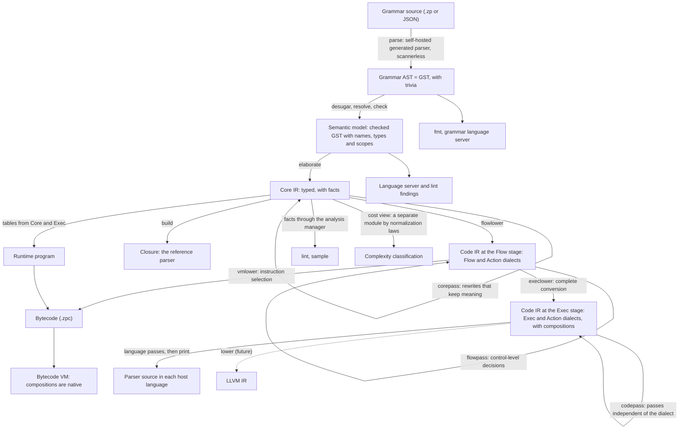
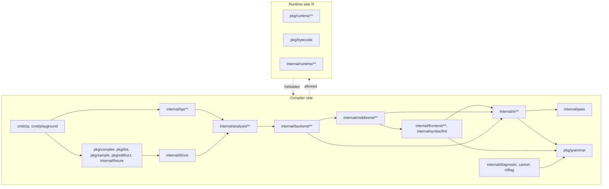
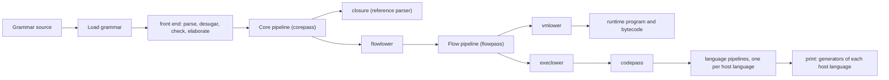

# Architecture

ZeroParse is a parser compiler: it turns a grammar written in an extended PEG language into parsers for several
backends, and every backend gives the same parse result for the same grammar and input. This page describes the
architecture of the system as a whole: the execution model, the intermediate representations and the pipeline between
them, the backends, the tools and the command line, and the package layout that implements them, with the public API,
the import rules and the driver. Read it before you work in any part of the compiler or the runtime.

> [!WARNING]
> The code is being migrated to the architecture this page describes and still differs from it in places. The package
> comments describe the code as it is.

The contracts that every backend must keep are in the [specification](../../spec/README.md); the representations are
explained in [Core IR and Code IR](intermediate-representations.md), the pass infrastructure in
[the pass pipeline](pass-pipeline.md), the code generation of host languages in
[the pass pipeline](pass-pipeline.md), and the decision behind the layout,
with its alternatives, in [record 072](records/072-release-package-layout.md).

## What ZeroParse Provides

One pipeline of intermediate representations carries every feature, so a grammar has one meaning wherever it is used.

- **Development support**: a formatter, a linter, complexity classification and a language server for grammars.
- **Run-time observation**: traces, profiles and explanations of syntax errors.
- **Automated testing**: sampling of accepted inputs and edit fuzzing of incremental parsing.
- **Execution**: the bytecode VM, generated parsers in host languages (Go and TypeScript today), and, in the future,
  native code.

## Execution Model

### The Grammar Language

A grammar is written in an extended PEG: PEG with types, actions, predicates, expectations, recovery, Operators Rules
and pragmas. Grammar sources use the extension `.zp`. A grammar can also be written as JSON, and that JSON form is a
public contract that the specification defines.

### Parsers and Parse Values

- A **parser** reads input by the rules of a grammar and builds a parse value. The details of the API may differ
  between backends; the meaning of the result does not.
- A **parse value** is a concrete syntax tree by default. When the grammar declares types and actions, the parser
  builds typed values directly.
- A **structural query** matches patterns against parse values. Its core is a programmatic pattern that is type-checked
  against the output schema (categories, types, rules, fields, elements and captures), so a wrong pattern is reported
  when it compiles. A text syntax for patterns is a later front end that produces these patterns.

### Modes of Execution

- **Recognition** decides, without building a tree, whether the input matches the grammar, and returns the same success
  and the same syntax errors (recovered ones included) as a parse. Predicates, and the actions that predicates read,
  run; the runtime errors of other actions and the conversion to typed values are not checked, so a recognition can
  succeed where a parse fails. "Recognize" is the one term for this mode in the command line, the API, the
  specification and the documents. "Validate" and "validation" mean only the structural check of an artifact: a grammar
  AST, a schema or a module.
- **Document mode** keeps the input and the parse state between edits and parses again only what an edit changed. It
  serves editors and other real-time analysis.
- **Stream mode** commits the result at each unit of the top-level repetition and drops what has been processed, so a
  large input is parsed in nearly constant memory.

## Intermediate Representations and the Pipeline

There are two intermediate representations.

- **Core IR** holds the meaning of a grammar as trees and facts. It is the minimal, typed form after desugaring and knows
  nothing of the mode: budgets, Documents, observation and the target are not part of it.
- **Code IR** is the shared base of structured code: modules, functions, statements and expressions, the machinery that
  declares operations, a verifier, a printer and a reference interpreter. Its dialects are tables of operations, which
  are data. There are three.
  - The **Flow** dialect has the operations of grammar control: matching, mark and restore for backtracking,
    expectations, captures, rule calls under a policy, charging for budgets and recovery.
  - The **Action** dialect has the operations that evaluate action expressions: Value Actions, Predicate Actions and
    bindings. It is valid both at the Flow stage and at the Exec stage.
  - The **Exec** dialect has the operations of the abstract machine and the compositions built on them.

The terms are fixed. A set of operations is a dialect: the Flow dialect, the Action dialect, the Exec dialect. A state
of a program is a stage: Code IR at the Flow stage and Code IR at the Exec stage, or the Flow stage and the Exec stage
where the context is clear. A stage is a state of a Code IR module. "The abstract machine" is the parser machine
that the Exec dialect defines; "the VM" is only the bytecode VM.



### The Front End

- **Grammar AST (GST).** The syntax tree of the grammar language, with comments and line breaks (trivia) attached to
  its nodes. It is the typed form of the JSON form and is owned by the public package `pkg/grammar`. The parser that
  builds it is a scannerless, self-hosted parser generated from the grammar of the grammar language, which holds all the
  lexical knowledge.
- **Semantic model.** A read-only result of analysis over the GST: name resolution (each reference to its
  declaration), the types of expressions and captures, scopes, the start rules and the table of type declarations. It
  is the one place that answers questions tied to a source range (hover and go to definition in the language server,
  lint findings, type errors). It transforms nothing.
- **Core IR** is elaborated once from the semantic model. The policy of a rule (Memo, Leader, Member, Cycle,
  Transient, Plain and the like) and the site numbers come only from facts and analyses on Core IR.
- **Runtime program.** Only the tables a parse needs: the rule table with the policies, the expectation table, the node
  kinds of types with their struct fields and zero values, the initial values of variables and the start rules. It is
  built at compile time from Core IR and Code IR, and a compiled file is its serialization. It holds no grammar AST, no
  type checker and no compile options, so loading a compiled file does not use the compiler.

### The Middle End

- **Core passes.** Rewrites that keep the meaning, and the facts: guard sets, first sets, effects, rule policies, the
  normalization of level O and the conversion of value-free class repetitions into scans. They know nothing of the mode.
- **Lowering from Core to Code IR** produces the Flow stage in one uniform shape: rule bodies become Flow operations and
  action expressions become Action operations. The Flow passes choose the shape.
- **Flow passes** are the layer where control-level decisions are made: call specialization, inlining, dispatch, the
  form of a match, removal of saves, merging and threading of failure paths, charging, slot sharing and outlining. Each
  declares its obligation, its applicability and the analyses it uses, and the Flow verifier runs after it. The table of
  passes, in order, with their obligations, is in [the pass pipeline](pass-pipeline.md#the-flow-passes). Flow is not a
  control-flow graph: a pass that needs one gets it as an analysis view.
- **Flow operations** carry a contract, a cost, the features they need, their laws and a **reference expansion** into
  Exec operations. The conformance suite compares every implementation of an operation with its reference expansion.
- **The Exec stage** is produced by a complete conversion from the Flow stage. Its postcondition, that no Flow operation
  remains, is checked by the verifier.
- **The Exec dialect** is the specification of the abstract machine (its components, registers, operations, contracts
  and cost bounds) together with the compositions: the call protocol, memoization, left-recursion growth, Operators
  Rules, Documents and streams. Grammar-specific code enters through the conversion from the Flow dialect. Every operation
  has a reference model in the Exec reference package and conformance cases.
- **Dialect-independent passes of Code IR** (the `codepass` package) are the passes that every dialect can run: function
  specialization, simplification and dead store elimination. They work only from the reads and writes that each
  operation declares, and they are not Core passes.

A conversion between dialects is a **lowering** (`flowlower`, the conversion to the Exec stage, `vmlower`). **Legalize**
is used only for adjustments inside a target, the language passes of each host language. The stage names of the dumps
are `core`, `flow` and `exec`.

## Backends

The specification is normative. There are two executable references: the closure backend for the meaning of grammar
code, and the reference models of the Exec dialect for the contract of each operation of the abstract machine.

The **host language** is the language of a generated parser. Go and TypeScript are the host languages today; another
host language is added as a new backend in the same pattern, without changing the representations.

- **Closure.** A reference parser built from Core IR, and the oracle of the differential tests. It deliberately does not
  share the lowering of grammar code through Flow and Exec: if it did, a bug in that lowering could not show up as a
  difference between backends. It needs Core IR, so it belongs to the compiler side, and it is public only as a
  constructor of the compiler package.
- **Bytecode and the VM.** The default backend: the compiler returns a parser on the VM. Instructions are selected from
  Code IR at the **Flow stage**, with superinstruction selection (`internal/backend/vmlower`). The instruction set is at
  the level of grammar control (string matches, classes, choices and so on), so instructions follow Flow operations almost
  one for one; mapping a mark that names a set of state to a choice instruction is a sound over-approximation. A call of
  a composition is one instruction, and common match patterns fuse into high-level instructions. The compositions are
  implemented natively in the VM and checked by the conformance suite of the Exec dialect. The VM has two drivers,
  recursive and iterative. A compiled file consists of the closed instruction set and the runtime program, and loads
  without the grammar. With this choice every practical backend (the VM, every host language and a future LLVM backend)
  takes grammar code from one Code IR, so charging and the propagation of options cannot drift between two lowerings of
  grammar code.
- **Host code generation.** The Exec stage is legalized and optimized by the passes of each host language, and then
  printed. Each host language has one package with the same three parts: passes, a printer and a runtime library. The
  shared dialect-independent passes run before them. The details, with the examples for the two host languages of today,
  are in [the pass pipeline](pass-pipeline.md#host-language-passes); the runtime library of generated parsers is either imported
  as a library or embedded in the generated output, as far as the packaging of the host language allows.

## Tools

### Static Analysis

- **`fmt`** formats the grammar AST with its trivia and keeps comments and blank lines. It is exposed by the grammar
  package.
- **`lint`** reads the grammar AST and the facts of Core IR. Findings are tied to source ranges, so they come from the
  AST; facts such as reachability and nullability come from Core IR, through the analysis manager, which shares them with
  the optimization passes. It is the public package `pkg/lint`.
- **Complexity classification** sorts a grammar into linear, polynomial, exponential and the other classes on a
  dedicated **cost view**: a Core IR module derived by normalization laws. The proofs that the classification is sound
  speak about the cost view, which is why it is a module separate from the Core module that the optimizations use. Users
  reach it through the lint package, as a check and as a classification. [Cost analysis](cost-analysis.md) explains how it
  works.

### Language Servers

- **The grammar language server** supports editing `.zp` files: syntax and type errors, go to definition, rename and
  formatting.
- **A language server for user languages** (future) loads any grammar and provides editor support for the language it
  describes, from Document mode and structural queries. It depends on the text syntax of queries.

### Automated Testing

- **Sampling** (`pkg/sample`) walks the grammar AST to generate inputs and confirms by a real parse that they are
  accepted. It has a coverage-guided mode. Its output serves table tests and seeds for fuzzing.
- **Edit fuzzing** (`pkg/editfuzz`) compares the reparse of a Document with a fresh parse over random edit sequences, on
  every backend and in every position unit. It can minimize a failing sequence, save failures and replay them, and an
  edit sequence is versioned JSON.

Run-time observation is described in [Observability](observability.md).

## The Command Line

The `zp` command groups its subcommands by task.

| Task | Commands | Purpose |
|:--|:--|:--|
| Parsing and recognition | `parse` | Prints the parse result as JSON or as an S-expression; its recognition mode prints success and syntax errors without a tree |
| Run-time observation | `explain`, `trace`, `profile` | Explains the rule calls behind a syntax error; traces the rules with filters and a depth limit; reports cost and wasted backtracking per rule |
| Static analysis, formatting and editor support | `lint`, `fmt`, `lsp` | Runs the checks and reports the complexity class; formats keeping comments, with a check mode; starts the grammar language server |
| Grammars and schemas | `convert`, `schema` | Converts between grammar source and JSON; writes the output schema and compares two schemas |
| Compilation and code generation | `compile`, `gen` | Writes a compiled grammar in one of its modes; generates a parser in a host language, optionally with types and with Recognize, and dumps the IR after each stage |
| Testing | `test`, `sample`, `edit-fuzz` | Runs JSON fixture suites; generates accepted inputs; fuzzes edit sequences |

## The Go Packages

The packages are cut by three criteria: cohesion (one concern per package), clarity for the user who imports them,
and the separation of the runtime side from the compiler side. The public API for users is under `pkg/`; the
implementation is under `internal/`. The compiler itself is written in Go.

### The Package Tree

```text
zeroparse/
├── cmd/
│   ├── zp/                       # the command line; reaches every feature through internal/driver
│   └── playground/               # the WebAssembly side of the playground
│
├── pkg/                          # the public API
│   ├── compiler/                 # makes executable artifacts from a grammar: parsers on the VM, reference parsers,
│   │                             #   compiled files, host-language parsers, the output schema, the optimization setting
│   ├── grammar/                  # grammar AST, its JSON form, loading of sources, formatting and conversion
│   ├── lint/                     # checks, findings and suggested rewrites; the complexity classification
│   ├── sample/                   # generation of accepted inputs
│   ├── editfuzz/                 # edit fuzzing of Documents, replay and minimization
│   ├── bytecode/                 # the instruction set and the compiled-file codec
│   └── runtime/                  # the parser interface, options, limits and statistics
│       ├── input/                # position units, locations, edits and kinds of change
│       ├── value/                # nodes, cursors, traversal, JSON, syntax errors
│       │   └── impl/             # the node representation
│       ├── schema/               # the output schema: types, JSON form, validation, comparison
│       ├── query/               # structural queries
│       ├── instrument/           # trace events, filters, depth and profiles
│       ├── vm/                   # loading a compiled file into a parser, and the parser and Document of the VM
│       └── golib/                # the support library of generated Go parsers
│
├── internal/
│   ├── driver/                   # drives the pipelines; the table of optimization profiles; the body of
│   │                             #   pkg/compiler and cmd/zp
│   ├── diagnostic/               # positioned static errors
│   ├── cancel/                   # cancellation of static work
│   ├── cliflag/                  # flag names of backends and position units
│   ├── fixture/                  # JSON fixture suites of zp test (a tool: it uses pkg/compiler)
│   ├── pass/                     # generic pass infrastructure: manager, analysis manager, preserved sets, registry
│   ├── ir/
│   │   ├── core/                 # Core IR: the meaning tree, attributes, verifier, printer
│   │   └── code/                 # the Code IR base: structure, operation declarations, verifier, printer,
│   │       │                     #   reference interpreter, builder
│   │       ├── flow/             # Flow dialect: grammar-control operations, reference expansions, its invariants
│   │       ├── action/           # Action dialect: operations that evaluate action expressions
│   │       └── exec/             # Exec dialect: operations of the abstract machine
│   │           ├── compose/      # compositions
│   │           ├── ref/          # reference models of the operations
│   │           ├── conform/      # conformance suite
│   │           └── spectest/     # specification tests
│   ├── frontend/                 # drives the front end; returns the semantic model and Core IR (the facts are
│   │                             #   computed by the analyses of the Core passes)
│   │   ├── parser/               # .zp to grammar AST
│   │   │   └── zpparser/         # the parser generated from the grammar of the grammar language
│   │   ├── desugar/              # rewriting into a smaller language
│   │   ├── check/                # name resolution and the checks of the value model (the semantic model)
│   │   ├── types/                # the type model
│   │   ├── astfacts/             # conservative facts on the AST
│   │   ├── elaborate/            # semantic model to Core IR
│   │   └── schemaexport/         # export of the output schema
│   ├── middleend/
│   │   ├── corepass/             # Core rewrites and the analyses of facts
│   │   ├── flowlower/            # Core IR to Code IR at the Flow stage
│   │   ├── flowpass/             # Flow passes
│   │   ├── execlower/            # complete conversion from the Flow stage to the Exec stage
│   │   └── codepass/             # dialect-independent passes of Code IR
│   ├── backend/
│   │   ├── closure/              # the reference parser, built from Core IR
│   │   ├── vmlower/              # instruction selection from the Flow stage to bytecode
│   │   ├── llvm/                 # (future)
│   │   └── codegen/
│   │       ├── common/           # parts shared by all host languages
│   │       └── <host>/           # one package per host language, with the same three parts (Go and TypeScript
│   │           │                 #   are the current instances)
│   │           ├── pass/         #   language passes: Exec stage to Exec stage, registered in the registry
│   │           ├── print/        #   the printer of the legalized Exec stage
│   │           └── lib/          #   the runtime library of generated parsers, and the printer of it
│   ├── runtime/                  # the internal implementation of the runtime side
│   │   ├── program/              # the runtime program (what a compiled file holds)
│   │   ├── state/               # the parser state that every backend shares
│   │   ├── document/             # the incremental Document
│   │   ├── vm/                   # the bytecode VM, recursive and iterative
│   │   ├── engine/               # the run-time entry points: parse, Document, stream
│   │   ├── nodes/                # the engine's access to the node representation
│   │   └── limits/               # defaults of the limits and overflow-safe budget arithmetic
│   ├── syntax/fmt/               # the grammar formatter
│   ├── analysis/
│   │   ├── lint/                 # the linter
│   │   └── complexity/           # the cost view and the complexity classification
│   ├── lsp/
│   │   ├── protocol/             # JSON-RPC and LSP messages
│   │   └── zpls/                 # the grammar language server
│   ├── testing/                  # repository test support, one package per kind of test (for example the
│   │                             #   import-graph test, the Exec conformance printer and the code generation tests)
│   └── bench/                    # benchmark inputs, size measurement, generated benchmark parsers
├── bench/  spec/  site/  examples/
└── go.mod
```

Within `codegen`, the host-language packages are the same pattern: a host language gets one package with the passes, the
printer and the runtime library. For Go, the library part holds the printer that prints the compositions into the
generated-parser library and into the shared engine state, and the copy of the library that is embedded when the
library is not imported. The passes that run on the Exec stage before any host language are in `codepass`.

### Placement Principles

- **`pkg/compiler` makes executable artifacts from a grammar.** Lint, sampling and edit fuzzing each
  have their own vocabulary (check names and severities, generation options, the format of an edit sequence), so each
  is a small, cohesive package of its own.
- **The grammar AST is in `pkg/grammar`.** The JSON form is a public contract of the specification, and the AST is its
  typed form, so it follows the language specification, which changes slowly, rather than an IR, which changes often.
  The front end receives it as the GST.
- **The output schema is on the runtime side** (`pkg/runtime/schema`), because the compiled parser, structural queries
  and the typed API use it while running. The comparison of schemas is a pure function over schemas, so it lives with
  the types.
- **The support library of generated Go parsers is `pkg/runtime/golib`.** It holds many support declarations that are
  versioned by the library protocol; keeping them apart from the user API avoids name clashes, such as the names of
  parsers and documents.
- **The node representation (`pkg/runtime/value/impl`) cannot be internal**, because a support library copied into a
  user's module by embedding imports it. It sits below `value` because `value` reads it.
- **The IR packages (`internal/ir/core`, and `internal/ir/code` with everything below it) hold data, attribute
  computation, verifiers and printers**; the transformation and analysis passes are in the middle end. A verifier checks
  that facts agree with the structure by recomputing the attributes, so it lives with the attribute computation.
- **The dialects are nested under the base.** The tree and the import paths say that Flow, Action and Exec are dialects of
  Code IR. The lowerings are packages of their own outside the IR packages, apart from the passes of each dialect.
- **Names avoid clashes that matter**: `internal/lsp/zpls` is not named like `pkg/grammar`, and
  `ir/code/exec/compose` is not named like `ir/core`.

## The Public API

The public API is the set of packages under `pkg/`. Its shapes are of two kinds. The grammar source and its loading,
the compile entry point, the query and instrument packages, and the pass infrastructure are decided. The other shapes
follow today's API; they are settled in the package documentation as each part is implemented. The reference
documentation lists the names.

- **`pkg/grammar`.** A grammar source is one grammar input: a named value made from bytes, a string, a reader or a path
  in a file system, with an explicit or detected format (grammar source or JSON). It is made by a constructor and its
  fields are unexported, which guarantees that it has exactly one supplier. Loading a source gives the grammar AST, which
  can be validated when a program builds it by hand; formatting and conversion between the two formats are in the same
  package. Action expressions have one name in the AST, in the JSON form and in the syntax: the name the specification
  gives Action Expressions.
  A grammar source shares no type with the parse input of the runtime input package. The parse input is the abstraction
  of what a parser reads: position units, sequential reads of a stream, the chunks and edits of a Document, and charging
  against a budget. A grammar source is read once at compile time and may span several files. The two share only the
  naming convention of their constructors. The command line reads grammars through the same type, from a file system.
- **`pkg/compiler`.** Turns a grammar into executable artifacts: a parser on the VM (the default backend), a parser from an
  AST that a program builds, the reference parser for differential tests, a compiled file, host-language parsers, and
  the output schema. One optimization setting, with the profiles `speed`, `memory` and `size` and overrides of
  individual flags, is received by every backend: the closure backend, the VM and the generators. The table from profile
  names to values is in the driver.
- **`pkg/lint`, `pkg/sample` and `pkg/editfuzz`.** Lint runs checks over the grammar AST and returns findings, each with a
  check name, a severity, a source range and, where one exists, a suggested rewrite; it also gives the complexity class,
  which is the public way to reach the classification. Sampling generates inputs that a grammar accepts, with a
  coverage-guided mode. Edit fuzzing generates, runs, replays and minimizes edit sequences, which are versioned JSON.
- **`pkg/bytecode`.** The module, the instruction set and its encoding, the compiled-file format and its validation. The
  instruction set is public, and its fields are documented as unstable until the release.
- **`pkg/runtime` and its subpackages.** The parser interface parses an input, recognizes it, parses a stream and emits
  each top-level element, creates a Document for edits, and gives the output schema. Parse options set limits, the
  context, the position unit, expectations, missing tokens, tracing, profiling and diagnostics. Recognition is expressed
  only by the parser's recognition method; no option switches a parse into a recognition. The API of generated parsers
  offers the same choice with the same meaning.
  - `input`: position units, locations, text edits and the kinds of change of a Document.
  - `value`: nodes, cursors, traversal, JSON and syntax errors. A recovered error is a node value, and a failure in a
    trace event carries a syntax error too.
  - `value/impl`: the node representation that the runtime and generated parsers share.
  - `schema`: the types of the output schema, its JSON form, validation and comparison.
  - `query`: structural queries, compiled against an output schema.
  - `instrument`: the model of trace events and profiles; see [Observability](observability.md).
  - `vm`: loads a compiled file into a parser, without the grammar and without the compiler.
  - `golib`: support declarations that only generated Go parsers use. It is not an API that users call.

## Dependencies and the Import-Graph Test

The runtime side never links the compiler side, and a test of the import graph enforces it.

- **The runtime side R**: `pkg/runtime` and everything under it (`input`, `value`, `value/impl`, `schema`, `query`,
  `instrument`, `vm`, `golib`), `pkg/bytecode` and `internal/runtime/**`.
- **The compiler side**: everything else: `pkg/compiler`, `pkg/grammar`, `pkg/lint`, `pkg/sample`, `pkg/editfuzz`, the
  other packages of `internal/**` and `cmd/**`.



- **Rule 1.** For every non-test package P of R, every package of the module that P depends on is in R. R imports no
  third-party package.
- **Rule 1a (generated parsers).** The support library of generated Go parsers imports only `pkg/runtime`, `input`,
  `value`, `value/impl` and `instrument` (and `schema` where the typed API needs it). It imports neither `vm` nor
  `internal/runtime/**`, so a generated parser links neither the VM nor the engine. The embedded copy of the library
  compiles by itself in a temporary module that imitates a user's module. The same rule holds for the library of any
  host language.
- **Rule 2 (layers).**
  - `internal/pass` imports no package of the module.
  - The IR packages (`internal/ir/core`, and `internal/ir/code` with everything below it) import only IR packages,
    `internal/pass`, `internal/cancel` and `pkg/grammar`. Among them, the Code IR base imports no dialect; the Flow dialect
    imports only the base and Core IR (to refer to immediates); the Action and Exec dialects import only the base, and the
    packages under the Exec dialect may also import the Exec and Action dialects. Only the lowerings of the middle end and
    the checks that span dialects import several dialects at once.
  - The front end imports no middle end, backend, analysis or language server; the middle end imports no backend,
    analysis or language server; a backend imports no analysis or language server.
  - The utility packages (`internal/diagnostic`, `internal/cancel`, `internal/cliflag`) may import `pkg/grammar`,
    because diagnostics carry source positions. `internal/fixture` is a tool that uses `pkg/compiler`, in the
    layer of the public tool packages.
  - Only the commands and `internal/testing` import `internal/lsp/**`. Of the non-test packages, only those inside
    `internal/testing` import `internal/testing/**`.
- **How it is enforced.** A test in `internal/testing` runs the dependency listing of the Go tool for every package under
  the default build tags and under each reference tag set (those of the reference build in [Development](../development.md)),
  and on a violation prints the shortest import chain that causes it. A deliberately wrong edge, which exists only in the
  test, is the negative control. The test also checks the dependencies of parsers generated in both library modes. The
  test has no allowlist: a violation fails it.

## The Pass Infrastructure

Transforms run in an explicit list, in order; analyses are computed when they are requested and cached. The pass
infrastructure of `internal/pass` holds this model, generic over the unit of IR: a preserved set that preserves nothing
unless declared, analysis keys with names that are checked for duplicates, an analysis manager that caches results and
records their dependencies, a transform interface, a manager and a registry. Its rules, and the list of passes of each
pipeline, are in [the pass pipeline](pass-pipeline.md).

- A failed analysis returns an error; it never degrades silently.
- When a transform returns a different IR value, the whole cache is invalidated.
- The attributes on Core nodes (nullability, first sets, effects) are invariants of the IR: they are stored on the nodes
  and the verifier checks them, and they are not cached. What is cached is derived results that are not written into the
  IR (rule facts, site numbers, the call graph, the cost view, lookahead sets and the like), which the optimization
  passes, lint, the complexity classifier and the generators share.

### Registration, Profiles and Driving

Optimization is divided into three concerns: **registration** (each pass declares its name, description, default and
applicability, and registers in the generic registry; printers and libraries register their controls with the kind
`library`), **profiles** (the choice a user makes, the public optimization setting of `pkg/compiler`, whose table is in
the driver) and **driving** (`internal/driver` runs the pipelines in order, and dumps and verification after each pass
are features of the manager). Details are in [the pass pipeline](pass-pipeline.md#the-registry).

## The Driver Flow



1. Every entry point of the compiler package calls `internal/driver`. The driver resolves the optimization setting
   through the profile table and passes the same settings to every pipeline.
2. The front end builds the semantic model and Core IR.
3. The Core pipeline runs. The closure backend branches off here.
4. `flowlower`, then the Flow pipeline. For the VM, `vmlower` selects instructions from here, and they are combined
   with the runtime program built from Core IR and Code IR into a compiled module.
5. For host languages: `execlower`, `codepass`, the language pipeline, then printing.
6. Each manager dumps at the stages that the dump flag names, and when verification after each pass is requested, an
   error names the pass. Analyses are shared through the analysis manager of each stage.

## Values, Documents and Streams

These mechanisms change how a parse treats input and results, so they cut across the stages.

- **Values.** A rule either builds a value or only recognizes. The compiler decides which, per rule, so that a
  recognizing path pays nothing for values it would discard. Typed output is the same decision made with the grammar's
  declared types.
- **Documents.** A Document keeps the input and the memo tables between edits, so after a change only the rules whose
  examined range was touched run again. This requires that every rule call keep exact accounting of what it read; a
  Document therefore parses on the path that keeps that accounting (the Document feature of the Flow passes), while a
  one-shot parse may skip it where nothing can observe the difference.
- **Streams.** A stream commits the elements of a top-level repetition and drops the input behind them, so memory
  follows the unconsumed input rather than the whole input. A stream is therefore allowed only where nothing later can
  need what was dropped.

## Invariants That Cut Across Packages

- **One behavior.** Every backend returns the same value, the same error and the same expectations at the same
  position for the same grammar and input. A backend that cannot meet this says so (the closure backend alone supports
  `#missing`) instead of approximating.
- **Specification first.** The specification states the contract; the runtime and the generators implement it. A
  behavior that only one of them has is a defect or a documented limit.
- **Generated code mirrors the engine.** The support library of each host language must match the behavior of the engine,
  and tests compare them; both are printed from the same compositions. Names that generated code calls are not an API
  for users.
- **One home for each fact.** Facts such as nullability, first sets and rule policies have one implementation, on Core
  IR, which the optimization passes, the linter, the complexity classifier and the generators share through the analysis
  manager.
- **The runtime does not link the compiler.** The rules of the import-graph test hold for every package of the runtime
  side and for generated parsers.
- **Positions and units.** Input is measured in one chosen unit (code points or bytes) everywhere a position,
  expectation or edit is reported.
- **Not stable before release.** Compiled files, JSON forms and bytecode may change between versions; there are no
  compatibility shims.

## Related Topics

- [Core IR and Code IR](intermediate-representations.md): the representations, their verifiers and how optimization
  works on them.
- [The pass pipeline](pass-pipeline.md): declared passes, the analysis manager, the registry, profiles and verification.
- [Cost analysis](cost-analysis.md): the cost view and the complexity classification.
- [Observability](observability.md): the run-time observation model.
- [Record 072](records/072-release-package-layout.md): the decision on the release layout and its alternatives.
- [Design records](records/): decisions and their alternatives.
- [Development](../development.md): the repository, tests and checks.
- [Optimization catalog](../optimizations/README.md): measured mechanisms.
