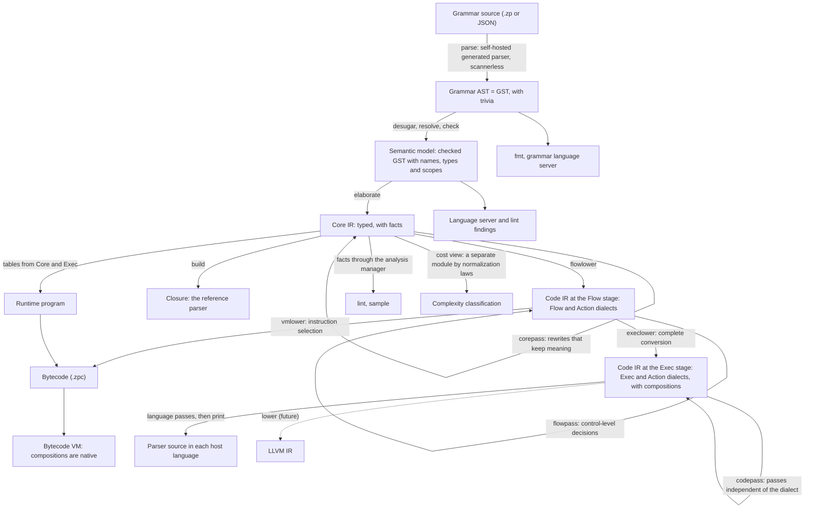
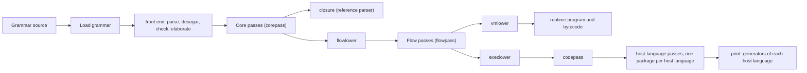

# Architecture

> [!WARNING]
> This page describes the target architecture. The code may still differ from it.

ZeroParse is a parser compiler: it turns a grammar written in an extended PEG language into parsers for several
backends, and every backend gives the same parse result for the same grammar and input. This page is the overview of
the system: what it provides, the execution model, the two intermediate representations and the pipeline between them,
the backends, the tools and the command line, and the package layout. Each part is explained in full on its own page,
which the sections below link to. Read this page before you work in any part of the compiler or the runtime.

The contracts that every backend must keep are in the [specification](../../spec/README.md).

## What ZeroParse Provides

One pipeline of intermediate representations carries every feature, so a grammar has one meaning wherever it is used.

- **Development support**: a formatter, a linter, complexity classification and a language server for grammars.
- **Run-time observation**: traces, profiles and explanations of syntax errors.
- **Automated testing**: sampling of accepted inputs and edit fuzzing of incremental parsing.
- **Execution**: the bytecode VM, generated parsers in host languages (Go and TypeScript today), and, in the future,
  native code.

## Execution Model

### The Grammar Language

A grammar is written in an extended PEG: PEG with types, actions, predicates, expectations, recovery, Operators Rules
and pragmas. Grammar sources use the extension `.zp`. A grammar can also be written as JSON, and that JSON form is a
public contract that the specification defines.

### Parsers and Parse Values

- A **parser** reads input by the rules of a grammar and builds a parse value. The details of the API may differ
  between backends; the meaning of the result does not.
- A **parse value** is a concrete syntax tree by default. When the grammar declares types and actions, the parser
  builds typed values directly.
- A **structural query** matches patterns against parse values. Its core is a programmatic pattern that is type-checked
  against the output schema (categories, types, rules, fields, elements and captures), so a wrong pattern is reported
  when it compiles. A text syntax for patterns is a later front end that produces these patterns.

### Modes of Execution

- **Recognition** decides, without building a tree, whether the input matches the grammar, and returns the same success
  and the same syntax errors (recovered ones included) as a parse. Predicates, and the actions that predicates read,
  run; the runtime errors of other actions and the conversion to typed values are not checked, so a recognition can
  succeed where a parse fails. The parser's `Recognize` method and the command-line recognition mode express it, and
  "Recognize" is the one term for this mode in the command line, the API, the specification and the documents. "Validate" and "validation" mean only the structural check of an artifact: a grammar
  AST, a schema or a module.
- **Document mode** keeps the input and the parse state between edits and parses again only what an edit changed. It
  serves editors and other real-time analysis.
- **Stream mode** commits the result at each unit of the top-level repetition and drops what has been processed, so a
  large input is parsed in nearly constant memory.

## Intermediate Representations and the Pipeline

There are two intermediate representations.

- **Core IR** holds the meaning of a grammar as trees and facts. It is the minimal, typed form after desugaring. It has
  no mode: budgets, Documents, observation and the target are not part of it.
- **Code IR** is the shared base of structured code: modules, functions, statements and expressions, the machinery that
  declares operations, a verifier, a printer and a reference interpreter. Its dialects are tables of operations, which
  are data. There are three.
  - The **Flow** dialect has the operations of grammar control: matching, mark and restore for backtracking,
    expectations, captures, rule calls under a policy, charging for budgets and recovery.
  - The **Action** dialect has the operations that evaluate action expressions: Value Actions, Predicate Actions and
    bindings. It is valid both at the Flow stage and at the Exec stage.
  - The **Exec** dialect has the operations of the abstract machine and the compositions built on them.

The terms are fixed. A set of operations is a dialect: the Flow dialect, the Action dialect, the Exec dialect. A state
of a program is a stage: Code IR at the Flow stage and Code IR at the Exec stage, or the Flow stage and the Exec stage
where the context is clear. A stage is a state of a Code IR module. "The abstract machine" is the parser machine
that the Exec dialect defines; "the VM" is only the bytecode VM.

### The Front End

- **Grammar AST (GST).** The syntax tree of the grammar language, with comments and line breaks (trivia) attached to
  its nodes. It is the typed form of the JSON form and is owned by the public package `pkg/grammar`. The parser that
  builds it is a scannerless, self-hosted parser generated from the grammar of the grammar language, which holds all the
  lexical knowledge.
- **Semantic model.** A read-only result of analysis over the GST: name resolution (each reference to its
  declaration), the types of expressions and captures, scopes, the start rules and the table of type declarations. It
  is the one place that answers questions tied to a source range (hover and go to definition in the language server,
  lint findings, type errors).
- **Core IR** is elaborated once from the semantic model. The policy of a rule (Memo, Leader, Member, Cycle,
  Transient, Plain and the like) and the site numbers come only from facts and analyses on Core IR.
- **Runtime program.** Only the tables a parse needs: the rule table with the policies, the expectation table, the node
  kinds of types with their struct fields and zero values, the initial values of variables and the start rules. It is
  built at compile time from Core IR and Code IR, and a compiled file is its serialization. It holds no grammar AST, no
  type checker and no compile options. Loading a compiled file therefore uses none of the compiler.

### The Middle End

- **Core passes** rewrite the Core IR in ways that keep its meaning, and compute its facts: guard sets, first sets,
  effects, rule policies, the normalization of level O and the conversion of value-free class repetitions into scans.
  They are independent of the mode. See [The Pass Pipeline](pass-pipeline.md).
- **Lowering to the Flow stage** (`flowlower`), a pass of the pipeline like the others, produces the Flow stage in one
  uniform shape: rule bodies become Flow operations and action expressions become Action operations. The Flow passes
  then choose the shape.
- **Flow passes** make the control-level decisions: call specialization, inlining, dispatch, the form of a match,
  removal of saves, merging and threading of failure paths, canonicalization, charging, slot sharing and outlining. Each
  declares its obligation, its applicability and the analyses it uses, and the Flow verifier checks what they leave. The
  passes, in order, are in [The Flow Passes](pass-pipeline.md#the-flow-passes).
- **The Exec stage** is produced by a complete conversion from the Flow stage (`execlower`), a pass of Code IR whose
  postcondition, that no Flow operation remains, is checked by the verifier. The **Exec dialect** specifies the abstract
  machine and the compositions over it: the call protocol, memoization, left-recursion growth, Operators Rules,
  Documents and streams. Each operation has a reference model and conformance cases. See
  [Core IR and Code IR](intermediate-representations.md).
- **Dialect-independent passes** of Code IR (`codepass`) are the passes that every dialect can run. They work only from
  the reads and writes that each operation declares. See
  [The Pass Pipeline](pass-pipeline.md#dialect-independent-passes-of-code-ir).

A conversion between dialects, or from one IR to another, is a **lowering** (`flowlower`, `execlower`, `vmlower`). A
lowering is a pass: the compiler from Core IR to bytecode or to the Exec stage of a host language is one pipeline of
passes, in which the lowerings take their places between the passes of each stage. As passes, the lowerings have the
registry, the dumps and the verification that every other step has. **Legalize** is used only for adjustments inside one
target, such as the passes of a host language. The stage names that the dumps use, `core`, `flow` and `exec`, are points
in that pipeline. See [Lowerings](pass-pipeline.md#lowerings).

## Backends

The specification is normative. There are two executable references: the closure backend for the meaning of grammar
code, and the reference models of the Exec dialect for the contract of each operation of the abstract machine.

The **host language** is the language of a generated parser. Go and TypeScript are the host languages today; another
host language is added as a new backend in the same pattern, without changing the representations.

- **Closure.** A reference parser built from Core IR, and the oracle of the differential tests. It is built independently
  of the lowering of grammar code through Flow and Exec, so a bug in that lowering shows up as a difference between
  backends. It needs Core IR, so it belongs to the compiler side, and it is public only through `NewReferenceParser` of the compiler
  package.
- **Bytecode and the VM.** The default backend: the compiler returns a parser on the VM. Instructions are selected from
  Code IR at the **Flow stage**, with superinstruction selection. The instruction set is at the level of grammar control
  (string matches, classes, choices and so on), so instructions follow Flow operations almost one for one; mapping a
  mark that names a set of state to a choice instruction is a sound over-approximation. A call of a composition is one
  instruction, and common match patterns fuse into high-level instructions. The compositions are implemented natively in
  the VM and checked by the conformance suite of the Exec dialect. The VM has two drivers, recursive and iterative. A
  compiled file consists of the closed instruction set and the runtime program, and loads without the grammar. With this
  choice every practical backend (the VM, every host language and a future native-code backend) takes grammar code from
  one Code IR, so charging and the propagation of options cannot drift between two lowerings of grammar code.
- **Host code generation.** The Exec stage is legalized and optimized by the passes of each host language, and then
  printed. Each host language has its own subpackages for its passes, its printer and its runtime library, and the parts
  that all host languages share sit beside them. The details, with the instances for the two host languages of today,
  are in [Code Generation for Host Languages](host-code-generation.md).

The future native-code backend would lower the Exec stage to LLVM IR. It is a low-priority plan, not a commitment of the
present design.

## Tools

### Static Analysis

- **`fmt`** formats the grammar AST with its trivia and keeps comments and blank lines. It is exposed by the grammar
  package.
- **`lint`** reads the grammar AST and the facts of Core IR. Findings are tied to source ranges, so they come from the
  AST; facts such as reachability and nullability come from Core IR, through the analysis manager, which shares them with
  the optimization passes. It is the public package `pkg/lint`.
- **Complexity classification** sorts a grammar into linear, polynomial, exponential and the other classes on a
  dedicated **cost view**: a Core IR module derived by normalization laws. The proofs that the classification is sound
  speak about the cost view, which is why it is a module separate from the Core module that the optimizations use. Users
  reach it through the lint package, as a check and as a classification. [Cost analysis](cost-analysis.md) explains how it
  works.

### Language Servers

- **The grammar language server** supports editing `.zp` files: syntax and type errors, go to definition, rename and
  formatting.
- **A language server for user languages** (future) loads any grammar and provides editor support for the language it
  describes, from Document mode and structural queries. It depends on the text syntax of queries.

### Automated Testing

- **Sampling** (`pkg/sample`) walks the grammar AST to generate inputs and confirms by a real parse that they are
  accepted. It has a coverage-guided mode. Its output serves table tests and seeds for fuzzing.
- **Edit fuzzing** (`pkg/editfuzz`) compares the reparse of a Document with a fresh parse over random edit sequences, on
  every backend and in every position unit. It can minimize a failing sequence, save failures and replay them, and an
  edit sequence is versioned JSON.

Run-time observation is described in [Observability](observability.md).

## The Command Line

The `zp` command groups its subcommands by task. A command that reads a grammar takes it with `-g`, `-i` gives an input
inline and `-o` names an output.

| Task | Commands and flags | Purpose |
|:--|:--|:--|
| Parsing and recognition | `parse`, with `-f` for the output format (JSON or `sexpr`) and `-recognize` for recognition | Prints the parse result; in recognition mode prints success and syntax errors without building a tree |
| Run-time observation | `explain`; `trace`, with `-failures`, `-rule`, `-show-depth` and `-f json`; `profile` | Explains the rule calls behind a syntax error; traces rules, filtered by failure or by rule and limited in depth; reports the cost and the wasted backtracking of each rule |
| Static analysis, formatting and editor support | `lint`; `fmt`, with `-w` and `-check`; `lsp` | Runs the checks and reports the complexity class; formats grammars keeping comments, or reports whether a change is needed; starts the grammar language server |
| Grammars and schemas | `convert`, with `-to zp` or `-to json`; `schema`, with `-all-rules` and `-o`; `schema diff` | Converts between grammar source and JSON; writes the output schema; compares two schemas and reports the effect of their difference |
| Compilation and code generation | `compile`, with `-mode parse`, `recognize` or `document`; `gen`, with `-module`, `-types`, `-lang ts`, `-recognize`, `-recognize-only`, `-lib import` or `-lib embed`, and the pass controls `-optimize`, `-opt`, `-no-opt`, `-print-after`, `-print-before`, `-print-changed`, `-verify-each`, `-print-pipeline`, `-stats`, `-time-passes` and `-opt-bisect-limit` | Writes a compiled grammar in one of its modes; generates a parser in a host language, optionally with types and with a Recognize function (`-recognize-only` generates only that function); chooses the optimizations, dumps and verifies the IR around the named stages and passes, prints the assembled pipeline, the statistics and the time of each pass, and bisects the optional passes, as [Controlling Passes](pass-pipeline.md#controlling-passes) describes |
| Testing | `test`, with `-f`, `-backend`, `-equivalence` and `-update`; `sample`, with `-n` and `-coverage`; `edit-fuzz`, with `-minimize` and `-save-failures` | Runs JSON fixture suites; generates accepted inputs; fuzzes edit sequences |

## The Package Layout

The packages are cut by three criteria: cohesion (one concern per package), clarity for the user who imports them, and
the separation of the runtime side from the compiler side. The public API for users is under `pkg/`; the
implementation is under `internal/`. The compiler is written in Go. The import rules that hold the layout together are
in [Package Layering](layering.md), and the public packages are described in [The Public API](public-api.md).

| Package | Holds |
|:--|:--|
| `cmd/zp` | The command line; reaches every feature through the driver |
| `cmd/playground` | The WebAssembly side of the playground |
| `pkg/compiler` | Makes executable artifacts from a grammar: parsers on the VM, reference parsers, compiled files, host-language parsers, the output schema, the optimization setting |
| `pkg/grammar` | The grammar AST, its JSON form, loading of sources, formatting and conversion |
| `pkg/lint` | Checks, findings and suggested rewrites; the complexity classification |
| `pkg/sample` | Generation of accepted inputs |
| `pkg/editfuzz` | Edit fuzzing of Documents, replay and minimization |
| `pkg/bytecode` | The instruction set and the compiled-file codec |
| `pkg/runtime` | The parser interface, options, limits and statistics |
| `pkg/runtime/input` | Position units, locations, edits and kinds of change |
| `pkg/runtime/value` | Nodes, cursors, traversal, JSON, syntax errors |
| `pkg/runtime/value/impl` | The node representation |
| `pkg/runtime/schema` | The output schema: types, JSON form, validation, comparison |
| `pkg/runtime/query` | Structural queries |
| `pkg/runtime/instrument` | Trace events, filters, depth and profiles |
| `pkg/runtime/vm` | Loading a compiled file into a parser, and the parser and Document of the VM |
| `pkg/runtime/golib` | The support library of generated Go parsers |
| `internal/driver` | Assembles and drives the compiler pipeline; the table of optimization profiles; the body of `pkg/compiler` and `cmd/zp` |
| `internal/diagnostic` | Positioned static errors |
| `internal/cancel` | Cancellation of static work |
| `internal/cliflag` | Flag names of backends and position units |
| `internal/fixture` | JSON fixture suites of `zp test` (a tool: it uses `pkg/compiler`) |
| `internal/pass` | The generic pass infrastructure: manager, analysis manager, preserved sets, registry |
| `internal/ir/core` | Core IR: the meaning tree, attributes, verifier, printer |
| `internal/ir/code` | The Code IR base: structure, operation declarations, verifier, printer, reference interpreter, builder |
| `internal/ir/code/flow` | The Flow dialect: grammar-control operations, reference expansions, its invariants |
| `internal/ir/code/action` | The Action dialect: operations that evaluate action expressions |
| `internal/ir/code/exec` | The Exec dialect: operations of the abstract machine, with `compose` (compositions), `ref` (reference models), `conform` (conformance suite) and `spectest` (specification tests) below it |
| `internal/frontend` | Drives the front end and returns the semantic model and Core IR; the facts are computed by the analyses of the Core passes |
| `internal/frontend/parser` | `.zp` to grammar AST, with `zpparser`, the parser generated from the grammar of the grammar language |
| `internal/frontend/desugar` | Rewriting into a smaller language |
| `internal/frontend/check` | Name resolution and the checks of the value model: the semantic model |
| `internal/frontend/types` | The type model |
| `internal/frontend/astfacts` | Conservative facts on the AST |
| `internal/frontend/elaborate` | Semantic model to Core IR |
| `internal/frontend/schemaexport` | Export of the output schema |
| `internal/middleend/corepass` | Core rewrites and the analyses of facts |
| `internal/middleend/flowlower` | Core IR to Code IR at the Flow stage |
| `internal/middleend/flowpass` | The Flow passes |
| `internal/middleend/execlower` | Complete conversion from the Flow stage to the Exec stage |
| `internal/middleend/codepass` | Dialect-independent passes of Code IR |
| `internal/backend/closure` | The reference parser, built from Core IR |
| `internal/backend/vmlower` | Instruction selection from the Flow stage to bytecode |
| `internal/backend/llvm` | The future native-code backend |
| `internal/backend/codegen/common` | Options and parts shared by the host languages; see [Code Generation for Host Languages](host-code-generation.md) |
| `internal/backend/codegen/golang/pass` | The Go passes on the Exec stage |
| `internal/backend/codegen/golang/print` | The printer of Go parsers |
| `internal/backend/codegen/golang/libprint` | The printer of the Exec compositions into the Go library and the shared engine state |
| `internal/backend/codegen/golang/libsrc` | The go:generate copy of the Go library, used when the library is embedded |
| `internal/backend/codegen/typescript/pass` | The TypeScript passes on the Exec stage |
| `internal/backend/codegen/typescript/print` | The printer of TypeScript parsers |
| `internal/backend/codegen/typescript/lib` | The TypeScript runtime library |
| `internal/runtime/program` | The runtime program (what a compiled file holds) |
| `internal/runtime/state` | The parser state that every backend shares |
| `internal/runtime/document` | The incremental Document |
| `internal/runtime/vm` | The bytecode VM, recursive and iterative |
| `internal/runtime/engine` | The run-time entry points: parse, Document, stream |
| `internal/runtime/nodes` | The engine's access to the node representation |
| `internal/runtime/limits` | Defaults of the limits and overflow-safe budget arithmetic |
| `internal/syntax/fmt` | The grammar formatter |
| `internal/analysis/lint` | The linter |
| `internal/analysis/complexity` | The cost view and the complexity classification |
| `internal/lsp/protocol` | JSON-RPC and LSP messages |
| `internal/lsp/zpls` | The grammar language server |
| `internal/testing` | Repository test support, one package per kind of test: `codegentest`, `compiletest`, `enginetest`, `factstest`, `starttest`, `complexitytest`, `linearity`, `recoveryquality`, `archtest` (the import-graph test) and `exectest` |
| `internal/bench` | Benchmark inputs, size measurement and generated benchmark parsers; not part of the public or the runtime layer |

The repository also holds `bench/`, `spec/`, `site/` and `examples/`.

### Placement Principles

- **`pkg/compiler` makes executable artifacts from a grammar.** Lint, sampling and edit fuzzing each have their own
  vocabulary (check names and severities, generation options, the format of an edit sequence), so each is a small,
  cohesive package of its own.
- **The grammar AST is in `pkg/grammar`.** The JSON form is a public contract of the specification, and the AST is its
  typed form, so it follows the language specification, which changes slowly, rather than an IR, which changes often.
  The front end receives it as the GST.
- **The output schema is on the runtime side** (`pkg/runtime/schema`), because the compiled parser, structural queries
  and the typed API use it while running. The comparison of schemas is a pure function over schemas, so it lives with
  the types.
- **The support library of generated Go parsers is `pkg/runtime/golib`.** It holds many support declarations that are
  versioned by the library protocol; keeping them apart from the user API avoids name clashes, such as the names of
  parsers and documents.
- **The node representation (`pkg/runtime/value/impl`) is public**, because a support library copied into a user's
  module by embedding imports it. It sits below `value` because `value` reads it.
- **The IR packages (`internal/ir/core`, and `internal/ir/code` with everything below it) hold data, attribute
  computation, verifiers and printers**; the transformation and analysis passes are in the middle end. A verifier checks
  that facts agree with the structure by recomputing the attributes, so it lives with the attribute computation.
- **The dialects are nested under the base.** The tree and the import paths say that Flow, Action and Exec are dialects of
  Code IR. The lowerings are packages of their own outside the IR packages, apart from the passes of each dialect. This
  is where their code lives; each one runs as a pass of the pipeline.
- **Names avoid clashes that matter**: `internal/lsp/zpls` is not named like `pkg/grammar`, and
  `ir/code/exec/compose` is not named like `ir/core`.

## The Driver Flow

1. Every entry point of the compiler package calls the driver. The driver resolves the optimization setting through the
   profile table, assembles the one pipeline for the backend and passes the settings to it.
2. The front end builds the semantic model and Core IR.
3. The pipeline runs the Core passes. The closure backend branches off here.
4. The pipeline runs `flowlower`, then the Flow passes. For the VM, its last pass is `vmlower`, which selects
   instructions from here; they are combined with the runtime program built from Core IR and Code IR into a compiled
   module.
5. For host languages, the pipeline continues with `execlower`, the `codepass` passes and the passes of the host
   language, and printing follows.
6. The manager dumps at the stages and passes that the dump flag names, lowerings included, and when verification after
   each pass is requested, an error names the pass. Each IR has its own analysis manager, through which its
   passes share analyses; a lowering preserves nothing, so the passes after it start with a fresh one.

## Values, Documents and Streams

These mechanisms change how a parse treats input and results, so they cut across the stages.

- **Values.** A rule either builds a value or only recognizes. The compiler decides which, per rule, so that a
  recognizing path pays nothing for values it would discard. Typed output is the same decision made with the grammar's
  declared types.
- **Documents.** A Document keeps the input and the memo tables between edits, so after a change only the rules whose
  examined range was touched run again. This requires that every rule call keep exact accounting of what it read; a
  Document therefore parses on the path that keeps that accounting (the Document feature of the Flow passes), while a
  one-shot parse may skip it where nothing can observe the difference.
- **Streams.** A stream commits the elements of a top-level repetition and drops the input behind them, so memory
  follows the unconsumed input rather than the whole input. A stream is therefore allowed only where nothing later can
  need what was dropped.

## Invariants That Cut Across Packages

- **One behavior.** Every backend returns the same value, the same error and the same expectations at the same
  position for the same grammar and input. A backend that cannot meet this says so (the closure backend alone supports
  `#missing`) instead of approximating.
- **Specification first.** The specification states the contract; the runtime and the generators implement it. A
  behavior that only one of them has is a defect or a documented limit.
- **Generated code mirrors the engine.** The support library of each host language must match the behavior of the
  engine, and tests compare them; both are printed from the same compositions. The names that generated code calls are
  internal to the generated code, not an API for users.
- **One home for each fact.** Facts such as nullability, first sets and rule policies have one implementation, on Core
  IR, which the optimization passes, the linter, the complexity classifier and the generators share through the analysis
  manager.
- **The runtime does not link the compiler.** The rules of the import-graph test hold for every package of the runtime
  side and for generated parsers.
- **Positions and units.** Input is measured in one chosen unit (code points or bytes) everywhere a position,
  expectation or edit is reported.
- **Unstable before the release.** Compiled files, JSON forms and bytecode may change between versions until the release.

## Related Topics

- [Core IR and Code IR](intermediate-representations.md): the representations, their verifiers and how optimization
  works on them.
- [The Pass Pipeline](pass-pipeline.md): declared passes, the analysis manager, the registry, profiles and verification.
- [Package Layering](layering.md): the runtime side and the compiler side, and the import-graph test.
- [The Public API](public-api.md): the packages under `pkg/`.
- [Code Generation for Host Languages](host-code-generation.md): the host-language packages and their passes.
- [Cost analysis](cost-analysis.md): the cost view and the complexity classification.
- [Observability](observability.md): the run-time observation model.
- [Record 072](records/072-release-package-layout.md): the decision on the release layout and its alternatives.
- [Design records](records/): decisions and their alternatives.
- [Development](../development.md): the repository, tests and checks.
- [Optimization catalog](../optimizations/README.md): measured mechanisms.
