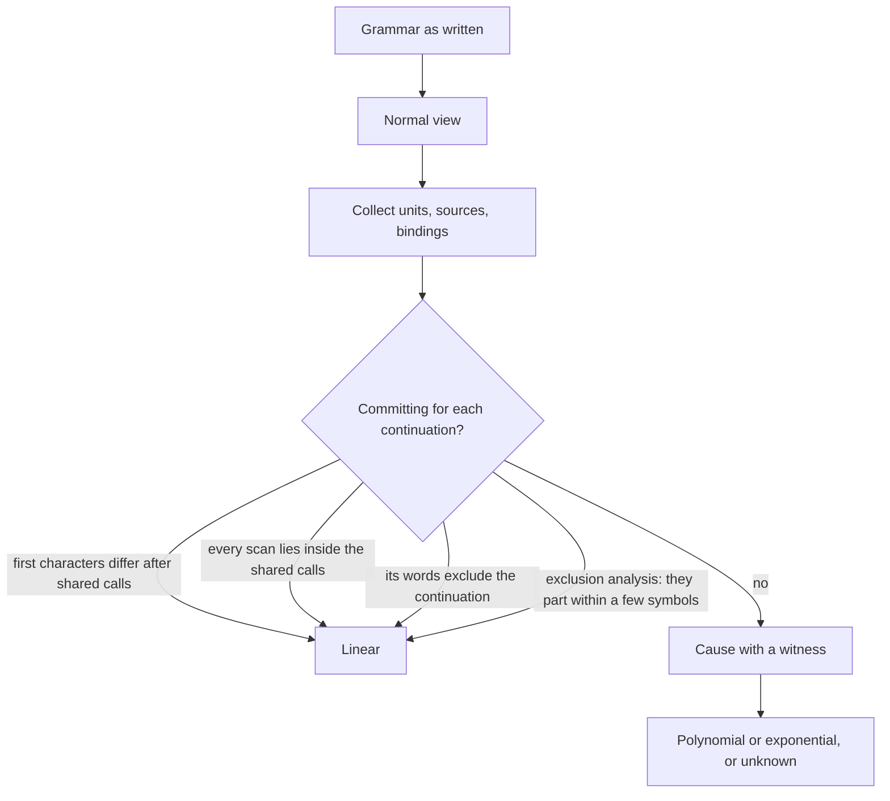

# Cost Analysis

`zp lint -classify` tells you how the cost of a parse can grow with the length of the input. This page explains how that
answer is built: a normalized view of the grammar that analyses read instead of the source, a classifier that finds the
places where work can repeat, an exclusion analysis that shows most of those places are harmless, and run records that the
engine keeps so that some of the rest stop being a problem. The contract that a user relies on is
[Classification](../../spec/runtime/parsing.md#classification); the decisions are
[record 064](records/064-grammar-complexity.md), [record 069](records/069-exclusion-analysis.md) and
[record 067](records/067-repetition-run-records.md).

## The Problem

Memoization bounds how often a rule body runs at one position, and that is not the same as linear time. A repetition
that scans ahead and then fails gives its input back to the choice around it; the next alternative can start inside the
input the scan already read, and read it again. The memo does not share that work because no rule was called twice at
the same position. A small grammar can therefore be quadratic, cubic or exponential, or build a value whose size is
exponential, and nothing in its source looks wrong.

The classifier has to answer a question that cannot be decided exactly (it would decide whether a grammar's language is
empty). So it is built to be **conservative in one direction**: the two best classes are promises, and the other classes
are estimates that come with a witness.

| Class | Meaning |
|:--|:--|
| Linear | the cost is at most a constant times the length of the input; a promise |
| Linear given an environment bound | linear, with a constant that grows with the number of values the variables can take; a promise |
| Polynomial | an estimate of a bound, with a witness for every condition that fails: the path of calls and expressions that shows each cause |
| Unknown | no claim: a condition of the proof fails that no witness accounts for; witnesses of growth it has give only a lower estimate |
| Exponential | an estimate of growth, with a witness |

The asymmetry is deliberate. A promise that is wrong costs a user an outage; an estimate that is pessimistic costs a
user a look at a grammar. Where the analysis cannot be exact it over-approximates: it assumes that every predicate can
both succeed and fail and that every continuation is reachable.

## Units, Continuations and Scanning Sources

The classifier works with three notions.

- A **scanning source** is an expression whose cost is the length of the input it examines: a repetition without an
  upper bound, the skip of a `#recover`, the growth of a left-recursive rule at a new position, the operators that an
  Operators Rule applies, and a copying operation whose operand is not bounded in size.
- A **unit** is an expression after whose failure the parser continues at the position where the unit started: an
  alternative of a choice other than the last, one iteration of a repetition, the expression of an option or of a
  lookahead, the base of a `#recover`.
- A **continuation** of a unit is what the parser can evaluate next at that position: the later alternatives of a choice,
  the next iteration of the enclosing repetition, what follows an option.

A unit is **committing** for a continuation if abandoning it means that nothing the parser evaluates next can read what
the scan read again. It can be committing in four ways: its first characters and those of the continuation differ
once the calls that both make first are set aside; all its scans lie inside those shared calls, which the continuation
reuses; the word it begins with, such as a keyword, rules out the continuation before the end of the word; or the
[exclusion analysis](#the-exclusion-analysis) shows that the two part within a few symbols. A grammar whose units are all committing, and whose other conditions hold, is linear. A unit that contains a
scanning source and is not committing, because a continuation can start again inside the input the source examined, is a
cause. Causes nested in one another through rule calls
raise the degree: a repetition restarted inside a restarted repetition is cubic.

## The Cost View

Spelling hides equality. Whitespace written as an unrolled loop and whitespace written as a repetition are the same
language, and an analysis that compares shapes sees two different things. The classifier therefore reads not the grammar but its **normal view**, the
grammar rewritten by normalization rules whose laws are proved in
[grammar-laws](../../spec/proofs/grammar-laws.md): spliced groups, flattened choices, duplicate and subsumed alternatives
dropped, runs of single-character alternatives merged into a class, repetitions merged, and alternatives that begin alike
left-factored. A parser never runs the view. It exists so that analyses compare shapes and not spellings.

An analysis of what a rule *matches* needs the view to preserve meaning: the same match or failure, the same end, the same
environment. The classifier needs a second property: the view must keep the **cost** of the grammar within a constant
factor, or an improvement of the view would be a way to hide a slow grammar. A rule of the view that drops an evaluation is
allowed to do so only when that evaluation was one the grammar never makes, or one it makes again in a state where it
already made it, and only if the repeated evaluation calls no rule that the memo leaves unanswered. Then its second
evaluation costs at most what its first cost, and the first is kept, so the drop cannot compound through recursion. Rules
that change what the runtime sees (the labels `@error` and `@diagnostic`, inlining) are off for the classifier, because
they change expectations and which evaluations the memo answers.

The view shares every node that no rule changes with the grammar and keeps the source positions of the nodes it rewrites,
so a message of the classifier points into the grammar as written. What the runtime decides from the grammar as written (the
cycles of left recursion and their leaders, the memoized rules, the variables that key the memo, the run sites) stays
decided from the grammar, not from the view.

## The Exclusion Analysis

Comparing the first characters of a unit with those of its continuations misses a common, harmless shape: two alternatives
that both begin with a call to the same rule, such as an identifier, and part one or two symbols later at a literal. The
first characters are the same, so the character test cannot call the unit committing, and yet the work that repeats is a
call to a rule that the memo answers.

The exclusion analysis compares **symbols** instead of characters, where a call of a rule is one symbol. It enumerates the
paths of a unit and of each continuation, and asks whether they **part**: after the symbols that both evaluate alike, do
they reach a symbol that at most one of them can pass? If every pair of a unit and a continuation parts within a few
symbols, and the symbols evaluated before they part are cheap (a constant cost, or no more than the unit paid for them at
the same position), then the continuation repeats only cheap work and the unit is committing.

Three properties define its character.

- It is a **cost argument, not a rewrite**. It changes no parser and inserts no cut. It only lets the classifier say
  linear in more cases.
- It is **bounded**. The number of paths, the length of a path, the number of rule bodies expanded for a pair and the total
  steps of one comparison are all limited. A comparison that exceeds its limit is *undecided*, which leaves the unit a
  cause. The analysis never guesses; it gives up.
- It treats **whitespace by convention**. A rule whose shape makes it trivia (a greedy repetition that depends only on the
  position and the variables it reads) is recognized from its body and its calls are compared by position.

The classifier uses the analysis by default. The argument that the classification stays sound with it is a sketch, and
[record 069](records/069-exclusion-analysis.md#soundness) states what it does not yet cover. Until a proof exists, the
evidence is differential: random grammars that the classifier calls linear are measured, with a family built to share
prefixes, separators, trivia calls and lookaheads.

## Run Records

Some units are neither committing nor cheap. A scan really is read again. The engine can make that cheap if the second
read is a lookup.

A **run site** is a repetition that records, for each position (and environment) where a walk of its iterations began,
where the walk ended and what it collected: the elements, the recovered errors, the farthest failure and the input it
examined. A later walk that reaches a recorded position in the same environment takes the rest from the record instead of
walking again. The idea generalizes the skip runs of whitespace and comments to ordinary repetitions.

A record may replace a walk only if the rest of the walk is a function of the position, the variables and the input, and
replaying it leaves the parse exactly as the walk would. A repetition is therefore a run site only when:

- it has no maximum and no cut applies to it from inside its element;
- its element has no Operators Rule, stream, missing-token insertion or diagnostic label, because what they do depends on
  more than position;
- everything unbounded in its element is itself a run site or repeats one character, and every rule the element calls is
  called without a level, is not left recursive and meets the same conditions;
- some iteration can be reached again, because a repetition that is walked once per position has no walk to reuse.

The conditions are eligibility, not heuristics: a repetition that does not meet them runs as before. The mechanism is
exact, so it never changes a result, an error or an expectation; it changes how many times the engine reads the same
input. [Run Sites](../../spec/runtime/parsing.md#run-sites) is the contract and
[optimization 133](../optimizations/133-run-records-of-restarted-repetitions.md) is the measurement.

Run records and the classifier meet at one point: a repetition that records is not a scanning source, because its second
walk costs a constant. The engine implements and uses run records. The classifier does not yet count them, because the
bounds they give have no proof yet; it keeps the marking behind a switch that the tests and the measurements turn on, so
the classes users see do not move until the classifier's use of run sites is proved. The design records say which further stages (records for the
Operators Rule, a size argument for copying, runs in the generated runtimes) are still to do.

## Where the Pieces Are

| Piece | Where | Contract |
|:--|:--|:--|
| Normal view | `internal/compile/normal_view.go` | the laws of [grammar-laws](../../spec/proofs/grammar-laws.md) |
| Classifier | `internal/compile/complexity*.go` | [Classification](../../spec/runtime/parsing.md#classification), [linear-cost](../../spec/proofs/linear-cost.md) |
| Exclusion analysis | `internal/compile/exclusion*.go` | [record 069](records/069-exclusion-analysis.md) |
| Run sites | `internal/compile/run_sites.go`, `internal/engine/core/` | [Run Sites](../../spec/runtime/parsing.md#run-sites), [run-sites](../../spec/proofs/run-sites.md) |

## Related Topics

- [Linting](../guide/linting.md#classifying-the-parse-cost): reading the classification of your own grammar.
- [Linear Rewrites](../cookbook/linear-rewrites.md): turning a cause into a linear grammar.
- [Record 064](records/064-grammar-complexity.md): the cost model, the classifier and its safeguards.
- [Record 066](records/066-limits-by-purpose.md): the limits that bound what the classifier cannot.
- [Record 071](records/071-doubled-recursion-values.md): when copies of a value of a recursion make it exponential.
