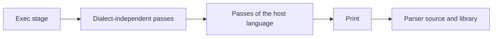

# Code Generation for Host Languages

> [!WARNING]
> This page describes the target architecture. The code may still differ from it.

The host language is the language of a generated parser. ZeroParse generates parsers in Go and TypeScript today. Another
host language is added in the same pattern, so the representations and the pass infrastructure do not change. This page
explains the pattern, the path from the Exec stage to printed source, the passes that the host languages share, the
passes of each of the two current instances, and the runtime library of generated parsers. The backends as a whole are
in [Architecture](architecture.md#backends).

## The Pattern

Each host language has subpackages for its passes, its printer and its runtime library.

- **Passes** legalize and optimize the Exec stage for the language. They run from the Exec stage to the Exec stage and
  are registered in the same registry as the other passes, so each has a flag. Go's passes are in the `golang/pass`
  package and TypeScript's in `typescript/pass`.
- **Print** prints the legalized Exec stage as it is. The printer does not carry transformations as string processing
  or as regeneration of the code. Go's printer is `golang/print`, and TypeScript's is `typescript/print`.
- **Library** is the runtime library of generated parsers. Go's library parts are `golang/libprint`, which prints the
  compositions of the Exec dialect into the library, and `golang/libsrc`, the copy of the library that a generated
  module embeds. TypeScript's runtime library is `typescript/lib`.

The parts that all host languages share, such as options and the helpers of the host-language packages, are in the
`common` package beside them.

## From the Exec Stage to Printed Source

1. The Exec stage is complete: `execlower` has converted every Flow operation.
2. The dialect-independent passes run. They specialize functions for the features of the build, canonicalize, remove
   dead stores and share identical helpers and literal tables.
3. The enabled passes of the host language run in order, as the last part of the same pipeline and under the same
   manager as every other pass. Their flags are in the registry, and their dumps and verification work as for the other
   stages.
4. The printer prints the legalized Exec stage. The generated parser and the library it uses come from the same
   representation, so the rules of a generated parser and the mechanisms they call agree.

## Passes Shared by the Host Languages

The dialect-independent passes serve every host language: specialization and canonicalization of functions, dead store
elimination, reachability after printing, and the sharing of identical helpers and literal tables. They are described in
[The Pass Pipeline](pass-pipeline.md#dialect-independent-passes-of-code-ir).

## The Passes of Each Host Language

The passes below are the instances for the two host languages of today. Each host language registers only the passes
that its own features need.

### Go

The Go instance has passes that are specific to Go:

- legalizing the scope of `goto` and of declarations, so that locals are enclosed and no `goto` jumps over a declaration;
- grouping variable declarations;
- encoding terminal regions as tables;
- turning literal comparisons into a `switch`;
- comparing fields in typed Go;
- removing unused helpers;
- adjusting the shape of the loops of Operators Rules.

### TypeScript

The TypeScript instance has passes that are specific to TypeScript:

- structuring with labeled blocks and `for(;;)`: TypeScript has no `goto`, so an exit from a loop is a labeled break;
- outlining large functions that hold a frame;
- its own decision on sharing literal tables, which differs from Go's;
- specializing the conversion to typed values;
- joining charges in a row into one charge of as many units (`ts-spend-runs`), the end of an expectation record and
  the merge of its expectations into one merge in place (`ts-merged-records`), and the test of whether the call that
  an `if` begins with matched into its condition (`ts-tested-inits`). These are the passes of `typescript/pass`; the
  printer prints the operations they replace as well, so each can be turned off.

## The Runtime Library

Each host language has a runtime library that the generated parsers call. For Go, it is the support library of generated
parsers.

- **The library printer** prints the compositions of the Exec dialect into the generated-parser library and into the
  shared engine state. For Go, `golang/libprint` is this printer, and `golang/libsrc` is the copy of the library that
  `go:generate` produces for the embedded mode. That printing is an edge of code generation, run through `go:generate`.
  It is not an import edge, so the runtime side does not depend on the printer.
- **Library mode.** The generator either imports the runtime library as a library, or embeds a copy of it in the
  generated output (`-lib import` and `-lib embed` for Go), as far as the packaging of the host language allows. The
  embedded copy compiles by itself, as the rules of the [Package Layering](layering.md) require for generated parsers.
- **Freshness.** A test keeps the printed library and its embedded copy identical to the printed output, so a change to
  the compositions cannot leave a copy behind.
- **Controls.** The printers and libraries register their own controls with the kind `library`, from the package that
  owns them. See [The Registry](pass-pipeline.md#the-registry).

## Related Topics

- [Architecture](architecture.md): the backends, the package layout and the driver flow.
- [The Pass Pipeline](pass-pipeline.md): the pass infrastructure that the host-language passes run on, and the registry.
- [Core IR and Code IR](intermediate-representations.md): the Exec stage, which the host languages consume.
- [Package Layering](layering.md): the rule that generated parsers must not link the VM or the engine.
- [Code Generation](../guide/code-generation.md#optimizations): the generator flags, with their defaults.
