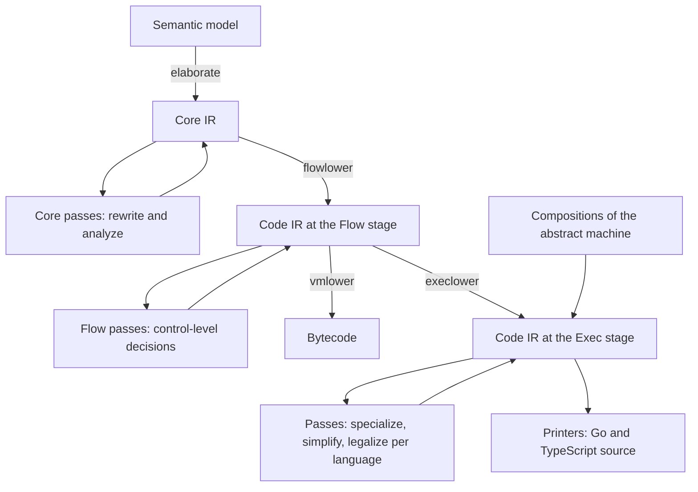

# Core IR and Code IR

Core IR and Code IR are the two internal representations between a checked grammar and what a backend runs or emits.
This page explains why there are two, what each one is for, how Code IR is divided into the Flow, Action and Exec
dialects, and how optimization works on them. It omits field tables, node inventories and call sites: the code,
starting with the package comments of the IR packages, is their source of truth. Nothing here is a public API.

> [!WARNING]
> The package layout is being migrated to the architecture this page describes, so parts of the current code still
> differ from it. In particular, Flow and Exec are still implemented as separate representations, not yet as dialects
> of one Code IR, and the specifications still describe them that way; [Migration](architecture.md#migration) lists the
> stages that reach the target.

The whole system is in [Architecture](architecture.md). The exact definitions are in the
[Core IR Specification](../../spec/core-ir/README.md), including the [text form](../../spec/core-ir/text-form.md),
which prints the module of this page's example in full, the [Flow specification](../../spec/flow-ir/README.md), which
defines every statement and expression of a rule's body, and the [Exec specification](../../spec/exec-ir/README.md),
which defines the abstract machine, every operation with its contract, the compositions and their lowering, passes and
printing. The reasons behind the levels are in [record 062](records/062-backend-independent-optimization-ir.md), the
abstract machine in [record 065](records/065-exec-ir-parser-vm.md), and the decision to make one Code IR with dialects
in [record 072](records/072-release-package-layout.md).

## Two Representations, Three Dialects



| | Core IR | Code IR at the Flow stage | Code IR at the Exec stage |
|:--|:--|:--|:--|
| Question it answers | What does this rule mean? | How does a parser control it? | What must the abstract machine do, and how is that composed? |
| Operations | A tree of grammar-level expressions, each carrying facts | Flow and Action dialects: matching, mark and restore, expectations, captures, calls under a policy, charges, recovery, action evaluation | Exec and Action dialects: operations of the abstract machine and the compositions over them |
| Optimized by | Rewrites that are valid for any backend | Control-level decisions with stated obligations | Behavior-preserving passes: specializing a function for the features of a build, removing what cannot run, legalizing for a language |
| Knows about | Input consumed, expectations, captures, failure | Parser state, control flow, the features of a build (budget, Document, tracing) | The abstract state of the parser (memo table, budget, ...) and the contract of each operation |
| Knows nothing about | Modes, targets, and parser state layout | How a target stores state or implements an operation | How a target stores that state or implements an operation |

The split keeps two kinds of reasoning apart. Whether a rewrite preserves what the grammar means is a question about
grammars and is answered once, on Core IR, where it is easy to state. How to turn the result into fast code is a
question about control and about a particular runtime, and is answered on Code IR, which no longer has to be correct
about grammars. A new target that reuses Core IR inherits the rewrites; a change to how loops are written does not touch
them.

Code IR is one representation: one structure of modules, functions, statements and expressions, one verifier, one
printer and one reference interpreter. What differs between the Flow stage and the Exec stage is which dialects, the
tables of operations, are allowed. Writing the base once means that action evaluation, the call protocol and the
structure of functions are defined once, and that one verifier can check the relation between the stages. A set of
operations is a dialect; a state of a program is a stage. "The abstract machine" is what the Exec dialect defines; "the
VM" is only the bytecode interpreter.

## Core IR

Core IR is a module of rules whose bodies are trees of expressions: sequences, choices, repetitions, lookaheads,
literals and classes, calls to other rules, captures, and the action expressions that build values. It is elaborated
once from the semantic model of the front end, and the decisions about each rule, such as which rules are memoized or
value-free, are facts computed on it.

### Effects Are Explicit

Every node carries attributes computed from its subtree: whether it can match empty input, which input can start it,
and which effects it can have. The effects are what a parse can do besides returning a boolean: consume input, fail,
record an expectation, write a capture, cut, recover from an error, call another rule, or raise an error that ends the
parse.

Making effects explicit is what makes optimization safe to state. "This alternative can only start with a comma" is a
checked fact, so a choice may skip alternatives without trying them. "This repetition has no capture and no call"
lets a loop be a tight scan. A rewrite is allowed exactly when it does not change an effect that anything can
observe: the input consumed, the expectations recorded at the farthest failure, the order of captures and errors.

### Kinds of Node

Nodes fall into a few families: matching, combining, structure (calls, captures, scopes), control (cut, recovery, left
recursion, Operators Rules), action expressions, and the optimized forms that passes introduce. The exact kinds and
what each one means are defined in the [Core IR Specification](../../spec/core-ir/nodes.md); a new node should fit one of
the families.

### What the Verifier Guarantees

The Core IR verifier checks, by default once after the last pass, that the module is well formed and that the facts
on it are true. With verification after each pass requested, it also runs after every pass and names the pass that
broke an invariant; see [Verification Between Passes](records/063-configurable-optimization-pass-pipeline.md#verification-between-passes).
It recomputes the attributes to compare them with the module, which is why it lives with the attribute computation in
the Core IR package. In principle it guarantees four things.

- **Referential integrity.** Every call, capture and slot reference points at something that exists in the scope it
  names, and the call graph equals the one computed from the bodies.
- **Facts match structure.** Guards, first terminals and similar attributes equal what the structure implies, so a pass
  cannot leave a stale fact behind.
- **Forms stay in their place.** Constructs that the runtime supports only in certain positions (an Operators Rule as a
  whole body, a stream at the top of a start rule) appear only there, and optimized forms contain only what they can
  represent.
- **Types are complete** in a typed module: every action expression, slot and rule value has a checked type.

The individual invariants are listed in [Invariants](../../spec/core-ir/invariants.md).

## Optimization

An optimization is a pass: a function from a module to a module. There are two kinds.

- **Analyses** compute facts. The attributes of each node (nullability, first terminals and effects) are invariants
  stored on the nodes; derived results such as the call graph, rule facts and site numbers are cached by the analysis
  manager and shared by the passes, the linter, the complexity classifier and the generators. Analyses never change
  meaning.
- **Rewrites** replace an expression with a cheaper one that does the same thing. Each rewrite has a precondition, the
  facts it needs, and an obligation, what it promises to preserve.

A rewrite is safe when its precondition is established and the replacement is indistinguishable from the original on
every input: same input consumed, same value, same error, same expectations at the same positions. Preconditions are
satisfied by asking the analysis manager, and a rewrite declares which analyses it preserves; every other analysis is
computed again when it is next asked for. How each rewrite proves itself is written beside it, as a comment, and tested by
differential runs against the reference backend, which is the oracle.

For example, replacing a choice's blind tries with guarded ones is safe because the guard equals the alternative's first
terminal, the literal or class that analysis proves every match of that alternative starts with: when the guard rejects
the next character, the alternative would have failed there anyway, with the same expectation. Turning a value-free
repetition of a character class into a scan is safe because it consumes the same characters, writes nothing and
records the same expectation when it stops.

The order passes run in, which are enabled, and how they are configured are declarations of the pipeline that the
driver runs; [the optimization pipeline](optimization-pipeline.md) explains declared passes, the analysis manager,
profiles and a flag per optimization.

### A Worked Example

A grammar with a rule that matches optional whitespace and one that reads a name:

```zp
package list

type Item = { Name node[string] }

@start
rule main = items:item+ $$

rule item Item = ws n:name ("," / ";")? => Item{Name: $n}

rule name node[string] = [a-z]+ #atomic

rule ws = [ \t]*
```

The module as elaborated from the grammar, for the rules `item`, `name` and the value-free twin of `ws` (rules 0
and 3 are left out), printed by the Core IR printer:

```text
rule 1 item memo transient scope=[n] => Item{Name: $0:n}!
  seq
    call 4:ws
    capture 0 n
      call 2:name
    opt
      choice
        alt
          lit ","
        alt
          lit ";"
rule 2 name want memo transient plain scope-value(k=1,mode=1)
  text
    repeat 1 -1 scan-site=1
      class [a-z]
rule 4 ws memo transient plain novalue
  repeat 0 -1 scan-site=3
    class [\u0020\u0009]
```

After analysis, guards and scans, the same rules read:

```text
rule 1 item memo transient scope=[n] => Item{Name: $0:n}!
  seq
    call 4:ws
    capture 0 n
      call 2:name
    opt
      choice
        alt guard=','
          lit ","
        alt guard=';'
          lit ";"
rule 2 name want memo transient plain scope-value(k=1,mode=1)
  text
    scan [a-z] 1 -1 scan-site=1
rule 4 ws memo transient plain novalue
  scan [\u0020\u0009] 0 -1 scan-site=3
```

Analysis also attaches the attributes that the printer shows in brackets. For the choice of `item` they are:

```text
choice [consume,fail,expect]
  alt guard=','
    lit "," [first=',' consume,fail,expect]
  alt guard=';'
    lit ";" [first=';' consume,fail,expect]
```

Each alternative of the choice gained a guard, which is the first terminal that analysis computed for its literal. In
`name`, the value-free repetition `[a-z]+` under `#atomic` became a scan. `item` calls the value-free twin of `ws`, rule
4, because it wants no value there, and the twin's repetition became a scan over the whitespace class; the twin's
value-building sibling, rule 3, is unchanged. Before analysis a node carries only whether its value is wanted and its
shape; nullability, first terminals and effects appear once analysis has run. None of the rewrites changes what any input
consumes or expects.

## The Flow Stage

Code IR at the Flow stage holds the body of each rule variant as operations of grammar control with structured
control: variables for positions and results, labeled blocks and loops, and the operations of the Flow dialect
(matching, mark and restore for backtracking, expectations, captures, rule calls under a policy, charging for budgets,
recovery), with action expressions as operations of the Action dialect. It contains no host-language text. It is not a
control-flow graph: a pass that needs a graph gets one as an analysis view from the analysis manager, so the form that
is printed and verified stays structured.

`flowlower` produces the Flow stage from Core IR in one uniform shape and fails loudly on a construct it does not
support rather than guess. The shape is then chosen by the Flow passes, which hold every control-level decision: call
specialization, inlining, dispatch, the form of a match, removal of saves that no failure path reads, merging and
threading of failure paths, where to charge, sharing slots between locals, and outlining. Each pass declares an
obligation, the property it preserves, and the features under which it applies, and the Flow verifier runs after it:
structure, variables, one runtime per function, the budget invariants, recorded reads under a Document and no in-place
reads in a traced parse. The passes, their order and their obligations are listed in
[Architecture](architecture.md#the-middle-end).

A charge of one step is one reservation of one unit, so a printer that charges several steps, or the code points of a
literal, with one call keeps them separate reservations: the runtime reserves a run that fits at once and, when the run
does not fit, fails at the unit that does not, as the separate charges would, and reports that unit as the reservation
that failed. The charge pass keeps the total charge, charges every loop iteration, charges input before examining it
and never moves a charge across a commit.

Every Flow operation states its contract, its cost, the features it needs and its laws, and carries a **reference
expansion** into Exec operations. The conformance suite compares each implementation of an operation with its
expansion, so a backend that implements a Flow operation natively, as the VM does, is checked against the same meaning
as one that prints its expansion.

## The Exec Stage

The Exec dialect has two parts. The first is the specification of the **abstract machine**: a set of components and
registers that make up the abstract state of a parse (the memo table, the budget, the position, ...) and a set of
operations, each a transition of that state with a signature, a behavior contract, a precondition, the components it
reads and writes, a bound on what it charges the budget, and the features it belongs to. An operation says what happens
and not how. The second part is **compositions**: functions in structured code over the operations, written once for
every runtime: the call protocol of a rule with memoization, left-recursion growth, Operators Rules, the observation of a
call, Documents and streams.

`execlower` converts the Flow stage to the Exec stage completely: each Flow operation becomes its expansion, and the
verifier checks the postcondition that no Flow operation remains. The rules of a grammar enter the Exec stage only this
way; the compositions are written in the Exec dialect directly.

Two kinds of checking keep the freedom of the targets safe. A conformance suite runs sequences of operations on a
reference model, written for clarity and never printed, and on an implementation, and fails on the first difference in
results or in the cost charged beyond the bound. Passes on the Exec stage keep a function's behavior: specializing a
function for the set of features of one build turns each feature into a constant, and simplification removes what then
cannot run, so the ordinary, budget-controlled, observed and Document variants of a mechanism are specializations of
one composition. These passes depend only on the reads and writes that each operation declares, so they are shared
across dialects.

## How Targets Use the Result

- **The closure backend** builds one closure for each node of Core IR, after the Core pipeline, and evaluates action
  expressions directly. It deliberately does not share the lowering to Code IR, so that a bug in that lowering shows up
  as a difference between backends.
- **The VM** takes Code IR at the Flow stage: `vmlower` selects instructions almost one for one from Flow operations,
  with superinstructions for calls of compositions and for common match patterns. The compositions are native in the VM
  and checked by the conformance suite.
- **Generated Go and TypeScript** take Code IR at the Exec stage, after the shared passes and the passes of each
  language that legalize and optimize it, and print it as structured source. The printers print the compositions of the
  runtimes too, so the rules of a generated parser and the shared mechanisms they call come from the same
  representation.
- **A future LLVM backend** lowers the Exec stage to LLVM IR.

The VM, Go, TypeScript and LLVM therefore take grammar code from one Code IR, and charging and the propagation of
options cannot drift between two lowerings of grammar code.

## Related Topics

- [Architecture](architecture.md): the stages around these representations, the backends and the packages.
- [The optimization pipeline](optimization-pipeline.md): how the passes are declared, configured and verified.
- [Record 072](records/072-release-package-layout.md): one Code IR with three dialects, and the alternatives.
- [Record 065](records/065-exec-ir-parser-vm.md): the abstract machine, its operations, compositions and conformance suite.
- [Record 062](records/062-backend-independent-optimization-ir.md): why the levels exist and the rewrites with their obligations.
- [Record 063](records/063-configurable-optimization-pass-pipeline.md): the pass pipeline, its profiles and per-optimization flags.
- [Optimization catalog](../optimizations/README.md): measured mechanisms.
