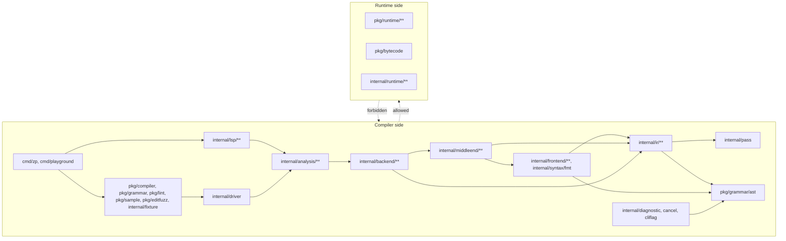

# Package Layering

> [!WARNING]
> This page describes the target architecture. The code may still differ from it.

The module has two sides. The runtime side runs parsers, and the compiler side makes them. The runtime side never
links the compiler side, and a test of the import graph enforces the rules on this page. Read it before you add an
import between packages, or a package that a generated parser or a loaded compiled file could reach. The packages
themselves are listed in [The Package Layout](architecture.md#the-package-layout).

## The Two Sides

- **The runtime side** holds `pkg/runtime` and everything under it (`input`, `value`, `value/impl`, `schema`, `query`,
  `instrument`, `vm`, `golib`), `pkg/bytecode` and the internal runtime packages.
- **The compiler side** holds everything else: `pkg/compiler`, `pkg/grammar`, `pkg/grammar/ast`, `pkg/lint`,
  `pkg/sample`, `pkg/editfuzz`, the other packages of the internal tree, and the commands.

## The Rules

- **Rule 1 (runtime side).** For every non-test package of the runtime side, every package of the module that it depends
  on is on the runtime side too. The runtime side imports no third-party package.
- **Rule 1a (generated parsers).** The support library of generated Go parsers imports only the runtime packages
  `runtime`, `input`, `value`, `value/impl` and `instrument`, and `schema` where the typed API needs it. It does not
  import the VM or the internal runtime packages, so a generated parser links neither the VM nor the engine. The embedded
  copy of the library compiles by itself in a temporary module that imitates a user's module.
- **Rule 2 (layers).**
  - The pass infrastructure imports no package of the module.
  - The IR packages (the Core IR package, and the Code IR base with everything below it) import only IR packages, the
    pass infrastructure, the cancellation package and the grammar AST (`pkg/grammar/ast`). Within them, the Code IR base
    imports no dialect. The Flow dialect imports only the base and Core IR, to refer to immediates. The Action and Exec
    dialects import only the base; the packages under the Exec dialect may also import the Exec and Action dialects.
  - Only the lowerings of the middle end, and the checks that span dialects, import several dialects at once.
  - The front end imports no middle end, backend, analysis or language server. The middle end imports no backend,
    analysis or language server. A backend imports no analysis or language server.
  - The utility packages (diagnostics, cancellation, command-line flags) may import the grammar AST, because diagnostics
    carry source positions. The grammar AST imports only the standard library. `pkg/grammar`, which loads, formats
    and converts grammar sources over the parser of the front end and the formatter, is in the layer of the public tool
    packages; besides them and the AST it imports only the bytecode package, to recognize a compiled grammar file, so
    loading or formatting a grammar does not link the compiler. The fixture package is a tool that uses `pkg/compiler`, so it belongs to the layer of the
    public tool packages.
  - Only the commands and the repository test support import the language server packages. Of the non-test packages,
    only those inside the repository test support import the test support.

## How the Import-Graph Test Enforces the Rules

The architecture test (`archtest`) runs the dependency listing of the Go tool for every package under the default build tags and under
each reference tag set (those of the reference build in [Development](../development.md)). On a violation it prints the
shortest import chain that causes it. A deliberately wrong edge, which exists only in the test, is the negative control,
so the test is shown to fail when an edge that the rules forbid appears. The test also checks the dependencies of parsers
generated in both library modes. A violation fails the test; no violation is allowed.

## Related Topics

- [Architecture](architecture.md): the overview, the packages and the pipeline.
- [The Public API](public-api.md): the packages under `pkg/`, which the runtime side and the compiler side share.
- [Record 072](records/072-release-package-layout.md): the decision on the layout and the alternatives that were rejected.
- [Development](../development.md): the checks that run the test.
