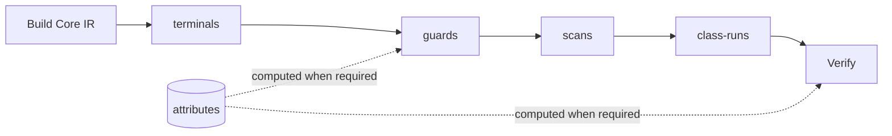
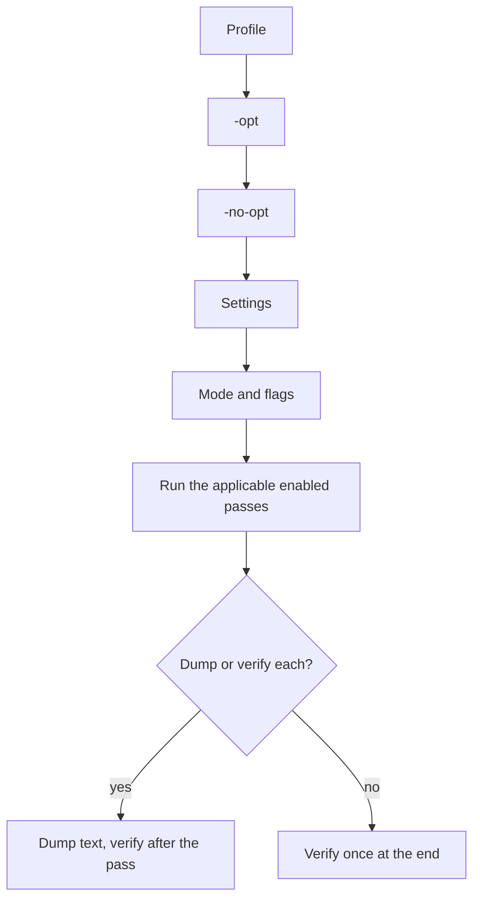

# The Optimization Pipeline

A parser that `zp gen` writes is faster than the plain translation of its grammar because the generator rewrites the
grammar before it prints it. This page explains how those rewrites are organized: declared passes that a small manager
runs, a registry that gives each optimization a name, profiles that choose values for the names, and a verifier that
checks the result. The rewrites themselves, and the proof that each is safe, are in
[Core, Flow and Exec IR](intermediate-representations.md); the decision and its alternatives are
[record 063](records/063-configurable-optimization-pass-pipeline.md).

## Why a Pipeline

Without a structure, every optimization is a function that the generator calls at the right moment, and the right
moment is knowledge that lives in the calling code: this rewrite needs the first characters of each alternative, that
one makes those facts stale, a third is only sound when the parser reports no events. Three things then go wrong
silently.

- A rewrite runs on facts that an earlier rewrite made stale, and the output is wrong or merely slower, and nothing says so.
- An optimization cannot be turned off on its own, so no one can measure what it is worth or bisect a bad output to it.
- A rewrite breaks an invariant of the intermediate representation and the failure shows up in a printer, far from the cause.

The pipeline moves that knowledge from the calling code into declarations that a manager checks.

## Declared Passes

A pass is a value, not just a function. It declares:

- its **name**, which is also the name of the flag that turns it off, of the dump that shows its result and of the error
  that names it when it fails;
- the **analyses it requires** and the analyses it **invalidates**;
- the passes it must **follow**, for passes that share no data and that an analysis would not order;
- when it **applies**: a pass is sound only in some generation modes, and one that does not apply never runs, whatever its
  flag says;
- its **obligation**, one sentence that says what it preserves. For every pass here that is the contract of a rewrite:
  the input consumed, the expectations recorded and the values built stay the same.

The manager does the bookkeeping that the callers used to do. Every analysis starts stale. Before a pass runs, the manager
computes the analyses it requires if they are stale. After the pass, it marks the analyses the pass invalidates as stale.
So a pass that needs the first characters of every alternative gets them, once, however the passes before it changed the
module, and a pass that does not need them never pays for them.

The passes of Core IR are `terminals` (value-free choices of literals and classes become one program), `guards` (an
alternative is skipped when the next character cannot start it), `scans` (a value-free repetition of a class runs as a
scan) and `class-runs` (consecutive classes run as one). They share one analysis, `attributes`: for every node, whether
it can match the empty string, the set of characters it can start with and its effects. `terminals`, `scans` and
`class-runs` replace nodes, so they invalidate it; `guards` reads it.

The package `internal/ir/pipeline` is generic: it knows nothing about Core IR, only about passes, analyses and an
ordered list. A second representation would declare its own pipeline and reuse the manager.

`Validate` checks the declarations before anything runs: names are non-empty and distinct, every required analysis can be
computed, and every pass named in a `follow` list precedes the pass that names it. A declaration that cannot be
satisfied is an error of every run, before any pass runs.

## Modes: Where a Pass Is Sound

A rewrite is sound for a parser only if the parser does not observe what the rewrite removes. The mode of a generation
carries the facts that applicability depends on.

| Mode fact | Meaning | Passes it governs |
|:--|:--|:--|
| Lean | the module is the typed rules of a parser that prints bodies in the ordinary form: no budget controls and no Documents | `terminals`, `class-runs`: budget controls and Documents charge for the input they read, which these rewrites would skip |
| Ordinary | the parser prints bodies in the ordinary form | the guarded-class variant of `guards` |
| Observe | the parser reports the rules it enters and the alternatives that guards skip | `terminals`: the program of a terminal does not report them |

A pass that does not apply is not an error. Asking for `-no-opt terminals` on a parser where it never applied does
nothing, and that is the right answer: the flag says what the user does not want, not what must have happened.

## The Registry

An optimization is a **flag** with a name in one registry (`internal/gen/opt`). Passes are not the only optimizations, and
the registry gives all of them the same interface. A flag has a kind, which says what it changes.

| Kind | What it changes | Examples |
|:--|:--|:--|
| Pass | a pass over Core IR, or a variant of one | `terminals`, `guards`, `guarded-classes`, `scans`, `class-runs` |
| Lowering | an option of the lowering from Core IR to Flow or Exec IR | `inline-literals`, `class-tables`, `text-dispatch`, `field-compare` |
| Printer | what the Go and TypeScript printers emit | `method-sharing`, `literal-sharing` |
| Runtime | a control of the runtime structures that the printers emit | `typed-object-slabs`, `typed-list-slabs`, `sparse-memo` |

A flag is on or off, or it has an integer parameter, where 0 turns it off. The registry checks itself: names and
descriptions exist and are unique, a value is 0 or 1 unless the flag takes a count, and a flag that **changes the output**
(the generated API or the representation of what a parser returns, not only its code and resource use) must be an opt-in
that no profile sets. That rule is the line between two contracts. An optimization that is not marked keeps the results,
the errors and the events of the parser, so it needs a test that the parser with the optimization off behaves the same
as the parser with it on. One that is marked has a contract test of its own, because turning it on is a decision about the
API.

The same names serve three uses: a user turns an optimization off to see what it is worth, a test compares a parser
against the same source with one flag changed, and a reference page names the flag that is the control of a measured
mechanism. A flag is how an optimization becomes something that can be measured by itself, which is why the catalog of
[measured mechanisms](../optimizations/README.md) names the generation flag that is each mechanism's control.

## Profiles

A profile is a preset: a name for fixed values of flags, with no logic of its own.

| Profile | For | Differs from the default by |
|:--|:--|:--|
| `speed` | the fastest parse that does not cost generated code or memory out of proportion; the default | nothing: the registry's own defaults are the speed values |
| `memory` | fewer bytes allocated and less live heap | typed objects and lists are not allocated in slabs |
| `size` | smaller generated source and binaries | literals are not compared in place; classes of five ranges or more match through a table |

A profile is kept only if it earns its place by a rule of measurement
([optimization 136](../optimizations/136-measured-effect-of-the-generation-flags.md)): it must improve the metric it is
named for by a margin beyond the noise of an identical copy on most of the language grammars, cost little parse time
overall and slow no grammar by much. That is why there are three profiles and not one per flag.

The settings of a generation are layered in a fixed order, so that each layer has one job: the profile sets the values
(`-optimize`), then `-opt` turns on or sets individual flags, then `-no-opt` turns individual flags off. The later layer
wins, so `-optimize size -opt class-tables=3` is the size profile with a different threshold, and a name that no flag has
is an error that lists the valid names.

## Verification and Dumps

After the passes, the manager runs the verifier of the representation (for Core IR, the checks listed in
[What the Verifier Guarantees](intermediate-representations.md#what-the-verifier-guarantees)), after making the analyses
it reads valid. By default it runs once, at the end. That tells a user that something broke, and not which pass broke it,
so a run can verify after **every** pass: the error then names the first pass that left the module invalid. Tests and
diagnosis ask for this; it costs generation time and changes no output.

A run can also **dump** the module as text: after the build, and after each pass that ran. `zp gen -print-after guards`
(or `all`) prints the Core IR after the named passes to standard error. A pass that did not apply prints nothing, which is
itself information: the dump is the way to see why an optimization did not happen for a parser.

## What the Pipeline Does Not Do

- It does not decide that an optimization is worth having. That is measurement, and the pipeline's job is to make the
  measurement possible: one flag, one control.
- It does not prove a rewrite. Each pass states its obligation, and the proof sits beside the rewrite and in the
  differential tests against the reference backend.
- It does not order passes by cost or by guess. The order is declared, and the manager checks that the declaration holds.

## Related Topics

- [Core, Flow and Exec IR](intermediate-representations.md): the representations the passes work on and the rewrites.
- [Record 063](records/063-configurable-optimization-pass-pipeline.md): the decision, the alternatives and the status.
- [Code Generation](../guide/code-generation.md#optimizations): the flags of `zp gen`, with their defaults.
- [Optimization catalog](../optimizations/README.md): the measured mechanisms and their controls.
