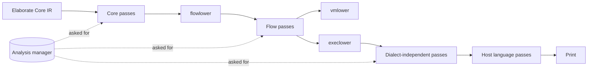
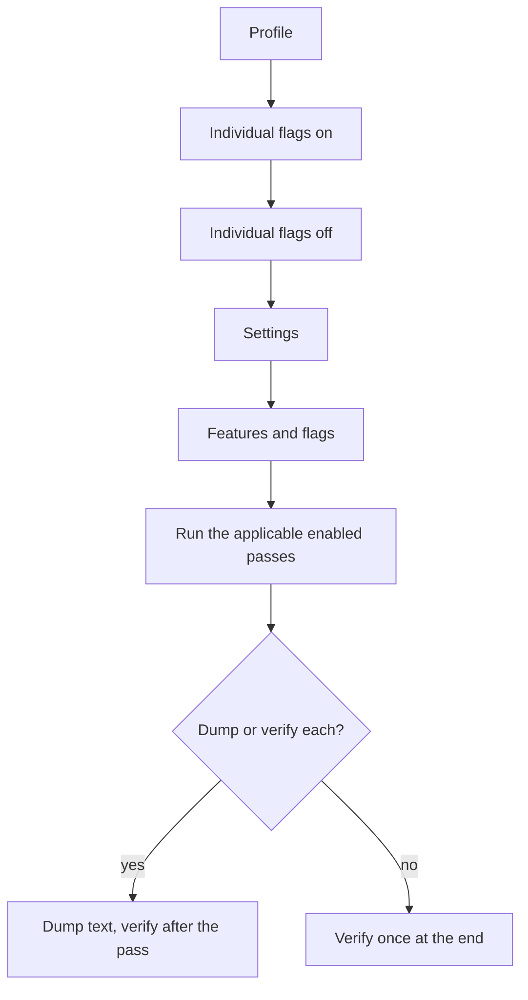

# The Pass Pipeline

A parser that ZeroParse produces is faster than the plain translation of its grammar because the compiler rewrites the
grammar on its way to every backend. This page explains how those rewrites, and the checks on the code they produce,
are organized: passes that are declared and run by a manager, an analysis manager that computes and caches what the
passes need, a registry that gives each optimization a name, profiles that choose values for the names, and
verifiers and dumps. The rewrites themselves, and why each is safe, are in
[Core IR and Code IR](intermediate-representations.md). The architecture as a whole is in [Architecture](architecture.md);
the decisions are [record 063](records/063-configurable-optimization-pass-pipeline.md) and
[record 072](records/072-release-package-layout.md).

> [!WARNING]
> The code is being migrated to the architecture this page describes and still differs from it in places. The package
> comments describe the code as it is.

## Why a Pipeline

Without a structure, every optimization is a function that the compiler calls at the right moment, and the right
moment is knowledge that lives in the calling code: this rewrite needs the first characters of each alternative, that
one makes those facts stale, a third is only sound when the parser reports no events. Three things then go wrong
silently.

- A rewrite runs on facts that an earlier rewrite made stale, and the output is wrong or merely slower, and nothing says so.
- An optimization cannot be turned off on its own, so no one can measure what it is worth or bisect a bad output to it.
- A rewrite breaks an invariant of the intermediate representation and the failure shows up in a printer, far from the cause.

The pipeline moves that knowledge from the calling code into declarations that a manager checks.

## Declared Passes

A pass is a value, not just a function. It declares:

- its **name**, which is also the name of the flag that turns it off, of the dump that shows its result and of the error
  that names it when it fails;
- the passes it must **follow**, for passes that share no data and that an analysis would not order;
- when it **applies**: a set of features (budget controls, Documents, tracing and the like). Core IR has no mode, so a
  Core pass that applies to every build declares no feature; a pass that does not apply never runs, whatever its flag
  says;
- its **obligation**, one sentence that says what it preserves: for a rewrite, the input consumed, the expectations
  recorded and the values built stay the same;
- the **analyses it asks for**, and the analyses it **preserves**.

A pass runs on one unit of IR and returns the new unit with the set of analyses it preserved. The manager runs the
enabled passes of a pipeline in order, invalidates what each pass did not preserve, and on request verifies and dumps
after each pass. One generic manager, in `internal/pass`, runs every pipeline: Core, the Code IR stages and the pipeline
of each host language.

The declarations are checked before anything runs: names are non-empty and distinct, every requested analysis has a
key, and every pass named in a follow list precedes the pass that names it. A declaration that cannot be satisfied is
an error of every run, before any pass runs.

## The Pass Model

Transforms run in an explicit list, in order; analyses are computed when they are requested and cached. The model is
generic over the unit of IR and consists of four parts:

- **Preserved sets.** A set of analyses that a transform keeps. It **preserves nothing by default**: a pass that
  forgets to declare what it keeps invalidates everything, which is the safe side.
- **Analysis keys.** Each analysis has a key with a name and a run function. Registering a second key with the same
  name is rejected, so that two analyses of the same name and different types cannot confuse the cache.
- **The analysis manager.** It computes an analysis when it is asked for, caches the result, and records which analyses
  each analysis used. Invalidating an analysis invalidates the analyses that used it, transitively. An analysis that
  depends on itself is detected and is an error. A failed analysis returns an error; it never degrades silently.
- **The transform interface, the manager and the registry.** A transform declares the name, ordering, obligation and
  applicability of a pass and runs on a unit, returning the new unit and its preserved set. The manager runs the
  enabled passes, invalidates the cache after each, and verifies and dumps on request. The registry holds the passes
  and control flags.

When a transform returns a different IR value, the whole cache is invalidated: a preserved set has meaning only for a
rewrite of the same unit.

The attributes on Core nodes (nullability, first sets, effects) are not cached analyses: they are invariants of the IR,
stored on the nodes and checked by the verifier. What the manager caches is derived results that are not written into
the IR: rule facts, site numbers, the call graph, the cost view, lookahead sets, liveness and the control-flow views
that some Flow passes use. The optimization passes, the linter, the complexity classifier and the generators share
them, so a fact has one implementation.

## The Pipelines

- **Core passes** rewrite meaning-preserving forms and compute the facts: guard sets, first sets, effects, rule
  policies, normalization, and turning a value-free repetition of a class into a scan. They know nothing of the mode.
  They are the only passes that work on Core IR.
- **Flow passes** make the control-level decisions, listed below. Their applicability is where the features matter: a
  rewrite is sound for a parser only if the parser does not observe what the rewrite removes, so a match form that
  skips charging input does not apply under a budget or a Document, and a form that hides rule entries does not apply
  when the parser is traced.
- **Dialect-independent passes of Code IR** run on the Exec stage, in the `codepass` package. They specialize functions
  for the features of a build, simplify, remove dead stores and share identical helpers and literal tables. They depend
  only on the reads and writes that each operation declares, so every dialect of Code IR can run them. They are not
  Core passes: they never see Core IR.
- **Host language passes** legalize and optimize the Exec stage for the host language before it is printed, such as the
  scope of `goto` in Go, or labeled blocks in TypeScript, which has no `goto`. [Host Language Passes](#host-language-passes) below
  describes them.

Lowerings are not passes. `flowlower`, `execlower` and `vmlower` change the dialect and have postconditions of their own,
so they run between pipelines.

## The Flow Passes

The Flow passes hold every control-level decision of the Flow stage. Each pass declares its obligation, the property it
preserves, and the analyses it needs and keeps. The table is in the order the pipeline runs them.

| Order | Pass | Obligation (what it preserves) | Main analyses |
|:--|:--|:--|:--|
| 1 | call-specialize | The result, memo records, expectations and events of a call stay the same; under observation the call is kept | Core facts (Plain, Memo, Leader), call graph |
| 2 | inline | The same nodes, values, memo entries and errors at the same positions | Call graph, size |
| 3 | dispatch | The same order of trying alternatives and the same expectation records; guards use only Core facts | Core first sets and guards |
| 4 | match-form | The same input consumed and the same expectations recorded; the charging invariants hold | Features (Budget, Document, Traced) |
| 5 | save-elide | No save that no failure path reads | Core effects, liveness |
| 6 | fail-merge/thread | The same behavior on every reachable path | Reachability |
| 7 | charge | The same total charge; every loop iteration charges, input is charged before it is examined, and no charge crosses a commit | Charge flow |
| 8 | slots | Locals share a slot only when their types are equal and their live ranges do not overlap | Liveness |
| 9 | outline (module) | The same behavior; enabled by the size profile | Structural hashes |

The Flow stage is not a control-flow graph: a pass that needs one asks the analysis manager for a graph view, so the form
that is printed and verified stays structured. After each pass, the Flow verifier runs: it checks the structure, the
variables, one runtime per function, the budget invariants, recorded reads under a Document, and that a traced parse
does not read in place.

## Analyses

An analysis is computed when a pass asks for it and is cached until it is invalidated, so a pass that needs the first
characters of every alternative gets them, once, however the passes before it changed the module, and a pass that does
not need them never pays for them. The rules of the analysis manager are chosen so that a mistake fails safe:

- What a pass preserves **defaults to nothing**. A pass that forgets to declare what it keeps invalidates every
  analysis, which costs time but never gives a stale answer.
- An analysis that used another analysis is invalidated with it, transitively. An analysis that depends on itself is an
  error.
- A transform that returns a different IR value invalidates the whole cache; a preserved set has meaning only for a
  rewrite of the same unit.
- A failed analysis returns an error. It never degrades silently into a weaker answer.
- Analysis keys are registered by name, and a second key of the same name is rejected, so two analyses cannot share a
  cache entry by accident.

## The Registry

An optimization is a **flag** with a name in one registry, the generic registry of `internal/pass`. Each pipeline
registers its own passes in the definition of the pipeline (name, description, default and applicability), and the
controls of printers and libraries are registered with the kind `library` by the code generators that own them. No name
is declared in two places, and every name differs from the others, so one name selects one pass in the flags and in the
dumps. A flag has a kind, which says what it changes: a pass of one of the pipelines, or a library control (the runtime
structures and helpers that the printers emit, such as allocating typed objects in slabs or sparse memo tables).

A flag is on or off, or it has an integer parameter, where 0 turns it off. The registry checks itself: names and
descriptions exist and are unique, a value is 0 or 1 unless the flag takes a count, and a flag that **changes the output**
(the generated API or the representation of what a parser returns, not only its code and resource use) must be an opt-in
that no profile sets. That rule is the line between two contracts. An optimization that is not marked keeps the results,
the errors and the events of the parser, so it needs a test that the parser with the optimization off behaves the same
as the parser with it on. One that is marked has a contract test of its own, because turning it on is a decision about the
API.

The same names serve three uses: a user turns an optimization off to see what it is worth, a test compares a parser
against the same source with one flag changed, and a reference page names the flag that is the control of a measured
mechanism. A flag is how an optimization becomes something that can be measured by itself, which is why the catalog of
[measured mechanisms](../optimizations/README.md) names the optimization flag that is each mechanism's control.

## Profiles

A profile is a preset: a name for fixed values of flags, with no logic of its own. A user chooses it through the public
optimization setting of `pkg/compiler` (`speed`, `memory` or `size`, with overrides of flags), and the same setting applies
to every backend: the closure backend, the VM and the generators. The table from profile names to values is in
`internal/driver`, which resolves the setting once and passes it to every pipeline.

| Profile | For | Differs from the default by |
|:--|:--|:--|
| `speed` | the fastest parse that does not cost generated code or memory out of proportion; the default | nothing: the registry's own defaults are the speed values |
| `memory` | fewer bytes allocated and less live heap | typed objects and lists are not allocated in slabs |
| `size` | smaller generated source and binaries | literals are not compared in place; classes of five ranges or more match through a table |

A profile is kept only if it earns its place by a rule of measurement
([optimization 136](../optimizations/136-measured-effect-of-the-generation-flags.md)): it must improve the metric it is
named for by a margin beyond the noise of an identical copy on most of the language grammars, cost little parse time
overall and slow no grammar by much. That is why there are three profiles and not one per flag.

The settings of a generation are layered in a fixed order, so that each layer has one job: the profile sets the values,
then the individual flags turn on or set values, then the individual flags turn off. The later layer wins, so a profile
with one flag set differently is a valid setting, and a name that no flag has is an error that lists the valid names.

## Verification and Dumps

After a pass, the manager can run the verifier of the stage: for Core IR, the checks listed in
[What the Verifier Guarantees](intermediate-representations.md#what-the-verifier-guarantees); for the Flow stage, the
structure, the variables, one runtime per function, the budget invariants, recorded reads under a Document and no
in-place reads in a traced parse; after `execlower`, that no Flow operation remains. By default each verifier runs once,
at the end of its pipeline. That tells a user that something broke, and not which pass broke it, so a run can verify
after **every** pass: the error then names the first pass that left the module invalid. Tests and diagnosis ask for
this; it costs compile time and changes no output.

A run can also **dump** the module as text after a stage or after a pass. The generator command takes the stage names
`core`, `flow` and `exec` and the names of passes (or `all`), and prints to standard error. A pass that did not apply
prints nothing, which is itself information: the dump is the way to see why an optimization did not happen for a
parser.

## What the Pipeline Does Not Do

- It does not decide that an optimization is worth having. That is measurement, and the pipeline's job is to make the
  measurement possible: one flag, one control.
- It does not prove a rewrite. Each pass states its obligation, and the proof sits beside the rewrite and in the
  differential tests against the reference backend.
- It does not order passes by cost or by guess. The order is declared, and the manager checks that the declaration holds.
- It does not lower. A lowering changes the dialect and is a step of its own between pipelines.

## Host Language Passes

Each host language has its own passes on the Exec stage, registered in the same registry, and its own printer. They run
after the dialect-independent passes and before printing. The printer prints the legalized Exec stage as it is, and does
not carry transformations as string processing or regeneration.

The passes below are the examples of the two host languages of today. A host language that lacks a feature has no pass
for it.

- **Shared by the host languages**, in the dialect-independent passes: specialization and simplification, dead store
  elimination, reachability after printing, and sharing of identical helpers and literal tables.
- **Go only**: legalizing the scope of `goto` and of declarations (locals are enclosed so that no `goto` jumps over a
  declaration), grouping variable declarations, encoding terminal regions as tables, turning literal comparisons into a
  `switch`, comparing fields in typed Go, removing unused helpers, and adjusting the shape of Operators Rule loops.
- **TypeScript only**: structuring with labeled blocks and `for(;;)` (there is no `goto`, so an exit is a labeled break),
  outlining large frame functions, its own decision on sharing literal tables, and specializing the conversion to typed
  values.

The runtime library of generated parsers is printed from the compositions of the Exec dialect. For Go, the library
printer prints them into the generated-parser library and into the shared engine state. That is an edge of generation
through the code generation command, not an import edge, so the runtime side does not depend on the printer. A freshness
test keeps the printed library and its embedded copy current.

## Related Topics

- [Core IR and Code IR](intermediate-representations.md): the representations the passes work on and the rewrites.
- [Architecture](architecture.md): the pass infrastructure in the package layout, with the driver flow.
- [Architecture](architecture.md#backends): the backends and the host languages.
- [Record 063](records/063-configurable-optimization-pass-pipeline.md): the decision, the alternatives and the status.
- [Code Generation](../guide/code-generation.md#optimizations): the flags of the generator, with their defaults.
- [Optimization catalog](../optimizations/README.md): the measured mechanisms and their controls.
