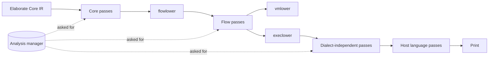
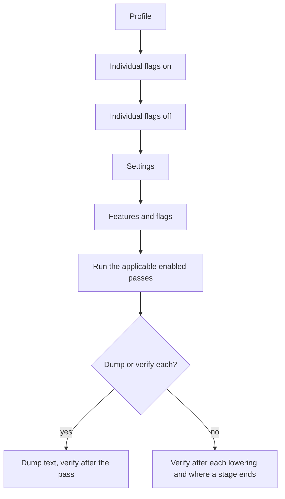

# The Pass Pipeline

> [!WARNING]
> This page describes the target architecture. The code may still differ from it.

The compiler rewrites a grammar on its way to every backend, and it checks the code that the rewrites produce. This page
explains how that work is organized: one pipeline of declared passes, lowerings among them, run by one manager, an
analysis manager that computes and caches what the passes need, a registry that gives each optimization a name, profiles
that choose values for the names, and verifiers and dumps. It is the one place where the pass model is explained. The
rewrites themselves, and why each one is safe, are in [Core IR and Code IR](intermediate-representations.md). The code
generation passes of host languages are in [Code Generation for Host Languages](host-code-generation.md). The decisions
are [record 063](records/063-configurable-optimization-pass-pipeline.md) and
[record 072](records/072-release-package-layout.md).

## Why a Pipeline

Without a structure, every optimization is a function that the compiler calls at the right moment, and the right moment
is knowledge that lives in the calling code: this rewrite needs the first characters of each alternative, that one makes
those facts stale, a third is sound only when the parser reports no events. Three things then go wrong silently.

- A rewrite runs on facts that an earlier rewrite made stale, and the output is wrong or merely slower, and nothing says so.
- An optimization cannot be turned off on its own, so no one can measure what it is worth or bisect a bad output to it.
- A rewrite breaks an invariant of the intermediate representation, and the failure shows up in a printer, far from the cause.

The pipeline moves that knowledge out of the calling code and into declarations that a manager checks.

## Declared Passes

A pass is a value, not just a function. It declares:

- its **name**, which is the name of the dump that shows its result and of the error that names it when it fails. An
  **optional** pass has a flag of the same name, which turns it off. A **required** pass, such as a lowering, has a
  name and no flag: it runs whenever the pipeline reaches it, and no flag or profile turns it off;
- the passes it must **follow**, for passes that share no data and that an analysis would not order;
- when it **applies**: a set of features (budget controls, Documents, tracing and the like). Core IR has no mode, so a
  Core pass that applies to every build declares no feature. A pass that does not apply never runs, whatever its flag
  says;
- its **obligation**, one sentence that says what it preserves: for a rewrite, the input consumed, the expectations
  recorded and the values built stay the same;
- the **analyses it asks for**, and the analyses it **preserves**.

A pass is typed by the IR it takes and the IR it returns: it is a pass from one IR to another, which takes a unit of its
input IR and returns a unit of its output IR with the set of analyses it preserved. A transform keeps its IR; a lowering
returns another IR or another dialect. A compilation is one pipeline, assembled by the driver as a typed composition of
passes: a sequence of transforms on one IR, then a lowering to the next IR, and so on. Because each pass takes the type
its predecessor returns, the Go type checker ensures that every pass receives the IR that the previous pass produced.
The generic manager of the pass infrastructure runs the enabled passes in order, invalidates what each pass did not
preserve, and on request verifies and dumps after each pass. The pipeline holds every step of the compiler in order: the
transforms, the steps that analyses drive, and the lowerings.

The declarations are checked before anything runs: names are non-empty and distinct, every requested analysis has a
key, and every pass named in a follow list precedes the pass that names it. A declaration that cannot be satisfied is an
error of every run, before any pass runs.

## The Pass Model

Transforms run in an explicit list, in order; analyses are computed when they are requested and cached. The model is
generic over the input and output IR of a pass and has four parts.

- **Preserved sets.** A transform declares the set of analyses it keeps. A preserved set **preserves nothing by
  default**: a pass that forgets to declare what it keeps invalidates everything, which costs time but never gives a
  stale answer.
- **Analysis keys.** Each analysis has a key with a name and a run function. Registering a second key with the same name
  is rejected, so two analyses of the same name and different types cannot confuse the cache.
- **The analysis manager.** It computes an analysis when it is asked for, caches the result, and records which analyses
  each analysis used. Invalidating an analysis invalidates the analyses that used it, transitively. An analysis that
  depends on itself is detected and is an error. A failed analysis returns an error; it never degrades silently into a
  weaker answer.
- **The transform interface, the manager and the registry.** A transform declares the name, ordering, obligation and
  applicability of a pass, and runs on a unit, returning the new unit and its preserved set. The manager runs the enabled
  passes, invalidates the cache after each, and verifies and dumps on request. The registry holds the passes and their
  control flags.

A transform returns the unit after it, and a transform that changed nothing returns its input with every analysis
preserved. When to copy is the manager's policy, not the transform's: the passes of one IR that run in a row form a
segment, and before the first of them runs the manager takes one private copy of the unit, which the passes of the
segment change in place. The caller's unit stays as it was until the segment succeeds. A pass that fails, or under
`-verify-each` a result that does not verify, rolls the segment back to its start: the copy is dropped, and only the
required steps go on, with the unit as the segment got it, never with a half-rewritten one. An observer that needs the
unit before each pass (`-verify-each`, `-print-changed`, the check of what a pass preserves, `-opt-bisect-limit`) makes
the manager copy before every pass instead; the result and the rollback are the same. So a normal build pays one copy per segment
and a run that is being diagnosed one per pass. A required step that is not a pass (`flow-finish`) changes the unit in
place, since a lowering or the copy of the segment before it made the unit the run's own; it copies only a unit that is
still the caller's. The returned preserved set is the declaration of what the pass kept: the result inherits those
analyses, and a lowering, which returns another IR, invalidates the whole cache. A copy keeps every analysis, so an
analysis whose result refers to parts of the unit by identity (pointers) cannot be kept as it is: it keys them by an ID
that copies keep (Core IR nodes carry one), or it is computed again.

Passes run one at a time, in the order of the pipeline. A pass that works on one function reads only analyses of the
module that were computed before it runs, and never the body of another function, so what it does to a function depends
only on that function and on facts fixed beforehand.

The attributes on Core nodes (nullability, first sets, effects) are not cached analyses. They are invariants of the IR,
stored on the nodes and checked by the verifier. What the manager caches is derived results that are not written into
the IR: rule facts, site numbers, the call graph, the cost view, lookahead sets, liveness and the control-flow views that
some Flow passes use. The optimization passes, the linter, the complexity classifier and the generators share them, so a
fact has one implementation.

## The Pipeline

The pipeline runs these parts in order. Each part is a sequence of passes; the order within a part is in its
declarations.

- **Core passes** rewrite meaning-preserving forms and compute the facts: guard sets, first sets, effects, rule
  policies, normalization, and turning a value-free repetition of a class into a scan. They are independent of the mode,
  and they are the only passes that work on Core IR.
- **`flowlower`** lowers Core IR to Code IR at the Flow stage, in one uniform shape that the Flow passes then refine.
- **Flow passes** make the control-level decisions, listed below. Their applicability is where the features matter: a
  rewrite is sound for a parser only if the parser does not observe what the rewrite removes. A match form that skips
  charging input applies only when no budget and no Document is in effect, and a form that hides rule entries applies
  only when the parser is not traced.
- **`vmlower`**, for the VM, selects bytecode instructions from the Flow stage, and the pipeline ends there.
- **`execlower`**, for host code generation, converts the Flow stage to the Exec stage completely.
- **Dialect-independent passes** run on the Exec stage, in the `codepass` package. They are described in their own
  section below.
- **Host language passes** legalize and optimize the Exec stage for one host language before it is printed. They are
  described in [Code Generation for Host Languages](host-code-generation.md).

### Lowerings

A lowering is a pass whose result is in another dialect or another IR. It declares its input stage and its output stage,
preserves no analysis, and has a postcondition: the verifier of its output stage, which always runs right after the
lowering, so that an error names the lowering. After `execlower`, for example, no Flow operation remains, which verification at the Exec stage checks because a module at a stage declares only operations of the dialects legal at it. A lowering is
a required pass: it has a name in the registry and the dumps can name it, but no flag or profile turns it off, because
the stages after it need its output. Making it a pass gives it the registry, the dumps and the verification that every
other step of the compiler has, and keeps the order of the whole compilation in one pipeline.

`execlower` works within Code IR, from the Flow stage to the Exec stage of the same module, so it is an ordinary pass of
Code IR that keeps its IR and converts the dialect. `flowlower`, from Core IR to Code IR, and `vmlower`, from Code IR at
the Flow stage to bytecode, change the type of the IR: in the typed composition they are the points where the type
changes.

Each IR has its own analysis manager. A lowering preserves nothing, so the passes after it start with a fresh analysis
manager for its output IR, and after `execlower` no analysis of the Flow stage survives into the Exec stage.

The registry, `-print-after`, `-print-before`, the dumps and verification work on every pass, and the flags on every
optional pass, whatever its types, through a description of the pass that does not depend on them: its name, whether it
is required, and how to dump and verify its output.

The lowerings are packages of their own, outside the IR packages and apart from the passes of each dialect. That
placement says where the code lives; in the pipeline, each lowering runs as a pass.

### Planning the Functions of a Table

Before `flowlower` runs, a planning step in the middle end (the `flowplan` package) decides which functions a rule
table is made of and in which form. The Go generator takes the functions of its Node table and its recognizer from this
plan, and the bytecode VM plans the Node table it runs from Flow IR the same way, so that both run the same functions
and their budget spends can be compared per input.

The Core IR of a Node or recognizer table and the options its functions are lowered with are built by one function of
the same package, which both call: it elaborates the program with or without the projected values of the Node table,
runs the Core passes through the caller's driver, and sets the lowering options from what the parser charges and
records (budget controls, observation, Documents, traced bodies). The VM builds the Node table of a parse with budget
controls at the default optimizations and runs the driver's Flow and Exec passes, the Flow passes for a target of its
own, the bytecode target of the Flow passes, so its functions are those of the generated Go parser with budget controls
in the forms the VM runs. The bytecode target declares what the VM prints beyond the forms of every backend: none of
the forms of the Flow passes. The forms of typed rules do not apply to the Node table, guarded classes apply only to
functions without budget controls, and the VM has no instruction that compares a literal in place, so it matches each
literal as the lowering wrote it. Each form charges what it replaces, so the VM's functions charge what the Go
parser's do.

The plan of a table is computed from the Core IR of the table after its Core passes, the rules of the table (value-free
twins included) as the plan reads them: their definitions, actions and run-time facts, and the rules that the backend
emits. The tests of which rules may run flat or framed are the plan's; a generator that decides a route of its own asks
them too, so every backend lowers the same rules. It holds:

- The functions of the table, in the order a backend lowers them: the body of each rule, then the skip and the lines of
  each Operators Rule. Each function is described by exactly what its lowering takes besides the table's Core IR and
  options: its form, its Core rule and name, and for a framed body the body, its capture slots and whether it builds a
  value. With the Core IR and options of the table, which every function of the table shares, it is the unit that
  `flowlower` lowers. A backend finds the function of a use (a rule body, an Operators Rule skip or line) by its key.
- The route of each rule body. A value-free, lean, plain rule whose body has no cut, recovery, predicate or nesting is
  a **flat** function, with no frame. Any other rule whose Core body can run inside the frame its runtime owns is a
  **framed** body, which builds its value unless the rule is lean. A flat function carries the framed body as its
  fallback.
- The refusal of a flat function, an analysis of its Exec IR after `execlower` and the Exec passes: the function is
  refused when a reachable statement reads its entry position or its context, which a flat function has no
  parameters for, or when a variable holds a value, which a value-free function does not keep. Reachability is the
  printers' (the dead-store analysis of Code IR). A refused function is replaced by its fallback.
- The capture-slot layout of each rule's frame: the names of the Core rule's scope, empty for a rule that runs flat or
  as an Operators Rule. A backend verifies the rows it emits against it: the Go generator the scopes of its rule
  table, and the VM the scope of each rule whose body it runs from Flow IR, whose framed body runs in that frame.

The typed table, the stream body and the TypeScript tables are still decided by their printers.

## The Flow Passes

The Flow passes hold every control-level decision of the Flow stage. Each pass declares its obligation, the property it
preserves, and the analyses it needs and keeps. The table is in the order the pipeline runs them.

| Order | Pass | Obligation (what it preserves) | Main analyses |
|:--|:--|:--|:--|
| 1 | call-specialize | The result, memo records, expectations and events of a call stay the same; under observation the call is kept | Core facts (Plain, Memo, Leader), call graph |
| 2 | inline | The same nodes, values, memo entries and errors at the same positions | Call graph, size |
| 3 | dispatch | The same order of trying alternatives and the same expectation records; guards use only Core facts | Core first sets and guards |
| 4 | match-form | The same input consumed and the same expectations recorded; the charging invariants hold | Features (Budget, Document, Traced) |
| 5 | save-elide | No save that no failure path reads | Core effects, liveness |
| 6 | fail-merge/thread | The same behavior on every reachable path | Reachability |
| 7 | canonicalize | The same behavior; each pattern keeps the behavior of the operations it rewrites | None beyond the operations it matches |
| 8 | charge | The same total charge; every loop iteration charges, input is charged before it is examined, and no charge moves or merges across a write to the observation or to the stream window, a callback of the caller, or a commit | Charge flow |
| 9 | slots | Locals share a slot only when their types are equal and their live ranges do not overlap | Liveness |
| 10 | outline (module) | The same behavior; enabled by the size profile | Structural hashes |

Save-elide narrows each mark to the parts that a failure path reads. A mark that no failure path reads at all is a dead
store, and save-elide removes it through dead-store removal, so dead state has one mechanism.

Marks stay typed locals: a choice restores the same mark before each of its next alternatives, and a loop restores the
mark of its iteration. The verifier checks how marks nest: every use of a mark is dominated by the mark's definition in
the structured body, and the marks of one component are used last in, first out, so no mark is used after a restore to
an older mark of the same component. The preconditions of the operations that take marks, such as truncating the
recovered errors to a mark, resetting the record of missing input or ending the innermost isolation of expectations, are
checked by the verifier, not only stated in their contracts.

The Flow stage stays structured. A pass that needs a control-flow graph asks the analysis manager for a graph view, so
the form that is printed and verified is the structured one. The Flow verifier runs right after `flowlower`, again where
the pipeline leaves the Flow stage, and with `-verify-each` after every Flow pass: it checks the structure, the
variables, one runtime per function, the budget invariants, recorded reads under a Document, and that a traced parse
does not read in place.

## Dialect-Independent Passes of Code IR

The dialect-independent passes are the passes of Code IR that every dialect can run, in the `codepass` package. They
specialize functions for the features of a build, canonicalize, remove dead stores and share identical helpers and
literal tables. They depend only on the reads and writes that each operation declares, so they work for every dialect.
They never see Core IR; the Core passes are the ones that work on Core IR. The host-language passes run after them, on
the Exec stage.

### Canonicalization

One pass of Code IR, `canonicalize`, applies local rewrite patterns until none applies. Each dialect declares the
patterns of its own operations, and the pass runs at both stages: at the Flow stage after fail-merge/thread and before
charge, so that charges are placed in code that is already simplified, and at the Exec stage after specialization for
the features of a build and before dead-store removal, so that what specialization made unreachable is gone before
liveness is computed. A pattern rewrites one operation, or a few adjacent ones, into a simpler form: it folds a
constant, removes code after an exit or splices a block into its parent. Each pattern has a name in the registry, so
`-opt` and `-no-opt` turn it on or off, `-opt-bisect-limit` gives each of its applications a number of its own,
`-print-pipeline` lists it under the pass, and the statistics count its applications. The pass tries the patterns in a
fixed order, so it reaches the same fixed point and the same output on every run. Running the patterns together to a
fixed point lets one rewrite expose the next without another pass in the pipeline, and the names of the patterns keep
each rewrite measurable and bisectable by itself.

Rewrites that are not local patterns, such as specialization for the features of a build, dead-store removal and the
sharing of helpers, stay passes with names of their own. Instruction selection in `vmlower` is a table of local patterns
of the same kind: it is deterministic and counts the matches of each pattern.

## The Registry

An optimization is a **flag** with a name in one registry, the generic registry of the pass infrastructure. Each part of
the pipeline registers its own passes where the part is defined (name, description, default and applicability), and the
controls of printers and libraries are registered with the kind `library` by the code generators that own them. Each
name is declared in one place, and every name differs from the others, so one name selects one pass in the flags and in
the dumps. A flag has a kind, which says what it changes: a pass of the pipeline, a pattern of `canonicalize`, or a
library control (the runtime structures and helpers that the printers emit, such as allocating typed objects in slabs or
sparse memo tables).

A flag is on or off, or it has an integer parameter, where 0 turns it off. The registry checks itself: names and
descriptions exist and are unique, a value is 0 or 1 unless the flag takes a count, and a flag that **changes the output**
(the generated API or the representation of what a parser returns, not only its code and resource use) must be an opt-in
that no profile sets. That rule is the line between two contracts. An optimization that is not marked keeps the results,
the errors and the events of the parser, so it needs a test that the parser with the optimization off behaves the same
as the parser with it on. One that is marked has a contract test of its own, because turning it on is a decision about the
API.

The same names serve three uses: a user turns an optimization off to see what it is worth, a test compares a parser
against the same source with one flag changed, and a reference page names the flag that is the control of a measured
mechanism. A flag is how an optimization becomes something that can be measured by itself, which is why the catalog of
[measured mechanisms](../optimizations/README.md) names the optimization flag that is each mechanism's control.

## Profiles

A profile is only a preset: a name for fixed values of flags. A user chooses it through the public type `Optimize` of
`pkg/compiler`, whose profiles are `Speed`, `Memory` and `Size`, with overrides of flags. The option `WithOptimize`
gives the setting to a call, and the same setting applies to every backend: the closure backend, the VM and the
generators. The table from profile names to values is in the driver, which resolves the setting once and passes it to
the pipeline.

| Profile | For | Differs from the default by |
|:--|:--|:--|
| `speed` | the fastest parse that does not cost generated code or memory out of proportion; the default | nothing: the registry's own defaults are the speed values |
| `memory` | fewer bytes allocated and less live heap | typed objects and lists are not allocated in slabs |
| `size` | smaller generated source and binaries | literals are not compared in place; classes of five ranges or more match through a table |

A profile is kept only if it earns its place by a rule of measurement
([optimization 136](../optimizations/136-measured-effect-of-the-generation-flags.md)): it must improve the metric it is
named for by a margin beyond the noise of an identical copy on most of the language grammars, cost little parse time
overall and slow no grammar by much. That is why there are three profiles and not one per flag.

The settings of a generation are layered in a fixed order, so that each layer has one job: the profile sets the values,
then the individual flags turn on or set values, then the individual flags turn off. The later layer wins, so a profile
with one flag set differently is a valid setting, and a name that no flag has is an error that lists the valid names.

## Verification and Dumps

Each stage has a verifier: for Core IR, the checks listed in
[What the Verifier Guarantees](intermediate-representations.md#what-the-verifier-guarantees); for the Flow stage, the
structure, the variables, one runtime per function, the budget invariants, recorded reads under a Document and no
in-place reads in a traced parse; for the Exec stage, among its checks, that no Flow operation remains. The verifier of
a lowering's output stage is its postcondition, and it always runs right after the lowering, so an error names the
lowering. The other runs of the verifiers are where the pipeline leaves a stage. That tells a user that a transform
broke something, and not which one, so a run can verify after **every** transform, with `-verify-each`: the error then
names the first pass that left the module invalid. Under `-verify-each` the pipeline also checks what each transform
claims to preserve: a pass that declares that it preserves every analysis must leave the text form of the unit
unchanged, and the pipeline reports a pass that changed it, because the analyses it kept would then be stale. Tests and
diagnosis ask for this; it costs compile time and changes no output.

A run can also **dump** the module as text after a step or after a pass. The `-print-after` flag of the gen command
takes the names of steps and passes, and `all` for every step and pass, and prints to standard error. The required steps
are `elaborate`, `flowlower`, `flow-finish` and `execlower`; each dump is named after the step that produced it. A dump of
the Flow or Exec stage prints each function as a listing of Code IR. A pass that did not apply prints nothing, which is
itself information: the dump is the way to see why an optimization did not happen for a parser.

## Controlling Passes

The passes are controlled by the gen command, which takes flags that set which optional passes run and what is
observed, and a Go program gives the same settings to the compiler package. The command builds the same settings that a
Go program gives, and the driver reads only those, so the command line and the Go API cannot drift apart.

### Choosing Optimizations

- `-optimize` chooses the profile: `speed`, `memory` or `size`.
- `-opt` takes a list of names separated by commas and is applied after the profile: a name alone turns on a flag that
  the profile leaves off, a name with `=0` turns it off, and a name with `=N` sets a flag that takes a count to N.
- `-no-opt` takes a list of names and turns them off after `-opt` is applied, to isolate a miscompilation or to measure
  one optimization.

These flags name the optional entries of the registry: the optional passes and the library controls. A required pass,
and every lowering is one, cannot be turned on or off: naming it in `-opt` or `-no-opt`, or in an override of the Go
setting, is an error. In Go, the setting is a value of `Optimize`, given with `WithOptimize`: a profile and the
overrides of individual flags.

### Observing the Pipeline

- `-print-after` takes step names, pass names and `all`, and dumps the module after each, as described above.
- `-print-before` takes pass names and `all`, and dumps the module that each named pass receives.
- `-verify-each` runs the verifier after every transform, so that an error names the first pass that left the module
  invalid, and reports a pass that claims to preserve everything but changed the text form of the unit.
- `-print-changed` dumps the module after each pass that changed it, and nothing after a pass that left it as it was.
- `-print-pipeline` prints the pipeline that the driver assembled for the build, as the names of its passes in order,
  with the required passes marked and the patterns of `canonicalize` listed under it.
- `-stats` prints, after the build, the counters of each pass: what it rewrote, and for `canonicalize` and instruction
  selection the applications of each pattern. The counters are summed over the units and printed in a fixed order.
- `-time-passes` prints the time each pass took, summed over the units it ran on.

These settings do not change the parser that is built, so they are not part of `Optimize`. In Go they are a value of
`Debug`, given with `WithDebug`. Eight of its fields mirror the flags one to one: the passes to print before
(`-print-before`) and after (`-print-after`), printing after a change (`-print-changed`), verification after each
transform (`-verify-each`), printing the pipeline (`-print-pipeline`), the statistics (`-stats`), the timing
(`-time-passes`) and the bisection limit (`-opt-bisect-limit`). The ninth, the writer the output goes to, has no flag:
the command writes to standard error. A test and the command line therefore see the same pipeline and the same dumps.

### Bisecting Passes

`-opt-bisect-limit N` numbers the runs of optional passes in the order the pipeline makes them, runs those numbered up
to N and skips the later ones. A run is one pass on one unit, so a pass that runs per function counts once for each
function. A run of `canonicalize` on a unit takes one number like every pass, and each application of one of its
patterns takes a number of its own, so that skipping a number skips that one application. Required passes always run, so
the output stays a valid parser whatever N is. Each decision is reported with its number, the name of the pass, the unit
and whether the pass ran. In Go, the limit is the bisection field of `Debug`. A differential test against the closure
reference parser can then search for the smallest N at which the generated parser differs from the reference, and that
run names the pass, and the unit, that introduced the difference.

### Textual Pipelines

For development, a pipeline can also be given as a text that names its passes in order. The text can reorder optional
passes or repeat them. The driver checks it as it checks a pipeline it assembles: each pass takes the IR that the
previous one returns, the ordering that the passes declare holds, and every required pass is in its place. An invalid
pipeline is an error before any pass runs. Internal test support uses the textual form to test a pass in a chosen
context; it belongs to neither the public API nor the public command line.

## Related Topics

- [Core IR and Code IR](intermediate-representations.md): the representations the passes work on and the rewrites.
- [Architecture](architecture.md): the overview and the driver flow.
- [Code Generation for Host Languages](host-code-generation.md): the host-language passes, the runtime library and the
  registry's library controls.
- [Record 063](records/063-configurable-optimization-pass-pipeline.md): the decision, the alternatives and the status.
- [Code Generation](../guide/code-generation.md#optimizations): the flags of the generator, with their defaults.
- [Optimization catalog](../optimizations/README.md): the measured mechanisms and their controls.
