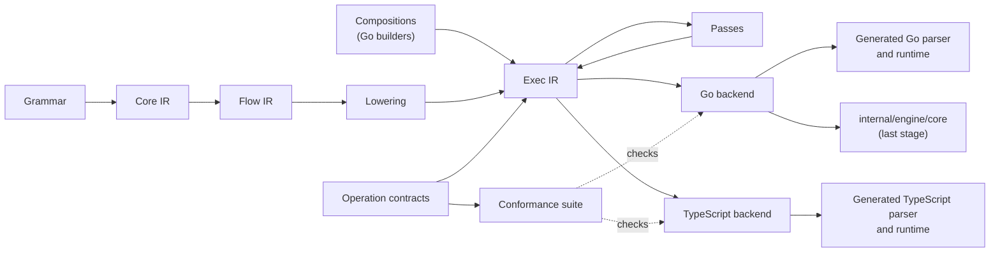

# 065. Exec IR: One Parser VM Specified for Every Target

- **Status**: Implemented, as [Completion](#completion) defines it
- **Author**: @ornew
- **Date**: 2026-10-31

The [Exec IR specification](../../../spec/exec-ir/README.md) defines the parser VM, its operations and
compositions as they stand; this record keeps the decision, the measurements and the rollout.

## Summary

The algorithmic core of a ZeroParse parse — memoization, left-recursion growth, expected-set merging, recovery bookkeeping,
the variable environment, budget charges, stream commitment, Document reuse and the Operators Rule loop — is written
once per runtime: in the engine (`internal/engine/core`, shared by the closure backend and both bytecode VMs), twice in
the generated Go runtime (the node `Parser` in `runtime/runtime.go` and the typed `TParser` in `runtime/typed.go`), and
in the TypeScript runtime (`internal/gen/tsgen/tsrt/runtime.ts`). A fix to one of these mechanisms is a fix to up to four
copies, and the copies already differ in algorithm where they should only differ in host.

This design specifies the **parser VM** once. **Exec IR** (`internal/ir/exec`) is that specification: it declares the
operations a parser VM provides — memo lookup and store, seeding a left-recursion growth, entering and leaving a
lookahead, merging expected sets, recovery bookkeeping, binding variables, charging the budget, committing a stream,
validating a reused Document result — each with a behavior contract over an abstract parser state, and it composes
them into the parse: the call protocol, the growth loop, the Operators Rule loop, and the grammar code lowered from
Flow IR ([record 062](062-backend-independent-optimization-ir.md)). An operation states what happens, not how; each
target backend implements every operation in its own language and optimizes it freely for that language, and a
conformance suite per operation, which every implementation must pass, is what makes that freedom safe.

Shared across targets: the contract of each operation, the composition of operations, the passes on Exec IR, and the
conformance suite. Chosen per target: the representation of the parser state, the implementation of each operation,
and how the composition is printed.

Flow IR is lowered into Exec IR from the start, so each language has one backend that prints grammar code and the
runtime alike. Compositions are written with Go builder functions. Migration starts with a pilot of memoization and
left-recursion growth on generated Go (node and typed) and TypeScript, and every stage, the pilot included, applies
the same performance gates to grammar code as to the runtime.

## Motivation

The evidence below was measured at commit `2d59b30d`. The repository history starts on 2026-10-07, so the window
covers 2026-10-07 to 2026-10-30: 1,263 commits.

### Four Copies of One Core

The engine's closure backend and both VMs already share one core: they drive `CallBegin`, `CallEnd`, `GrowBegin`,
`GrowStep` and `GrowEnd` in `internal/engine/core/runtime.go`. The generated runtimes do not use it. The generated Go
runtime has one copy for node results and one for typed results, and the TypeScript runtime a fourth.
[Appendix A](#appendix-a-inventory) lists every mechanism with its files, functions and sizes. In approximate lines:

| Mechanism | Engine | Go node | Go typed | TypeScript |
|:--|--:|--:|--:|--:|
| Memoization, deferred memoization and the call protocol | 520 | 580 | 300 | 330 |
| Left-recursion growth | 80 | 30 | 25 | 30 |
| Expected-set merging | 85 | 215 | 30 | 155 |
| Operators Rule loop | 340 | 260 | 255 | 310 |
| Variable environment | 90 | 145 | 40 | 85 |
| Budget charges | 1,800 | 1,410 (shared) | — | 500 |
| Stream commitment | 350 | 180 | — | none |
| Document reuse | 540 | 200 | 250 | none |

On top of the copies per runtime, each runtime keeps hand-written variants per mode: the generated Go runtime has 72
functions suffixed `Ordinary`, `Controlled`, `Spend` or `Budget`, and the TypeScript runtime 28 `…Spend` functions,
that repeat a body with or without budget charges.

### Changes Paid Several Times

Of the 1,263 commits, 79 touched the non-test sources of two or more of the four copies (the engine runtime files
under their former and current paths, `runtime/` or its former `internal/engine/genrt/`, and the TypeScript runtime
under its former and current paths; the copy in `gen/_runtime` is mechanical and not counted). Classified by hand:

| Kind | Commits | Examples |
|:--|--:|:--|
| Core mechanism semantics or cost | 22 | the left-recursion guard keyed by rule and position; reuse of results with recovered errors only in the same context; adaptive memo counter overflow; sparse seen pages; one work budget; memo growth charged by demand; Pratt nesting and committed prefixes; bounded binding histories |
| Term evaluation and the value model | 35 | named node types, tuple literals, variable binding checks, `concat` fusion |
| Host-specific (input, output, API) | 9 | case-insensitive literals, JSON ranges, start rule selection |
| Renames, moves and cleanup | 12 | moving the generated runtime into a package; budget naming |
| Initial import | 1 | |

Of the 22 core commits, 8 touched all four copies, 7 touched three, and 7 touched two. The core commits by mechanism
(a commit may count under two): budget 8, memoization 7, Operators Rule 3, expected sets 2, environment 2, left
recursion 1, recovery 1, stream 1, rule completion 1, depth 1. 47 of the 79 commits edited both the node and the
typed Go copy.

The copies also drift where no test observes it. In a Document, the engine moves an entry and its nodes in place when
a parse reuses it, and records and resumes the runs of repetitions; the generated Go runtime applies each edit to the
memo at once, copies the nodes of a moved result and resumes no repetition, so the two can reuse different results
after the same edit. Both keep a result that read the growing seed of a left recursion out of the memo, in the tables
of its context, so neither needs to track such results in a Document.

### The Mechanisms Are Host-Neutral

Most of the core is integer and pointer work over the parser's own structures: position-indexed slot arrays, chained
memo entries, bit pages, counters, persistent environment lists and a stack of expectation identifiers. It touches
the host only to read input, to compare and build values, to report events and to check cancellation. That boundary
already exists in each copy; it is not written down.

## Goals

- Each core mechanism has one specification and one composition, shared by every runtime that needs it: generated Go
  (node and typed), generated TypeScript and, in the last stage, the engine.
- Each target implements the operations in the form that is fastest for its language, and a change of
  representation in one target needs no change in any other.
- Every operation implementation passes the same conformance suite, so that a target cannot drift from the contract
  without a failing test.
- Every parse returns byte-identical results to today on every target: values, JSON output, errors, expected sets,
  recovered errors, positions in both units, budget counts (`budget.golden`), and trace and profile event streams.
  Document statistics change only where a stage unifies an algorithm and states the change.
- No stage changes parse time, allocations, generated size or generation time beyond measurement noise, for grammar
  code and runtime alike, measured per target as in [Performance Acceptance](#performance-acceptance).
- Printed code is readable, formatted, commented, deterministic and checked in, so that it can be debugged, profiled
  and reviewed as hand-written code is.
- A new target language needs one backend — its operation library, its printer and its host code — not a new core.

## Non-Goals

- Changing Core IR or Flow IR. Flow IR gains a lowering into Exec IR; the decisions that lowering from Core IR
  makes stay where they are.
- Changing the grammar language, the public API, the bytecode instruction set or the specification of any mechanism.
- Adding Document or stream parsing to TypeScript. A shared composition makes it cheaper; whether to add it is a
  separate product decision.
- A textual Exec IR syntax, an editor ecosystem or a serialized or public Exec IR. Builders come first; a text form is
  an extension that this design leaves room for.
- A second bytecode VM in another language ([The Engine and a Second VM](#the-engine-and-a-second-vm)).

## Design

### Three Levels

| | Core IR | Flow IR | Exec IR |
|:--|:--|:--|:--|
| Question it answers | What does this rule mean? | How does a parser run this rule? | Which operations of the parser VM run, in what order, and what does each do? |
| Written by | The Core IR builder, from the grammar | Lowering, from Core IR | Lowering, from Flow IR; compositions written with Go builders |
| Content | Parsing expressions with effects | Variables, registers, structured blocks, parse primitives | Operations with contracts over an abstract parser state, and their composition |
| Optimized by | Grammar rewrites | Lowering decides save and restore, charges and mode; no passes | Feature specialization, constant folding, dead-store analysis |
| Turned into code by | — | — | One backend per target language |

The names say what each level holds. Core IR is the core language of a grammar: what remains of its meaning once the
surface syntax is gone. Flow IR is the control flow of a parse. Exec IR is the executable form: the operations of a
parser VM and the program that drives them. Its package is `internal/ir/exec`, beside `internal/ir/core` and
`internal/ir/flow`.

[Record 062](062-backend-independent-optimization-ir.md) keeps runtime algorithms out of Core IR and Flow IR: Flow IR
calls them as runtime services (`CallRule`, `Isolate`, `MergeExpected`, `StreamStart`) and rejected a third level
without passes of its own. Exec IR keeps that boundary for Flow IR and gives those services a home with passes of
their own: a Flow IR primitive lowers into a call of a transitional operation that holds the primitive
([Lowering From Flow IR](../../../spec/exec-ir/lowering.md)), and a mechanism moves from such an operation into a
composition, where its algorithm is written once, as it migrates. The [specification](../../../spec/exec-ir/README.md)
owns what the levels contain; the [intermediate representations](../intermediate-representations.md) page
explains how they fit together.

### The Parser VM

A **parser VM** is the abstract machine that runs a parse. It is not the bytecode VM: the bytecode VMs, the closure
backend and every generated parser are hosts of the same parser VM. Exec IR specifies it in three parts, which
[The Parser VM](../../../spec/exec-ir/machine.md) and [Functions](../../../spec/exec-ir/functions.md) define:

- **Abstract state**: a few scalar registers and state components such as the memo table, the expectation
  record, the variable environment and the budget. The state is abstract: a contract talks about it, a target
  chooses how to represent it.
- **Operations**: each a transition of the abstract state with a signature, a behavior contract, a
  precondition that its callers guarantee, the state it reads and writes, a cost bound, the features it belongs
  to and laws that passes may use. Behavior outside the precondition is unspecified, and conformance never
  exercises it: two implementations may differ on states that no composition reaches. Handles that operations
  return are opaque, and only operations look inside.
- **Functions**: structured code over the operations, with no `goto` and no exception; a fatal condition is an
  operation that does not return, and a protected region runs its cleanup however its body ends, which a
  target prints as its unwinding cleanup (a deferred call in Go, `try`/`finally` in TypeScript). Locals are
  scalars and handles, and functions have no records, arrays or maps: data structures live inside operations,
  where targets choose them.

The host is what touches a value, an input encoding, the user or the platform: input decoding, value and node
construction, value equality, error text, readers, edits and snapshots, cancellation, tracing sinks and the public
API. Host operations are declared in Exec IR with typed signatures and implemented once per target; values and
nodes are opaque to the parser VM.

### The Operation Boundary

The boundary decides whether the design pays off. With operations too coarse, an operation hides a policy — whether
a memo result may be reused, when growth stops — and every target re-implements that policy: four copies again,
behind a shared name. With operations too fine, an operation is a step of a data structure — set bit `k` of page
`p` — and Exec IR becomes Go-like code that fixes one representation and leaves nothing for a target to optimize.

An operation is placed by four rules.

1. **No parse decision inside.** An operation never chooses between outcomes of the parse: reusing or recomputing,
   growing or stopping, which error or expectation survives. Those choices read operation results and entry
   attributes in a composition, which is written once.
2. **Complete contract.** Everything an operation does that can be observed — its results, the abstract state
   afterwards, the statistics it counts, and its cost — follows from its contract, so that a test can check it
   without knowing the implementation.
3. **Representation stops the split.** An operation is not divided further once the parts would only make sense for
   one data structure. Its implementation is where a target picks slot arrays or hash maps, slabs or the garbage
   collector, the word size of a bit page, a membership filter.
4. **No re-entry.** An operation does not run grammar code. Where a mechanism must run a rule body in the middle — a
   memoized call, a growth step — it is a composition, or a begin and an end operation around the body. The
   transitional operations that invoke a rule's body, a line of an Operators Rule or a term are the exception
   until their mechanism is a composition; their contracts say so ([Operations](../../../spec/exec-ir/machine.md#operations)).

The measured history supports these rules. Each of the 22 core commits of [Changes Paid Several
Times](#changes-paid-several-times) is placed below by the part of this design it would change (classified by hand
from the commits' subjects and the mechanisms they touched; the placement is approximate):

| Change lands in | Commits | Examples | Cost under this design |
|:--|--:|:--|:--|
| A composition | 11 | the left-recursion guard keyed by rule and position; reuse of results with recovered errors only in the same context; Pratt nesting, committed prefixes and empty applications; default budgets and the input limit at parse entry; splicing hidden rules into their caller; the iterative VM's plain call path | One edit, printed for every target |
| A pass | 1 | splitting the budget-controlled bodies off the helpers | Done by feature specialization; no hand edit |
| An operation contract | 6 | one work budget; memo growth charged by demand; bounded binding histories; adaptive memo counter overflow; charges of a CodePoints preparation | One contract and conformance edit, and one implementation edit per target, each checked by the suite |
| One target's representation | 3 | sparse seen pages; a membership filter before exact expectation scans; a shared memo key where no variable is defined | Optional per target; no shared change |
| Several parts | 1 | cancellable parsing and work limits | Contract, composition and implementations |

Under this boundary 12 of the 22 changes become a single edit or none, and 3 need no cross-target work at all. The 6 contract
changes still touch every target, but each is a small, specified change guarded by the conformance suite instead of
a re-derivation of an algorithm.

### Operations

[Operations](../../../spec/exec-ir/operations.md) and [Values](../../../spec/exec-ir/values.md) of the
specification declare every operation with its contract, state, cost bound and kind. This section keeps, for each
group, what the design shares across targets, what a target chooses and how the group is checked; costs follow
[Cost Contracts](#cost-contracts). An operation is one of three kinds: an operation with a reference model and
conformance cases, a host operation whose effect lies outside the parser VM's state, and a transitional
operation that stands for a runtime function until its mechanism is a composition. A group is under
conformance only where the specification declares its operations of the first kind.

**Input.** Reading the input is not an operation of Exec IR. Peeking, matching and advancing are primitives of
Flow IR, which lower to transitional operations that each target implements over its own input
representation, and the examined bound of a Document is kept by the operations of the call bookkeeping. *Shared*:
the meaning of positions in both units, by the runtime specification. *Target*: decoding, buffers, fast paths
for ASCII or decoded code points, literal matching by machine word.

**Memo table and deferred memoization.** The operations that look up, store, prune and splice entries are under
conformance with a reference model of the memo, with random sequences of stores, lookups and prunes and storage
charges that do not depend on storage left by an earlier parse, as
[Cancellation and Budget Limits](../../../spec/runtime/parsing.md#cancellation-and-compute-limits) requires.
The memo holds only results that read no growing seed, so a lookup is exact on every target. A rule that only a
Document memoizes is looked up by identity of the key's values over a bounded part of the chain, a miss that is
always sound. *Shared*: keys, the entry attributes, which entry a lookup returns, the storage charge. *Target*:
slot arrays or maps, chaining, slab allocation and free lists, entry layout and packing. The adaptive policy of
deferred memoization (per-rule counters and the switch to eager memoization) is part of its contract, because
it decides how many bodies run, which `Evaluated` reports; *shared*: the policy and its thresholds; *target*:
dense or sparse pages, word size, counter width.

**Left-recursion contexts and growth.** The dependency memo of
[Evaluations of Rules](../../../spec/runtime/parsing.md#evaluations-of-rules) has a reference model of its state:
the growths in progress, each the key of a leader at a position with its cycle, its leader bit, its seed and the
seed's identity; a stack of dependency frames, which record the seeds that an evaluation read, by identity, the
lookaheads it observed, by outcome, and the seeds those lookaheads read (their shadows), which a frame that
cannot check an observation depends on instead; and a table for the first growth of a cycle at a position. For
each head (the rule, level and present set of a call, or the site and present set of a lookahead) the table holds
dependency sets in the order of their first store, each mapping the values of its dependencies to results. A
reuse takes the first set whose dependencies all have values in the current context and, in it, the result of
equal key values; a store of the same values and key replaces the result, and a result with more dependencies
than a set indexes is not kept. The `ctx` operations have this model and conformance cases that run on the engine
and generated Go. The cases do not run the growth loop: operations that exist only for conformance install a
growth with a seed and identity that the case chooses, change the seed of the innermost growth, end it (dropping
the table it began), and begin and end a lookahead through each target's own lookahead entry points, so that the
`ctx` operations are checked apart from how growth steps compute identities. An operation that writes components
other than its own (`ctx.replay`, later `grow.step` and `grow.end`) is modelled as the composition of those
components' models that its contract names: the reuse count and examined input of the call bookkeeping, the merge
of the expectations, the position and the recovered-error entry; it charges what those parts charge, and it stops
being transitional only once every component it writes has a model. The growth loop (the steps, jumps and runs of a
growth in a context, and the canonical identities of equal seeds) builds on the same state and stays transitional
until it has a model of its own; the missing-token mode, in which no result in a context is memoized, is outside
the cases. *Shared*: what a result depends on and when it is reused, the seed identities, the present sets, the
order of the dependency sets. *Target*: table layout, keys and hashing, allocation of results, the width of the
present sets. The differential tests against the engine on random cycle grammars, with negative controls that
break each check, and the linearity tests of the growth shapes remain the checks of the whole.

**Expectations.** The expectation record is an insertion-ordered set of expectation identifiers at the farthest
position. Recording an expectation, keeping a set (which reuses the set kept last when it holds the same
expectations) and merging a set at a position are compositions over the operations of the record. `isolate` and
`unisolate` stay operations because what they save and restore is the layout of the record, which differs by
target. The operations of the record are declared transitional; their observable contract is the farthest
position and the exact order of the set, which error messages expose. A reference model states it, with
conformance cases (handwritten, randomized and a negative control of broken models) that run on the engine
and the generated Go runtime through bindings that each target's printer prints from the operations, so
that the suite runs the code the compositions run. A set that `unisolate` returns may stay where the record
grows next, so the model allows reading an entry of it only until a write reaches that entry's place, which
merging the set entry by entry respects. *Target*: membership filters, stack layout, where kept sets live
and how their memory is accounted.

**Examined input.** In a Document parse the active rule call examines a range of the input, which a call starts at its
position, widens as it reads and merges into the enclosing call's range when it ends; the operations `doc.enter`,
`doc.leave`, `doc.touch`, `doc.touchFrom`, `doc.low`, `doc.high`, the observed form `doc.examinedBegin` and
`doc.examinedEnd`, and the counts `doc.reused` and `doc.evaluated` are operations of the call bookkeeping with a
reference model and conformance cases that run on generated Go and the engine (which does not observe calls, so
the observed form runs on generated Go only). A parse that reads no Document keeps no range. A target may start the
range of a call as the empty range at its position or as one unit, which the suite states as a configuration of
the model. *Target*: where the range lives and how the Document counts.

**Operators Rule descriptors and matches.** The operators, operand lines and trivia of an Operators Rule (`opr.led`,
`opr.prefix`, `opr.count`, `opr.at`, `opr.operands`, `opr.operand`, `opr.line`, `opr.level`, `opr.infix`, `opr.postfix`,
`opr.right`, `opr.nonAssoc`, `opr.scope`, `opr.hasSkip`), the match of an operator (`opr.attempt`, `opr.found`, `opr.op`,
`opr.end`, `opr.cut`, `opr.env`, `opr.errs`), the two flags of the loop (`opr.setCutFailed` and
`opr.setNudBound`, each with its getter) and the records of the split forms (`oprLongest`, `oprNud`, `oprExpr`, a getter and a
setter for each field, a field holding the zero value of its type until it is set) have a reference model, with
conformance cases that run on the engine and, for all but the records, on generated Go. A harness that reaches
the targets' printed bindings by reflection serves both. The operations that run grammar code or build values
(`opr.skip`, `opr.match`, the value of a line, `opr.build`, `opr.buildTyped`, `opr.attemptMissing`, `opr.replay`) stay
transitional until the scripted-rule model covers them. *Target*: the representation of lists, lines and attempts.

**Recovery.** The recovered errors are an ordered list with marks, and immutable lists that entries share, so that
a replay costs a constant however many errors it brings back and listing k errors visits fewer than 2k lists
([Lemma 14](../../../spec/proofs/linear-cost.md#lemma-14-shared-recovered-errors)). No list moves: a memo entry
that holds recovered errors stops being valid where an edit would move it. The operations are under
conformance, with the identity of each error and of each list compared after every write, on generated Go and
the engine; TypeScript stays on its parity tests. The missing-token operations of the engine are
transitional. *Target*: the representation of entries and lists, the scratch a stream keeps, and where the sites
that make an error record it: grammar code and the recovery of each engine write the push in their own language.

**Variable environment.** A persistent environment: a binding makes a new environment that shares what it can,
and an equal binding keeps the environment it is, so that what depends on its identity stays valid. The
operations are under conformance, with nested scopes, shadowing, vectors of one and of several levels and keys
of equal and unequal values, on generated Go and the engine; TypeScript stays on its parity tests. *Shared*:
scoping, equal bindings, key equality by the host's value equality. *Target*: the representation of the
environment, and a key shared for the initial environment.

**Terms.** Evaluating a term stays a transitional operation of each runtime, since it reads the value model;
what surrounds it, the predicate and the binding, is one composition on every runtime. On either, a term that
fails is an ordinary failure of the expression: what it gathered and created is dropped, and the parse goes on to
its next alternative. The operators, member reads and built-in functions of terms are compositions over value
operations ([Values](../../../spec/exec-ir/values.md)), with tables that every target shares and runs on fixed
fixtures. On generated Go and TypeScript, a term made of constants, captures, locals, variables, operators, member reads, `len`,
`text`, conversions and casts is lowered from Core IR to a function of Exec IR that calls those compositions,
which the Go runtime exports for generated parsers and the TypeScript runtime has as methods of its parser; terms with constructors, tuples, list built-ins or lambdas are
not yet written on them.

**Capture frames.** Slots of a rule body or a line, and a trail of writes that a backtracking point undoes. A mark
is the position, the environment, the recovered errors and the length of the trail; what a reset restores from it
is the composition `reset`. The operations are transitional, and a static test follows their charges. *Target*:
the representation of a mark (a struct in Go, four numbers in TypeScript), pooling and scratch reuse, and, until the
charges below settle it, whether opening a frame charges for its slots (see [Cost Contracts](#cost-contracts)).

**Budget, nesting and observation.** Charging adds to the one work budget, checks the limit and, at intervals the
target chooses, cancellation through a host operation; it does not return when the parse is interrupted, and charges
are never rolled back. The nesting limit is fatal when exceeded. Observation reports go to a host sink. The
silent depth is a register that functions assign, not an operation. *Shared*: when a charge interrupts and when
each event reports. *Target*: counter representation, the cancellation interval and the sink.

**Stream window.** A commit is the composition `streamCommit`: it makes everything before a position final.
Discarding input, releasing the scratch and the node memory of the delivered elements, and dropping the records
below the floor are host operations of the window, and pruning the memo is the specified `memo.prune`, under
conformance together with the floor of the memo. The position the parse needs, which the default budget of a
stream follows ([Streaming](../../../spec/runtime/streaming.md)), is reported by the input reader. *Shared*: what a
commit releases and finalizes, and when it prunes. *Target*: buffers and the representation of the pruned memo.

**Counting in a region of Document work.** The memo operations of a rule that a parse from scratch memoizes too run
in a region of Document work, where the steps of a walk along the chain and the growth of the table are not counted
against the default limit. The charges that a parse from scratch makes for the same lookup are lifted out of the
region and counted: the hash of the key, and its comparison with each entry of this parse that the walk compares it
with. The comparison with an entry of an earlier text is Document work: a parse from scratch has no such entry.

**Document reuse.** A call records with its entry the input it examined, and an edit is applied by `memo.splice`: an
entry that examined only input before the edit stays, one that examined only input after it moves by the change
unless it is pinned or holds recovered errors, and every other entry goes. The value of a moved entry moves when
the entry is reused, through `doc.move`, a host operation because the positions in a value lie outside the parser
VM's state; the target may refuse a value it cannot move, and the call evaluates the rule again. Which entry is
reused stays in the composition. A target may apply `splice` lazily: the engine logs the edit, decides the entries
at the replaced positions at once, and applies the log to any other entry when a lookup finds it, through the
composition `memoAdvance`; an entry that lags behind more than a limit of edits is a miss, so a target drops it
where it meets it, which bounds the comparisons with the entries of earlier texts by the work of that window of
edits. The cost bounds state the extra work of such a target alone (pending edits and a key scan over the
entries it still holds), so the bounds of the generated runtimes are those of an eager memo. The repetition runs
are host operations of the engine: a backend drives a run and evaluates its elements between its begin and end,
and charges its own steps, and no composition calls them, so the backends need no split form. *Shared*: which
entries stay, move or go, and the positions after a move. *Target*: tables rebuilt or relinked at an edit, side
tables of pending moves, copying or moving nodes in place, and repetition runs. *Conformance*: the memo operations
under random edits on both Go runtimes and on the engine's Document memo, and the Document differential tests,
which compare every result after an edit with a parse from scratch. Runs and moves have no reference model; tests
of the engine measure their charges.

The Operators Rule loop has no operation of its own: the longest operator match, the loop, binding powers, prefix
commitment and the application order are composition, which is where all three of its core changes landed. The
operations it calls read the rule's descriptors, run the grammar code of a line, make the values of lines and
applications as host primitives and hold a match of an operator. Term evaluation and the value model join in a
second wave ([Decisions](#decisions)).

### Compositions

The [compositions](../../../spec/exec-ir/compositions.md) are the algorithms that the copies re-implemented: the
call protocol (deferred memoization, memo lookup and the reuse conditions, store, restore on failure, nesting and
statistics), left-recursion growth, rule completion, Document calls, the expectation record, the Operators Rule
loop, stream delivery and commitment points and parse entry. The specification lists them with the feature sets
that each runtime prints.

A rule body lowered from Flow IR calls the same operations through the transitional operations that hold its
primitives. A composition that must suspend while a rule body runs, as the iterative VM needs, is also written as a begin, step and end split over a
small state record, from the same builder functions as the whole composition: the generated runtimes print the
whole call, the engine the split forms.

### Cost Contracts

A charge sits either in a composition or inside an operation. A charge in a composition — one per call, per growth
step, per loop iteration, per operator or operand line an Operators Rule tries, per expectation compared or merged —
is a `budget.charge` of the composition, shared and exact on every target; a form specialized without the budget
feature leaves it out.
A charge inside an operation pays for work whose size depends on the operation's data: scanning an expectation
record, growing the memo, inspecting input. The rule settles what an operation of constant work charges: nothing,
because the call or the step around it has paid. By it, an empty memo key costs nothing, a key costs one unit for
each value it reads and each node on the path to that value, a capture write costs nothing where `frame.undo` costs
one unit for each write it undoes, and forgetting the values of a term costs one unit for each value. Four charges
do not follow the rule yet, and the targets differ on them until they are settled:

- `frame.open` charges one unit for each slot in TypeScript, and nothing in Go and the engine, within its bound
  of one unit per slot;
- `env.bind` charges one constant unit for reading the old value, where `env.lookup` charges one unit for each of
  the levels+1 nodes of the same walk;
- forgetting the nodes that an action created is free in generated Go and costs one unit for each node in the
  engine;
- dropping gathered values (`flow.DropKids` of Flow IR) is free in generated Go and TypeScript and costs one unit
  for each value in the engine.

The specification already lets budget counts depend on the backend and
the generated artifact as long as they are deterministic ([Cancellation and Budget
Limits](../../../spec/runtime/parsing.md#cancellation-and-compute-limits)), and the targets already differ here:
generated Go charges an expectation scan only after its membership filter matches, TypeScript charges every element
it scans. An operation's cost contract is therefore a deterministic count per target within a declared bound
([Decisions](#decisions)).

A bound is a constant plus a sum of terms, each a positive coefficient times an abstract quantity that the reference
model of the component defines ([Costs](../../../spec/exec-ir/machine.md#costs) lists them). A bound is the worst
case over the representations a target may choose: deferred memoization is bounded both by the regions a sparse
record allocates and by the size of a dense record of calls in position order. An operation that copies a set or a
list declares the copy in its bound. A transitional or host operation that charges declares a bound too, with no
reference model to measure it against; a test instead follows the static calls of the Go runtime from each such
operation and requires a quantity of its bound for every charge it can reach, so that a charge added to the
runtime is accounted for when it is added. The operations that run a rule body or a term declare none: what they
charge includes the grammar code or the term they run, which no bound of theirs can state.

Charges inside an operation spend the same budget that `budget.charge` and `budget.used` see. The conformance suite
measures what an implementation charges in each call, checks it against the bound and adds it to the model's budget;
an implementation may end the parse with a limit interruption inside an operation only when charges within the
bound could exceed the limit.

### Authoring

Compositions, operation declarations and conformance cases are written with Go builder functions in
`internal/ir/exec`. A builder returns Exec IR that the verifier checks against the
[invariants](../../../spec/exec-ir/invariants.md). The IR has a text form for tests, golden files and error
messages ([Text Form](../../../spec/exec-ir/text-form.md)), which nothing parses, and an interpreter that runs a
function against a machine of operations, which is how Go runs conformance cases until a backend prints them. A
textual syntax, parsed by a ZeroParse grammar, can be added later without changing the IR.

### Passes

Exec IR passes know operations by their declarations, not by name. The
[specification](../../../spec/exec-ir/passes.md) defines the passes that exist: **specialization** (features are
constants; a function specialized for a set of them folds the constants and removes dead code, so that the
hand-written `…Ordinary`, `…Controlled` and `…Spend` variants and the node and typed copies become
specializations of one composition), **simplification** and **dead-store analysis**, which tells a printer which
locals nothing reads. The design plans more that no code implements yet:

- **Operation elimination.** An operation whose effect is unobserved is removed, using the declared reads and
  writes and the declared laws: a save and restore of a component that nothing between them writes; an
  `isolate` and `unisolate` pair around code that records no expectation; examined-bound recording outside a
  Document; trace events outside an observable build.
- **Charge coalescing.** Charges in straight-line code merge, under the invariants of record 062: each loop
  iteration charges, input is charged before it is inspected, and no charge moves across a commit. Budget counts
  stay as `budget.golden` pins them unless a stage states otherwise. The TypeScript backend merges the charges in
  a row of a rule before it prints them; that is not a pass of Exec IR.
- **Inlining** of compositions into callers, within a budget that the backend sets per target.
- **Cold-path marking** of error paths, growth and Document bookkeeping, which a backend may outline. A function
  that is marked no-inline exists today.
- **Protocol fusion**: begin, body and end fused where the target recurses.

Flow IR has no passes: lowering makes the decisions that record 062 planned for them, before the function reaches
Exec IR.

### Target Backends

A backend turns Exec IR into code for one language; [Printing](../../../spec/exec-ir/printing.md) defines what
it prints. It has three parts:

- an **operation library**: the implementation of every operation and of the parser state, written in the target
  language and tuned for it;
- a **printer** for compositions and grammar code, which decides per call whether an operation is expanded inline
  or called;
- a **conformance runner** that executes the conformance suite against the library.

The Go backend serves the generated runtime and, in the last stage, the engine; its operation library has one
source, printed with the value type of each. The tuning that the hand-written runtimes encode today becomes the
backends' choice.

**Go.**

- State prints as structs with fields in the order the library declares, so that hot fields share a cache line and
  packed `i32` fields stay adjacent, as in `memoEntry`; pooled entries print as a slab arena with a free list.
- Hot functions stay within the inlining budget (cost 80) by outlining cold paths; a test reads the inlining cost of
  each printed hot function from `go build -gcflags=-m=2`, so that a change that pushes one over the budget fails a
  check instead of a benchmark.
- Split protocol state stays on the caller's stack, passed by pointer only to non-escaping parameters.
- The node and typed specializations print as two monomorphic copies, not one generic function: a type parameter
  instantiated with `*Node` and `any` would share one GC shape and pay dictionary calls.

**TypeScript and JavaScript.**

- State prints as classes whose constructors initialize every field, in declared order, with a value of its type
  (`null` for references, `0` for numbers), so that every instance has one hidden class and access stays monomorphic;
  references use `null`, never `undefined`.
- `i32` and `u32` stay small integers; `u64` bit pages print as pairs of 32-bit words; integer arrays print as typed
  arrays and reference arrays are allocated at their final length, so that they never become holey.
- Loops print as `for (;;)` with labeled `break`; no iterator protocol or closure appears in a hot path.

Printed code is checked in: the Go runtime in `runtime/` (and its copy in `gen/_runtime`), the TypeScript runtime in
`internal/gen/tsgen/tsrt/`, and the engine's in `internal/engine/core`. A test regenerates them and fails on any
difference, as the runtime copy test does today. Names come from the compositions and operations, with a suffix only
for a specialization; each printed function starts with a comment naming its source and specialization, so that a
stack trace or a profile leads back to it; comments carry through; output is formatted by `go/format` and by the
TypeScript printer's formatter.

### Testing

- **Conformance suite.** Every operation of the first kind has conformance cases, which the
  [specification](../../../spec/exec-ir/printing.md#conformance) defines. Each backend prints them into a test
  program in its language and runs it, so that a case runs the same way on every target; until a backend exists,
  the interpreter runs them in Go. Randomized sequences draw arguments from small domains, so that keys collide,
  and keep to every precondition by consulting the model while they are drawn. A conformance case is added with
  every contract change and every bug found in an implementation.
- **Bindings of existing runtimes.** Before a backend prints an operation library, an existing runtime is checked
  through a test binding that calls its functions. Where an operation is inline code of a composition, the binding
  does what that code does: in the generated Go runtime, `memo.store` allocates an entry and stores it with
  `memoPut` as the call does.
- **Mutation controls.** Each operation library has deliberately broken variants — an off-by-one prune, a lookup that
  ignores the binding level, a counter that wraps — that the suite must reject.
- **Differential tests.** Within a stage the old and new paths run side by side behind a private switch, as record 062
  does for its stages. The existing differential tests between the engine, generated Go (node and typed), Documents,
  streams and TypeScript run with the switch on and off, on the corpora of record 062: repository grammars with
  golden files, specification test data, grammar fixture suites, `sample/` inputs and mutated inputs. Results must be
  byte-identical as listed in [Goals](#goals). The switch is removed when the default flips; from then on the Exec IR
  route is the only one, and the generator goldens and the fixture suites pin its output.
- **Negative controls for compositions.** Each migrated composition has broken variants that the differential tests
  must detect, for example: reusing a silent result outside a lookahead; reusing a memo entry where a leader grows that
  did not grow when it was evaluated; keeping a result that read a growing seed in the memo of a Document; omitting the
  expectations of a reused entry.
- **The engine as oracle.** Until the engine adopts the shared core it is an independent implementation, so a bug in
  a composition shows as a difference between the engine and generated parsers. After it adopts the core, golden files
  and fixture expectations, which no backend derives, are the independent checks.
- **Budget determinism.** `budget.golden`, the budget determinism tests and the ordinary-versus-controlled parity tests
  of each target pass unchanged unless a stage states why a count changes.
- **Printer tests.** For each Exec IR construct, small functions printed for each target and executed: integer
  wraparound, labeled exits, specialization, protocol fusion.

### Performance Acceptance

The baseline of each stage is the commit before it, on the same machine. The gates apply to grammar code and to the
runtime alike, because every stage prints grammar code through the Exec IR backend.

- **Go.** `bench` `BenchmarkParse`, `BenchmarkRecognize`, `BenchmarkIncremental`, `BenchmarkIncrementalLong` and
  `BenchmarkStream`, for node and typed parsers, in both position units, with and without budget controls; at least
  ten samples, base and head interleaved, compared with `benchstat`.
- **TypeScript.** The Node benchmarks (`bench/ts-parse.mjs`, `bench/ts-typed.mjs`), ten interleaved samples.
- **Engine** (final stage). The full-suite benchmarks of the closure backend and both VMs, in both families of
  record 062, and `Compile` time.
- **Size and build.** Generated source bytes per repository parser, Go runtime source bytes and the binary size of each
  generated parser package; TypeScript runtime bytes and gzipped bytes; generation time of `zp gen` for each
  repository parser.

A stage is accepted when no benchmark shows a statistically significant slowdown in `sec/op` (benchstat, p < 0.05),
`allocs/op` are equal, `B/op` and sizes are within noise, and budget counts are unchanged or explained. With hundreds
of benchmark rows some cross p < 0.05 by chance, so a flagged row is accepted as a regression only when a second
interleaved run reproduces it. A trade-off that is faster on one workload and slower on another is not accepted by
default; it can become an option of its own.

### The Engine and a Second VM

The closure backend and both VMs already share `internal/engine/core`, so the engine is one copy, not three. It
adopts the shared core last: the Go backend prints the compositions into `internal/engine/core` with the `missing`
feature and the split protocols that the iterative VM needs, over the Go operation library with the engine's value
type. Until then it is the independent oracle of the differential tests.

The bytecode instruction set is specified independently of Go ([Bytecode](../../../spec/bytecode/README.md)). A VM in
another language needs a dispatch loop, load-time validation and the parser VM; with this design the parser VM comes
from that language's backend. Whether a second bytecode VM is worth having is measured against the generated parser
of the same language first, and is not part of this design.

### Migration Order

Each stage is accepted by the gates of [Testing](#testing) and [Performance Acceptance](#performance-acceptance)
before the next begins, and a release can be cut after any completed stage. Mechanisms not yet migrated are reached
through **transitional operations**: an existing hand-written runtime function declared as an operation with its
current behavior and no conformance cases, removed by the stage that migrates its mechanism. They let grammar code
move to Exec IR at once while mechanisms move one at a time.

1. **Foundation.** Exec IR, builders, the verifier, the listing and the interpreter; the declarations of the pilot's
   operations, the reference models of their components and the conformance harness, with the generated Go runtime
   as the first implementation checked through a test binding. No output change.
2. **Pilot** ([Pilot](#pilot)): the passes, the Go and TypeScript backends with their printer tests, and the
   transitional operations that the pilot's compositions call; grammar code in the ordinary mode lowered from Flow
   IR into Exec IR, and memoization, deferred memoization, the call protocol and left-recursion growth as specified
   operations and compositions. Passes, printers and transitional operations serve printed compositions: before
   compositions exist, passes have nothing to transform, a printer test has no backend to run, and no composition
   calls a mechanism that has not migrated.
3. **Every mode of grammar code.** Budget controls, observable builds, Document and stream variants print through the
   Exec IR backend over transitional operations; the default flips and the Flow IR printers of structure are removed.
4. **Expected sets, recovery bookkeeping and the variable environment.**
5. **Budget charges and mode specialization.** The charges of compositions go through `budget.charge`, so that a
   form specialized without a budget leaves them out; keeping and merging expectations become compositions on every
   target, and the transitional operations that charge declare their cost contracts. The other `…Ordinary`, `…Controlled` and
   `…Spend` variants specialize host primitives — input access, nodes, error text — or belong to the mechanisms of
   stages 6 and 10, and specialize with them.
6. **Capture frames and the Operators Rule loop.** The Operators Rule loop (the parse with its nesting count, the
   loop of binding powers, the prefix and operand start, the longest operator match and the trivia between them)
   and the reset to a mark are compositions printed into the Go and TypeScript runtimes. The loop charges one unit
   per operator or operand line it tries on every target, and nothing of its own per iteration: an iteration pays
   for the operators it tries.
7. **Stream commitment** (generated Go). The commit is a composition. Pruning the memo is the specified
   `memo.prune`, under conformance on the generated Go runtime; the floor of the memo is the position of the last
   prune. Discarding input, releasing the memory of delivered elements, the records a prune drops besides the memo,
   the delivery callbacks and cancellation at stream boundaries are host operations of the window. On generated Go,
   `BenchmarkStream` is within noise except `generated`, 1.1% slower in two interleaved runs; a layout experiment
   that padded the window's fields to the offsets they had before the stage kept the difference, and a CPU profile
   spreads it over functions the stage does not change
   (`bufio.Reader.ReadRune`, `SpendRead`, `streamPeek`), which points to code placement.
8. **Document reuse** (generated Go). An edit applies to the memo through `memo.splice`, which moves the entries
   after the edit instead of dropping them, as the engine does ([Decisions](#decisions)); `memo.examine`,
   `memo.before` and `memo.pin` record what that needs, under conformance on the node and typed runtimes, and the
   host operation `doc.move` moves a value when its entry is reused. The node runtime copies the nodes with their
   positions moved, since a returned result may share them; it evaluates again a value that holds an action value
   other than nodes and basic values. The typed runtime moves only basic values, since its other values carry
   spans. Results do not change; `Stats` does: over the sampled Document corpus of the differential tests,
   `Evaluated` falls by 38% and `Reused` rises by 3%, and no case evaluates more. The engine records the edits and
   moves an entry and its nodes in place when it is reused; the generated runtimes apply each edit to the memo at
   once and copy the nodes. The remaining difference is the recording and resumption of repetition runs, which the
   engine has and the generated runtimes do not. The node runtime numbers its moves with a counter that lives as long
   as the Document, so a mark left by an earlier parse never reads as a check of the current one, and it starts again
   with an empty memo before the counter overflows. The reference model keeps the far position of an expectation
   record with `memo.setExpected`, not with `memo.splice`, and the random conformance cases generate entries with
   recovered errors. Mutating the runtime shows what the tests pin: dropping the shared-node path of a move fails
   the runtime tests of moved values, and so does dropping the line-start touch of a skip run (`SkipHit`). Dropping the touch of the unit before a result that a left-recursion context replays (`replayCtx`,
   `growNext`) changes only the counts of reuse: a context lasts as long as the first growth of its leader, every
   result in it was made inside that growth, and its frames already hold what the result read before its position, so
   the touch is conservative and stays. On generated Go, in interleaved
   runs, `BenchmarkIncremental/generated/document` takes 58% less time and `BenchmarkIncrementalLong/generated` 4%
   less, `BenchmarkStream/generated` is within noise, and the batch parses and recognizers are within 2% each, 0.4%
   slower in geomean.
9. **Engine adoption.** The compositions and the Go operation library replace the hand-written mechanisms of
   `internal/engine/core`; the closure backend and both VMs run on them. The iterative VM suspends a call while
   the rule body runs, so the call protocol also has a split form, a begin and an end composition built from the
   same builder functions as the recursive call, with its state in a record that the caller holds. The
   mechanisms that only the engine has keep their meaning and become the engine's implementations of
   operations: the missing-token mode, the edits that a Document applies to an entry when it is looked up, the
   moves of nodes in place, the examined input before a position (`From`), the repetition runs and traced calls.
   The stage has five parts, each accepted on its own:
   1. the call protocol, deferred memoization and left-recursion growth, with the `missing` feature in the call
      composition; the dependency memo and the growth steps stay transitional operations, as in the generated
      runtimes;
   2. the expectation record and the variable environment;
   3. the Operators Rule loop, with a split form for the iterative VM;
   4. stream commitment;
   5. Document reuse, where the edits that the engine applies when an entry is looked up are its implementation of
      `memo.splice`, and the repetition runs a host operation of the engine.

   In the first part, the compositions `engineCall`, `callBegin`, `callEnd` and `grow` print the engine's `Call`,
   `CallBegin`, `CallEnd` and `grow` into `internal/engine/core/call_exec.go`, the first three specialized for
   Documents, the missing-token mode and budget controls; `call_ops.go` holds the engine's implementations of the operations they
   call, and the split form keeps its state in a `CallState` that the caller holds. An entry's `From` is the low
   bound of the input its call examined: a call examines from its position, or from the unit before it to tell a
   line or input start, so `From` is the position or the one before, and edits move both alike. A call that
   examines no input records the empty range at its position, which the generated runtimes tell from an entry
   without a record. An entry's recovered errors are charged after its expectations and context end rather than
   before, which moves only the point where a limit interrupts the call. A call in a context that records no
   dependencies, as with missing tokens or without the context memo, sends its result nowhere, as the generated
   runtimes do, so it allocates no entry and takes no list of its recovered errors: on a left-recursive grammar with
   recovery, a call that is not recorded charges 6 fewer compute units and 48 fewer value bytes in the pinned
   grammar on every backend, which a budget test pins. On `BytecodeIterative`, `callFrame` embeds the larger
   `CallState` (440 to 464 bytes, charged per new frame), so peak memory grows by 24 bytes per nesting level: about
   1.4% at depth 5000 for `e = e "+" "a" / "(" e ")" / "a"` (8,688,908 to 8,808,956 bytes), and a Memory limit that
   passed before can fail there. `Closure` and `Bytecode` do not change. Budget counts depend on the version, so
   this is acceptable. Results and `Stats` do not change. Mutating the printed
   file shows what the tests pin: keeping the recovered errors of a failed call, narrowing either end of an
   entry's examined range, dropping the lookahead or the context check of reuse, leaving the caller's examined
   end as it was, storing a result that goes nowhere or that read a growing seed in the memo, or copying the
   recovered errors before keeping the expectations each fail named tests, and a long test builds them with
   each mutant through `-overlay`. In nine interleaved rounds against the hand-written protocol, no engine `sec/op` row is more than
   0.8% slower, 43 engine rows are faster and 6 slower, and the geomean of all rows is 0.3% faster; on engine
   time-benchmark rows `B/op` rises by at most 0.2% and `allocs/op` does not rise, and the `zp` binary grows by 528 bytes.

   In the second part, the compositions `expect`, `mergeExpected` and `keep` print the engine's `Expect`,
   `MergeExpected` and `Keep` into the same file, specialized for budget controls. They are specialized without the
   Document's touch of the unit at an expectation, because the engine's backends record the examined input where
   they read it. `Isolate` and `Unisolate` stay hand-written, as in the generated runtimes, and the record's
   operations are transitional and have no conformance cases, so tests of the printed code are what binds them.
   Results, `Stats` and budget counts do not change. Mutating the printed file shows what the tests pin: a long test
   builds 30 mutants through `-overlay`, each dropping one guard, reset, charge or copy of the three functions, and
   each fails a named test. Two more edits are equivalent and left out: without expectations a record holds at most
   the placeholder and its filter stays empty, so a merge past the farthest position that keeps the record or the
   filter leaves the same state. In ten interleaved rounds against the hand-written record, no engine `sec/op` row
   is more than 1.0% slower, 38 engine rows are faster and 10 slower, and the geomean of all rows is 0.3% faster; on
   engine time-benchmark rows `B/op` rises by at most 0.01% and `allocs/op` does not rise, and the `zp` binary
   shrinks by 80 bytes.

   The call compositions read the values of a rule's variables for its memo key with `env.key`, so this part adopts
   that operation of the variable environment, and the engine has it from the first part.

   In the third part, the Operators Rule compositions print the engine's loop, longest match, skip of trivia and
   `Reset` into `core/operators_exec.go`, specialized for budget controls and missing tokens, and the engine gains
   `env.restore` with them. The iterative VM does not recurse, so the compositions gain split forms: steps between
   the points where it runs a line, a skip or an expression, built from the same builders as the recursive forms, with
   their state in records that its frames hold. One step ends a line of a longest match and starts the next, because
   the VM pays for a call at every line of every match. The engine still skips the loop for a rule without infix or
   postfix operators.

   The engine adopts the charges of stage 6, which changes its budget counts on every backend: one unit per operator
   or operand line it tries, and none at the entry of a level or per iteration. A longest match tries every line, so
   it charges them at once, here and in the generated runtimes. Charges are never rolled back, so a fixed limit
   admits the same parses and the count does not change. Where the budget grows with demand, as the default budget of
   a stream does, the bulk charge can exhaust it earlier, by at most the lines of that match less one unit. A charge
   can pass a poll boundary by more than a unit, so a run can poll its context once less. One charge per line costs
   1 to 2 points on rows with Operators Rules, because the default budget makes each charge a call.

   On `BytecodeIterative`, an attempt takes its errors with the memory charge that the recursive forms make, and a
   Memory limit below the count still stops the parse with the limit error. Results and `Stats` do not change, and
   the frames of the VM keep their sizes.

   Direct tests run the recursive and split forms from one table of lines. Mutating the printed file shows what the
   tests pin: a long test builds mutants through `-overlay`, each dropping one guard, reset, charge or copy of a
   function, and each fails the direct tests or a named test; two of them charge one unit for a whole match instead
   of one per line, which a case with three lines in a level detects. Four more edits are equivalent and left out;
   the test states why. The mutants bind the printed steps; the hand-written driver of the iterative VM that calls
   them rests on the parity tests between backends.

   In ten interleaved rounds against the hand-written loop, 9 engine `sec/op` rows are faster, 37 slower and 11 of
   the slower more than 1% slower; the geomean of all rows is 0.2% slower. `Closure` rows stay within 1%. The 11 rows
   are accepted:

   | Row | `sec/op` |
   |:--|--:|
   | `Parse/Arith_OperatorsRule/iterative` (code points, bytes) | +2.7%, +3.3% |
   | `Recognize/Arith_OperatorsRule/iterative`, `…/bytecode` | +2.7%, +1.4% |
   | `Recognize/Minilang/bytecode` | +2.0% |
   | `Recognize/Recovery/bytecode` | +1.9% |
   | `Incremental/iterative/fresh` | +1.6% |
   | `Recognize/Arith_LeftRec/bytecode` | +1.5% |
   | `Parse/JSON/bytecode` (code points, bytes) | +1.4%, +1.1% |
   | `Parse/Minilang/bytecode/bytes` | +1.1% |

   `Parse/Arith_OperatorsRule/iterative` is slower because the grammar tries eight operator lines per operand and each
   costs a call into a step: `LongestStep` takes 0.68 s of the profile, about 2.3% net, while the profile of the
   charge itself falls from 0.93 s to 0.79 s. `Incremental/iterative/fresh` parses the Minilang grammar, whose
   Operators Rule meets the same call per line, but it is slower than the `Parse/Minilang/iterative` rows (+0.7% and
   +0.8%) by a margin that this measurement does not explain. `JSON` and `Arith_LeftRec` run no Operators Rule, and
   `Machine.step` moves within its cache line from build to build: `JSON` moved from 0.6% to 1.4% slower between two
   builds that differ in the split forms and in a rebase of about 1,200 lines of other changes, so layout is a
   plausible cause of those rows that is not separated from the rest. On `Parse` rows `B/op` rises by at most 0.01%;
   `Recognize` rows, whose median swings by up to 55% between rounds, rise by at most 6.6%, and `allocs/op` by at most
   1.2%. The `zp` binary grows by 201 KB, nearly all of it the builders of the split forms, which the generator
   links: their code grows by 78 KB and the engine's by 3.9 KB. Generated parsers are at most 0.8% slower.

   In the fourth part, the compositions `streamEmit`, `streamCommit` and `streamsIn` print the engine's `EmitStream`,
   `Commit` and `StreamsIn` into `core/stream_exec.go`, specialized for stream, and `core/stream_ops.go` holds the
   engine's implementations of the operations. Delivery and commit run straight through on every backend, so the
   iterative VM needs no split form. The backends call `EmitStream`, whose delivery also freezes the element. The
   floor of the window is the memo's `Base`, so the parser keeps no second copy of it. The report and the delivery run
   for every element, so the engine's printer writes them in the printed function rather than behind calls: a call for
   each costs `StreamDiagnosticLimit/bytecode/codepoints/complete` 2.8%, with the profile of the commit itself
   unchanged, and neither moving the functions nor padding them removes it.

   Charges, results and `Stats` do not change. A differential comparison of the hand-written and printed commits makes
   26,293 runs (23,732 under Compute limits, 2,321 under Memory limits, 120 under the default budget and 120 with a
   callback that stops): five grammars on three backends, both position units, with and without a diagnostic limit, on
   whole input and on a reader that returns one byte at a time, with Compute limits in steps of 101 or 509 and Memory
   limits growing by a quarter until the parse succeeds. The two sides are identical. The cost declarations bound what
   each implementation charges: the release, at most two units for each frame of its scratch, since it scans them for
   the frame in use and clears them again when that frame lies outside; the discard, the elements it copies and those
   it scans for line starts, which are all that are loaded when the input is complete and nothing is discarded yet;
   the dropped records, the inactive capacity they clear; settling the errors, its 16 slots; and pruning the memo, the
   entries it removes and three units for each position it covers. The other operations of the compositions charge
   nothing. A test measures the release, the discard and the settling at those values.

   A long test builds 60 mutants through `-overlay`: each drops, reorders or moves one step of the printed functions,
   of `core/stream_ops.go` or of the backends' calls, and each fails a named test. Four more edits are equivalent and
   left out; the test states why. Moving the first checkpoint after the report and dropping the checkpoint before each
   diagnostic are two of them, since each stands in for the other; one of the 60 takes both edits. The operations of
   the window are host operations without reference models, so the tests bind their behaviour directly: a delivered
   element stays final, the diagnosed count is forgotten, the scratch of errors stays bounded, a panic of the
   diagnostic callback stays the caller's, a cancellation in its last call stops the element, and the order of
   discard, release, pruning and settling holds.

   In ten interleaved rounds against the hand-written commit, 12 of 135 engine `sec/op` rows are faster and 31 slower,
   and the geomean of all rows is 0.05% slower. `Stream`, `Incremental`, `IncrementalLong` and `Closure` rows have
   none above 1%. 21 rows are more than 1% slower, up to `Parse/CSV/bytecode/bytes` at +1.92%. All 21 are `bytes` rows
   of `Bytecode` or `BytecodeIterative`, 11 of them parses that deliver nothing, and no `codepoints` row is slower.
   These rows follow the layout of the binary, and the mechanism is not identified. The change leaves `Machine.step`
   64 bytes shorter and in this build starts it 48 bytes into a 64-byte line, where the build of the hand-written
   commit starts it at 0. In twelve interleaved rounds of 24 rows, 10 of them among the 21, the same code padded so
   that `Machine.step` starts at 0, 16 or 32 bytes has no row above 1% where the unpadded build has 7, and a geomean
   of -0.04%, -0.05% and -0.19% over the 24 where the unpadded build has +0.48%. The offset of `Machine.step` alone
   does not reproduce the effect: on one machine, in ten rounds of 12 rows, 9 of them among the other 11, with one
   offset per build, the hand-written commit padded so that `Machine.step` starts at 48 has a geomean of +0.37%, no
   row above 1% and `Parse/CSV/bytecode/bytes` at +0.53%; the unpadded printed commit has +1.22%, 9 rows and +2.05%;
   and the printed commit padded to 0 has -0.30%, no row and +0.32%. The rows are accepted. Whether another binary
   shows them is not measured. `B/op` rises by at most 0.06% and `allocs/op` by at most 0.02%. The `zp` binary grows
   by 240 bytes. Generated parsers run the same code as before: their significant changes range from -1.59% to +0.76%.

   In the fifth part, the composition `memoAdvance` prints the engine's `AdvanceEntry` into `core/document_exec.go` in
   two forms, one for a parse, which charges each edit, and one for an edit, which has no parse to charge.
   `core/document_ops.go` holds `EditMemo`, the engine's `memo.splice`, and `doc.move`, which moves nodes in place. The
   generated runtimes apply an edit to every entry at once, so the decision is a condition of their own loop and they
   print no `memoAdvance`; conformance binds both to the contract of `memo.splice`. The repetition runs stay host code
   of the engine, declared as operations. The closure backend and the VMs drive them, each charging its own steps, and
   no composition runs an element, so the iterative VM needs no split form.

   A memo that applies edits lazily charges more than one that applies them at once: a lookup pays for each pending
   edit, an entry that an edit dropped stays in its slot until a store under its key, a later edit that includes its
   position, or the drop of the whole table removes it, and is charged at each scan and each lookup, and the slots hold
   the gap. The costs of `memo.lookup` and `memo.store` state these for such a target alone, so the bounds of the
   generated runtimes are those of an eager memo.
   The model of a lazy memo counts the edits an entry accounts for as of its last store or lookup, while the engine
   applies an edit at once to the entries at the positions from the start of the edit to its end, both included, so
   for these entries `pending_edits` is a bound by design: the model counts the edits since, which the engine does not
   charge.
   Measured tests hold each operation at its bound: `memo.lookup` and `memo.store` against the entries and pending
   edits the model counts through random stores, edits and lookups, where they are equal for a key that no entry holds
   and for the entry at the end of its chain, except for those entries; `memo.store` against the slots the model counts
   through random edits, `doc.move` for trees, shared and empty nodes, generations and the case that reaches its bound,
   and each `run` operation. These guarantees concern Documents, which have no default budget that grows with demand and
   deliver no result or diagnostic during a parse; a trace observer receives events. The run operations and lazy edits
   exist in the engine alone. `memo.splice` holds on generated Go through its conformance; `doc.move` has no reference
   model there: the static audit of charges covers its charges, since it is not an operation of the engine alone, and
   the differential tests of generated Documents, `TestGeneratedDocumentAgainstBatch` and
   `TestGeneratedDocumentsMatchBatchOnCorpus`, which compare every result after an edit with a parse from scratch,
   cover its results.

   Results, errors, expectations, `Stats`, cache statistics and charges do not change. A differential comparison of the
   hand-written and printed reuse makes 879,825 parses: 15 grammars on three backends, both position units, with the
   default and the smallest length of a recorded run, four seeds and five modes of 14 edit steps, which include failed
   edits, batches and two edits between parses; the modes parse without limits, under Compute limits that rise until
   the parse ends, after one Compute limit, under Memory limits, and with a cancelled context, a fine sweep of Compute
   limits and a snapshot. The two sides are identical, including the 39,320 parses that return an outcome, a result
   or a syntax error, and report a `Reused` above zero; 18,984 of them return no error. A parse that ends
   with a limit, nesting or cancellation error does not report the reuse of a completed parse, and it is not counted.
   The same comparison detects two of the mutants below, with 18 and 8,159 lines that differ.

   A long test builds 144 mutants through `-overlay`, of both printed forms, `EditMemo`, `doc.move`, the cleanup that
   ends a move, the charges of the runs, the calls of the printed lookup and the model of a lazy memo, and each fails a
   named test. A test of both forms against the contract,
   charges included, is what kills the mutants of one form: an edit reaches only the entries at its positions, and a
   lookup all others. Three more edits are equivalent and left out; the test states why.

   In ten rounds against the hand-written reuse, on an idle machine under the benchmark lock, with the two builds
   alternating in order from round to round, 41 of 132 engine `sec/op` rows are faster and 34 slower (benchstat,
   p < 0.05), and the geomean of all 183 rows is 0.14% faster. The engine rows are the 44 of each of the closure,
   bytecode and iterative backends, not the generated parsers or the counterparts of the standard library. One of them has a median
   above +1%: `Incremental/bytecode/document`, +1.04%. The next are three closure rows at +0.93%, +0.93% and +0.92%.
   The closure rows move together: the median change of their rows is +0.65% for `Recognize` (8 rows), +0.71% for
   `ControlledParse` (4) and +0.61% for `Parse` (16), while that of the bytecode rows is -0.28% (44) and that of the
   iterative rows -0.23% (44), each the median over a backend's rows of the change of a row's median. Likely the
   layout of the binary causes it, which is not proved, and padding removes only part of it. In a focused run of twelve
   rounds, `Recognize/Minilang/closure` is 1.11% slower, 0.70% slower with `Parser.Call` and `Machine.step` of the
   printed build padded to their offsets in the hand-written build, and 0.12% slower with the hand-written build
   padded to the printed offsets. `Incremental` and `IncrementalLong` rows are not faster, and up to +1.04% slower;
   the `Stream` rows and those of the two adoption families range from -1.76% to +0.52%. Of the engine's functions,
   only `AdvanceEntry`, `EditMemo` and `Document.Edit` change size. `Incremental/*/document` calls all three, but they
   take at most 0.34% of its samples, so they do not explain its rows, and `MoveTree`, about 75% of its samples, is
   identical in the two builds. The change in these rows is real: in twelve alternating rounds
   `Incremental/bytecode/document` is 0.98% slower (p = 0.001), the iterative row 0.84% slower (p = 0.005) and the
   closure row unchanged. Likely the layout causes it here too, which is not proved. In a control of twelve alternating
   rounds of 500 ms with `MoveTree`, `moveChild` and `ShiftOf` at the same offset modulo 64 in the padded build as in
   the other build, where they differ by 32 bytes, the bytecode row is 0.60% slower (p = 0.045) and the iterative row
   0.73% slower (p = 0.003). Padding the printed build to the hand-written offsets leaves 0.44% (p = 0.089) and 0.17%
   (p = 0.410). Padding the hand-written build to the printed offsets makes it 0.51% (p = 0.101) and 0.50% (p = 0.060)
   slower than itself, so that it differs from the printed build by 0.09% (p = 0.630) and 0.23% (p = 0.291). The
   iterative row follows the offsets in both directions; the bytecode row does so clearly only in the second. Padding
   moves other functions too, and it makes the closure row of the unchanged hand-written build 0.51% slower (p = 0.001),
   so a shift of this size is within what layout does to these rows, and the control gives no stronger conclusion.
   `StreamDiagnosticLimit/iterative/codepoints/limit-32` is 0.83% slower here, 0.80% slower in sixteen rounds of
   500 ms with `complete` 0.55%, and 1.17% slower in the focused run. Padding the printed build so that `Parser.Call`
   and `Machine.step` start at their offsets in the hand-written build leaves it at 1.34% in the sixteen rounds, and
   padding the hand-written build to the printed offsets gives 0.22%, so these two offsets do not explain it, and the
   cause is not identified. `B/op` of the engine rows rises significantly by more than 0.02% only on
   `Recognize/Recovery/closure` (+2.23%), and `allocs/op` significantly on that row (+2.64%) and on
   `Parse/XML/closure/codepoints` (+2.47%). By raw median, without significance, `Recognize/JSON/closure` rises by
   1.54% in bytes and 1.67% in allocations, and `Parse/Arith_LeftRec/bytecode/codepoints` by 1.15% in bytes. A fixed
   allocation of each run is amortised over `b.N`, which can differ between the builds: at an equal count of iterations the builds
   agree, within 0.05% in bytes (`Recognize/Recovery/closure` at 25: 478,246 to 478,255 B/op and
   615 allocs/op; `Parse/XML/closure/codepoints` at 18: 14,081,220 to 14,081,693 B/op and 1,660 or 1,661 allocs/op;
   `Recognize/Arith_OperatorsRule/closure` at 33: 23,389 to 23,399 B/op and 54 allocs/op). The `zp` binary grows by
   50,208 bytes: the builders and contracts of the new operations and compositions, which it links because it also
   generates parsers. Generated parsers run the same code as before: their significant changes range from -1.96% to
   +0.99%.
10. **The variable environment, terms and recovery.** `env.bind`, `env.lookup`, `env.scope`, `env.restore` and
    `env.key` are specified with a reference model and conformance suites on generated Go (node and typed) and the
    engine, which the charges of `env.bind`, `env.lookup` and `env.key` meet exactly. The surroundings of a term are
    the printed compositions `predicate` and `bind` on every runtime, with one failure policy: on a term that fails,
    a predicate and a binding fail and drop what the term left. The engine prints them for each backend, which evaluates
    terms in its own way. The recovered-error list is specified in the same way as the environment, with `rec.push`
    and `stream.settleErrors`. `frame.set` and `frame.close` are declared. Charges follow one rule
    ([Cost Contracts](#cost-contracts)): generated Go stops charging a unit for a memo key and for a capture write,
    TypeScript and generated Go charge for the values a term leaves, and generated Go charges for the error slots a
    stream clears.

    Results are identical to those before the stage on 1,220,195 Document parses (with edits, limits that rise
    until the parse ends, memory limits, cancellation and snapshots, including statistics and cache reuse counts) and
    7,381 stream parses, over grammars that bind, read and key variables, fail terms and recover. Over ten interleaved
    rounds the geomean of the time benchmarks moves by +0.16%, `B/op` and `allocs/op` of the engine do not rise, and a
    benchmark whose items run four terms each moves by +0.3% to +0.6%, within noise. The rows of the JSON and XML
    grammars on the closure backend with byte positions (`Parse`, `ControlledParse`) are 0.8% to 1.4% slower from the
    commit that prints `predicate` and `bind`, measured build by build over the stage. The machine code that a JSON
    parse runs is byte-identical in the builds before and after it, and about 50 functions of the closure backend
    change their phase within 64 bytes, so placement is the remaining explanation; no control that restores the phases
    confirms it. `ControlledParse/JSON/bytecode`, up to 2.3% slower in some runs, is slower in one intermediate build
    only, which changes no engine code, and within noise in the builds after it.

### Completion

The migration is complete when every mechanism of the parser VM runs on one composition or a declared operation:
a change to a mechanism's policy is an edit of a composition, or of the contract of an operation that each target
implements. That definition does not make each operation's implementation shared, and it holds today.

These stay transitional, each declared with its contract and cost bound and implemented by hand on each target:

- the operations in `ops/transitional.go`, `ops/operators.go`, `ops/document.go`, `ops/window.go` and `ops/split.go`
  that have no reference model, whose charges a static test follows instead (capture frames,
  left-recursion growth, calls, missing tokens, Operators Rule lines, Documents and the stream window); printed
  tests bind what they do;
- the primitives of grammar code, which reach each runtime's helpers through the lowering of Flow IR, among them the
  sites that make a recovered error;
- evaluating a term (`term.eval`), which is the following work: term evaluation written on the value operations that
  the specification already declares with tables that every target shares. It takes in the function values that
  bindings refuse today;
- TypeScript's conformance: a runner of the suite in TypeScript does not exist, so TypeScript stays on its parity
  tests and on the printed forms it shares.

### Pilot

**Scope.** Generated Go (node `Parser` and typed `TParser`) and generated TypeScript, in the ordinary mode without
budget controls, Documents, streams or observation:

- grammar code lowered from Flow IR into Exec IR and printed by the Go and TypeScript backends;
- the memo table, deferred memoization and their operations, with conformance suites and reference models;
- the call protocol of a memoized rule outside Documents and left-recursion growth as compositions.

Expected sets, recovery lists, environments and frames start as transitional operations.

**Work.**

1. Write the passes, the backends and their printer tests, and the transitional operations the compositions call.
2. Build the Go and TypeScript operation libraries for them from the current hand-written code, which passes the
   suite before anything else changes.
3. Write the compositions with builders, lower Flow IR into Exec IR, and print both with the switch selecting the new
   or old path.
4. Run the differential tests and benchmarks with the switch on and off.
5. Re-apply one recorded composition change, the left-recursion guard keyed by rule and position, as a single edit,
   and show that it reaches all three targets and that a negative control without it fails on each.
6. Change one target's representation alone — the seen pages of the TypeScript library — and show that the suite
   and the differential tests pass with no change elsewhere.

**Acceptance criteria.**

| Criterion | Measure | Bar |
|:--|:--|:--|
| Identical results | Differential tests, `alpha-parsers/test.sh`, fixture suites, switch on vs off | Byte-identical on every corpus and target |
| Identical costs | `budget.golden` and the budget determinism tests | Unchanged |
| Conformance | The pilot operations' suites on Go node, Go typed and TypeScript | All pass; every mutation control fails |
| Detection | Four composition negative controls | Each fails at least one differential test on every target |
| Go speed | `BenchmarkParse`, `BenchmarkRecognize`, `BenchmarkStream` on every bench grammar including `calclr` (left recursion), node and typed, both units; n ≥ 10 interleaved | No reproduced `sec/op` slowdown (p < 0.05); `allocs/op` equal |
| TypeScript speed | `ts-parse` and `ts-typed` on every bench grammar, n ≥ 10 interleaved | No reproduced slowdown |
| Size | Generated source and binary size, Go runtime source, TypeScript runtime bytes and gzip, generation time | Within noise; any growth is reported |
| Inlining | Inlining cost of each printed hot function, grammar code included | Every function inlined today is still inlined |
| Readability | Printed functions next to the hand-written ones | Same structure and names; differences limited to specialization suffixes and comments |
| Single source | Hand-written call protocol and growth code removed from the three copies | Reported |
| Independent optimization | Work step 6 | No change outside the TypeScript library |

If a criterion fails and cannot be met by backend tuning, the pilot stops and its findings decide between this design
and the alternatives.

## Decisions

These are settled.

1. **Three levels**: Core IR, the core language of a grammar; Flow IR, the control flow of a parse; Exec IR, the
   parser VM, in `internal/ir/exec`.
2. **Exec IR specifies operations, not code.** Each operation has a behavior contract; each target implements and
   optimizes it for its language. Shared: the contracts, the compositions, the passes on Exec IR and the conformance
   suite, which every implementation must pass.
3. **Go builders first.** Compositions, operations and conformance cases are built with Go builder functions; a
   textual syntax and its tooling are a later extension.
4. **Flow IR is lowered into Exec IR from the start**, so each language has one backend for grammar code and runtime.
   Because that puts grammar code at risk in every stage, every stage applies the same performance gates to grammar
   code.
5. **The engine adopts the shared core in the last stage**; golden files and fixtures carry the independent checks
   after that.
6. **Where copies differ in algorithm, the engine's algorithm wins**, after measuring the incremental benchmarks on
   both, with the change of `Stats` stated in the stage's record. For the results after a Document edit, which the
   generated runtime moves as the engine does, the specification makes reuse visible only through the
   statistics ([Reuse](../../../spec/runtime/documents.md#reuse)), so results do not change.
7. **Printed code is checked in**, with a drift test, as `gen/_runtime` is today.
8. **Term evaluation and the value model are a second wave.** The value operations and their tables are specified
   first; term evaluation moves onto them afterwards. They account for 35 of the 79 multi-copy commits.

9. **Cost contracts are deterministic per target, within a declared bound.** Each operation's contract states an
   upper bound on its charges in abstract terms (for `exp.copy`, at most one unit per expectation of the set)
   and requires determinism; the exact count belongs to the target and is pinned by that target's golden counts.
   The budget bounds work, and a bound is what a user relies on; an exact cross-language count would forbid the
   representation choices this design exists to allow, and the specification already lets counts depend on the
   backend. Charges in compositions stay exact and shared.
10. **Each state component has a reference model**: a small, deliberately naive Go implementation of its contract,
    against which randomized operation sequences are compared on every target. It finds what handwritten cases miss
    (counter overflow, page boundaries) and is never printed or optimized, so it does not become another copy to tune.
11. **The Flow IR printers of structure are removed after stage 3**, once every mode of grammar code prints through
    Exec IR. Each language has one backend early; transitional operations live until their mechanism migrates, and
    each target still writes the code of the primitive that each `flow.` operation holds.
12. **A slowdown counts only when a second interleaved run reproduces it.** With hundreds of benchmark rows some cross
    p < 0.05 by chance; a reproduced slowdown fails the stage.

## Alternatives Considered

**A restricted subset of Go as the source of the core.** Write the core in Go, type-check it with `go/types`, reject
what is outside a subset, and translate the rest to every target. The source would run as Go for its own tests and
work with existing tools. It is rejected. Go fixes the procedure — the data structures, their layout, the order of
steps — so every other target receives Go's representation, and optimizing per language means teaching the
translator to recognize and rewrite Go idioms: a compiler from Go to many languages. And Go code cannot say what it
means for a parse: a loop over a memo chain does not state which entry a lookup must return, so neither a translator
nor a reviewer can tell an optimization from a change of behavior. Operation contracts state exactly that.

**An imperative Exec IR of records, arrays and loops, printed per target.** The core written once as target-neutral
imperative code, with printers tuned per target. It shares one fixed procedure instead of a specification: a target
can only tune how a given data structure is printed, not choose another one, and the parse meaning is spread over
code instead of stated per operation. Conformance can only be tested end to end.

**Hand-written runtimes with a shared conformance suite.** Keep four copies and add a suite. It catches observable
divergence but not divergence in policy, cost or reuse, and every composition change — 11 of the 22 measured core
changes — is still paid on every copy. This design keeps the suite and removes that cost by sharing compositions.

**One core compiled to WebAssembly.** The core calls the host on every rule body and stores host values, so each memo
lookup and call would cross the WebAssembly boundary, and values in the JavaScript heap need handles. Go's WebAssembly
output adds megabytes to every parser, and the Go targets keep their copies.

**Extending Flow IR with data structures instead of a third level.** Flow IR's invariants (every loop iteration of
a budget-controlled function charges, every Document read is recorded) do not hold for runtime loops such as a
memo chain walk, so they would have to be scoped by function kind, and any pass of Flow IR would have to skip or
understand the runtime's state. Exec IR leaves Flow IR's invariants as they are and gives the runtime's mechanisms
passes of their own.

**Generics to merge only the node and typed Go copies.** It removes one copy of four, pays dictionary calls where the
instantiations share a GC shape, and does not help TypeScript or the engine.

## Risks

- **Grammar code regresses.** Every generated rule body goes through a new backend from the start. The per-stage
  gates on grammar code, the inlining check and the size report are the guards, and the old printers stay behind the
  switch until stage 3.
- **The boundary erodes.** A policy can slip into an operation because it is faster there, and reappear as per-target
  copies. The rule is checked in review: an operation whose contract mentions a reuse, growth or error choice is too
  coarse.
- **Contracts are incomplete.** An implementation can pass the suite and still differ in a way no case observes. The
  reference models, mutation controls and differential tests together cover it; each implementation bug adds a case.
- **Transitional operations linger.** They are listed in [Completion](#completion) and the work that migrates a
  mechanism removes its transitional operations.
- **A shared bug reaches every target.** One composition means one bug everywhere. The engine as oracle until the last
  stage, golden files, fixtures and negative controls are the guards.
- **Budget counts.** Charge coalescing and new operation implementations could change counts; counts stay pinned per
  target unless a stage states why they change.

## Appendix A: Inventory

Measured at `2d59b30d`. Line counts are approximate, from function boundaries in non-test sources, and include
comments.

### Implementations

| Implementation | Files | Non-test lines |
|:--|:--|--:|
| Engine core, shared by closures and both VMs | `internal/engine/core/*.go` | 7,142 |
| Engine backends (dispatch only) | `internal/engine/closure/*.go`, `internal/engine/vm/vm.go`, `ivm.go` | 1,218 + 2,015 |
| Engine Document API | `internal/engine/document/*.go` | 1,784 |
| Generated Go runtime | `runtime/*.go` (copied to `gen/_runtime`) | 11,475 |
| TypeScript runtime | `internal/gen/tsgen/tsrt/*.ts` | 4,444 |

### Mechanisms

| Mechanism | Kind | Engine | Go node (`runtime.go`, `document.go`, `stream.go`) | Go typed (`typed.go`, `typed_document.go`) | TypeScript (`runtime.ts`, `budget.ts`) |
|:--|:--|:--|:--|:--|:--|
| Memo table | Core | `MemoTable` `Get`, `Put`, `Alloc`, `Retire`, `Reset`, `Prune`, `Splice` (`memo.go`, ~410) | `memoTable` `get`, `put`, `alloc` (~120) | `memoGet`, `memoPut`, `…Controlled` (~110) | `memoGet`, `memoPut`, `newEntry` (~90) |
| Deferred memoization | Core | `firstCall`, `MarkSeen`, `MarkSparseSeen`, seen pages (`memo.go`, `runtime.go` `FirstCall`, ~130) | `FirstCall`, `markSeen`, `markSparseSeen`, `seenPageArena` (~160) | shares the node code | `firstCall`, `markSeen`, `markSparseSeen` (~95) |
| Call protocol | Core | `CallBegin`, `CallEnd`, `InvokePlain`, `InvokeBegin`, `InvokeEnd`, `Memoizes` (`runtime.go`, ~250) | `Call`, `callBody`, `callMemo`, `callUnmemoized`, `invoke`, `InvokePlain` (~300) | `Call`, `callBody`, `CallMemo`, `invoke`, `InvokePlain` (~190) | `call`, `callBody`, `invoke`, `invokePlain` (~200) |
| Left-recursion growth | Core | `GrowBegin`, `GrowStep`, `GrowEnd` and the dependency memo (`context_memo.go`, ~730) | `grow` and the dependency memo (`context_memo.go`, ~1,200) | shares the node code | `grow` and the dependency memo (~970) |
| Expected sets | Core | `Expect`, `Isolate`, `Unisolate`, `Keep`, `MergeExpected` (`runtime.go`, ~85) | `Expect`, `ExpectBudget`, `ExpectOrdinary`, `Isolate`, `Unisolate`, `Keep`, `MergeExpected`, `RenamedExpected` (~215) | `tracked`, `ErrorAttr`, `DiagnosticAttr` (~30) | `expect`, `keep`, `mergeExpected`, `isolate`, `unisolate`, `renameExpected`, `mergeKept` (~155) |
| Recovery bookkeeping | Core | recovered lists in `CallEnd`, `GrowStep`, `applyRecovered`; `#missing` in `missing_token.go` (engine only, ~190) | `RecoverAttr`, `Restore`, `applyErrors` (~50) | `RecoverAttr`, `applyErrors` (~35) | recovery in `callBody`, `apply` (~20) |
| Variable environment | Core | `Env.Lookup`, `Bind`, `EnvValues`, `memoEnv`, `SeedVars` (~90) | `bind`, `envValues`, `memoEnv`, `SetVars` (~145) | `Bind`, `Lookup` (~40) | `envValues`, `bind`, `bindValue` (~85) |
| Capture frames and trail | Core | `Mark`, `Reset`, `SetCapture`, `Finish`, `AttachCaptures` (~90) | `NewFrame`, `frameScratch`, `Mark`, `Reset`, `SetCapture…`, `Finish` (~135) | `NewFrame`, `FreeFrame`, `DropTrail`, `Mark`, `Reset`, `Finish` (~185) | `newFrame`, `reset`, `setCapture`, `finish` (~120) |
| Operators Rule loop | Core | `operators_rule.go` (~340) | `longest`, `operatorsRuleExpr`, `operatorsRuleNud`, `operatorsRuleBuild` (~260) | same names (~255) | same names (~310) |
| Budget charges | Core (charges), host (cancellation) | `budget_*.go` (~1,800) | `budget.go` (~1,410, shared by node and typed) and 72 mode variants | shares `budget.go` | `budget.ts` (~500) and 28 `…Spend` variants |
| Stream commitment | Core (commit, prune), host (readers) | `Commit`, `Discard` (`input.go`), `stream_*.go` (~350) | `streamCommit`, `streamDiscard`, `pruneStreamMemo`, `EmitStream` (~180 of 758) | — | none |
| Document reuse | Core (reuse), host (edits, snapshots) | `resume.go`, `Splice`, `moveResult`, `MoveTree` (~540); Document API (1,784, host) | `callDocument`, `documentTouch`, `editReuse` (~200 of 423) | `DocumentCall`, `invalidate` (~250) | none |
| Input access | Host | `input.go`, `input_pieces.go` | `Peek…`, `MatchLiteral…`, `stream…` readers | `MatchLiteral…` | `peek`, `decode…`, `matchLiteral…` |
| Values, nodes, terms | Host (later candidate) | `eval.go`, `value_runtime.go` | `ActCtx`, `rt…` built-ins | `TActCtx`, `trt…` built-ins | `Actx`, `rt…` built-ins |
| Public API, I/O, tracing | Host | `internal/engine/program*.go`, `trace.go` | `RunParse…`, `WithLimits…`, JSON, `trace.go`, `profile.go` | `TParse…`, `TPub…` | `run`, `resolveOptions`, `trace.ts`, `profile.ts` |

### Duplication Cost

Method: for each commit from 2026-10-07 to 2026-10-30 (the whole history after the initial import), the non-test
files it touched were mapped to the four copies (engine runtime, Go node runtime, Go typed runtime, TypeScript
runtime) under their former and current paths; commits touching two or more copies were classified by hand from their
subjects and diffs.

| Measure | Commits |
|:--|--:|
| All commits in the window | 1,263 |
| Touching two or more copies | 79 |
| … of which core mechanism semantics or cost | 22 |
| … of which term evaluation and value model | 35 |
| … of which host-specific | 9 |
| … of which renames, moves, cleanup, import | 13 |
| Core commits touching all four copies | 8 |
| Core commits touching three copies | 7 |
| Core commits touching two copies | 7 |
| Touching both the node and the typed Go copy | 47 |
