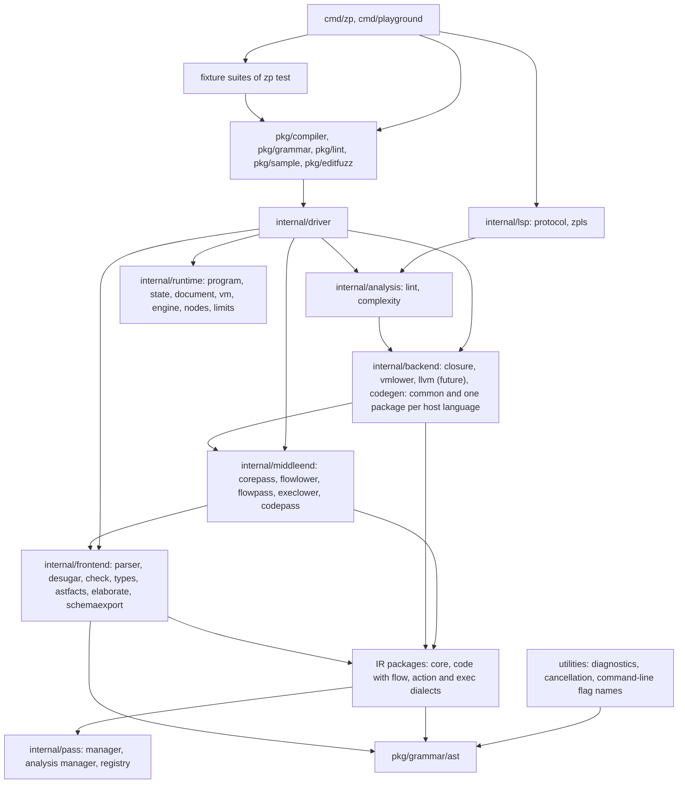

# 072. Release Package Layout

- **Status**: Accepted
- **Author**: @ornew
- **Date**: 2026-11-16

> [!WARNING]
> The code is being migrated to the target this record decides and still differs from it in places.

## Summary

ZeroParse is released with one package layout. A public layer `pkg/` is the only Go API, the runtime side of the module
never links the compiler side, and the middle of the pipeline is one Code IR with three dialects. This record fixes that
layout as the **target** and gives the reasons for it. The complete architecture is [Architecture](../architecture.md);
its import rules are in [Package Layering](../layering.md), its public API in [The Public API](../public-api.md) and its
host-language packages in [Code Generation for Host Languages](../host-code-generation.md). This record keeps the
decision: the problems, what was decided, why, and what was rejected. Where records 062 and 063 describe separate
pipelines for Core, Flow and Exec, this record supersedes them: the compiler is one pipeline, and the lowerings are
passes of it. The plan for reaching the layout is kept in the project's issue tracker, not in this record.

## Motivation

The packages grew with the features, and four problems follow from how they grew.

- **The public surface is spread over the root.** Public packages sit beside internal ones with no common prefix, so
  neither a reader nor a tool can tell the API from the rest, and a package that carries both runtime and compiler
  vocabulary (one package joins the runtime to the output schema and also compiles) has no single reason to change.
- **The runtime links the compiler.** A parser loaded from a compiled file, or a generated parser, needs only the parts
  that run a parse. Nothing forbids it from importing the grammar checker, so the dependency can grow by accident and
  the size of a loaded parser follows.
- **The middle of the pipeline has grown by accretion.** The Flow and Exec representations and the passes between them
  each define their own structure, printer and verifier, the pass runners are per-pipeline, and facts about rules are
  computed in more than one place.
- **Knowledge has several addresses.** A checked program, the Core IR and the runtime tables each hold part of what a
  rule is, and one idea ("check input without building a tree") has several names across commands, API and documents.

## Goals

- One place for the public Go API, with a stable-in-intent contract, apart from everything internal.
- A runtime that cannot depend on the compiler, enforced mechanically.
- Every piece of knowledge has one home, and each structure has one printer and one verifier. A rule's policy flags and
  site numbers come from Core IR facts.
- One compiler pipeline with one pass model, so that every pass, lowerings included, says what it needs, what it keeps
  and when it applies.

## Non-Goals

- Changing what a parse does. Parse results, errors, recovery, limits and the output schema keep their behavior; a
  change of generated output is measured and explained.
- Stability beyond what the release promises. The layout is the shape of the packages, not a promise that every
  exported name inside them is frozen.

The layout does change some names and formats, and these are decided parts of it rather than side effects: the field
`"term"` of the grammar JSON and the syntax symbol of an action expression become `"action"` and `=> expr` (see
[Naming](#naming)); the import paths of generated Go parsers change when the public runtime packages are introduced; a
compiled file becomes the serialization of the runtime program and a closed instruction set; and bytecode is selected
from Code IR at the Flow stage. None of these is kept compatible with the earlier form before the first release.

## Design

The sections below state each decision with its reason. The full package layout is in
[Architecture](../architecture.md), and the public API is in [The Public API](../public-api.md).

### The Public Layer

Everything a user imports lives under `pkg/`; everything else is `internal/` or a command. The packages are cut by the
vocabulary they own, not by the stage that implements them.

- `pkg/grammar`: grammar sources, their loading, formatting and conversion; and below it `pkg/grammar/ast`, the grammar
  AST and its JSON form. The AST follows the language, which changes slowly, rather than an IR, which changes often, and
  the front end receives it as the grammar syntax tree (GST). The AST is a package of its own because loading needs the
  parser of the front end and formatting needs the formatter, and both build or read the AST; so the AST imports only the
  standard library, and `pkg/grammar` sits over the parser, the formatter and the AST, as `go/parser` and `go/printer`
  sit over `go/ast`. A grammar source is a value with a name and an encoding, made by one of the constructors (from bytes, a string, a
  reader or a file-system path) and given an explicit encoding by a method. Loading reads grammar source and JSON and
  rejects a compiled file with an explicit error; the command line reads grammars through the same constructors. A
  grammar source is separate from the parse input, which has positions, streaming, edits and budgets; the two share only
  the naming convention of their constructors.
- `pkg/compiler`: turning a grammar into something executable. It returns the parser on the bytecode VM, the default
  backend; a parser from an AST that a program builds; the reference parser for differential testing; a compiled file;
  parsers in each host language; and the output schema. One optimization setting, with the profiles speed, memory and
  size and per-pass overrides, applies to every backend alike.
- `pkg/lint`, `pkg/sample` and `pkg/editfuzz`: the checks and the complexity classification, input generation, and edit
  fuzzing. Each has its own vocabulary (check names and severities, generation options, a versioned edit-sequence
  format), so each is a small package rather than a part of the compiler.
- `pkg/bytecode`: the instruction set and the compiled-file codec. It is public but marked unstable until release.
- `pkg/runtime` holds the parser interface, options, limits and statistics, and has these subpackages: `input` (position
  units, locations, text edits and change kinds), `value` (nodes, cursors, traversal, JSON, syntax errors), `value/impl`
  (the node representation), `schema` (the output schema, its JSON form, validation and comparison), `query` (structural
  queries), `instrument` (trace events, filters, depth and the per-rule profile), `vm` (loading a compiled file into a
  parser) and `golib` (the support declarations that generated Go parsers import; it is not an API for direct calls). The
  node representation sits below the value package because a generated parser copied into a user's module imports it,
  which an internal package cannot allow. The output schema is runtime-side because a parser, structural queries and the
  typed API use it while running. The support library of generated Go parsers is a package of its own, apart from
  `pkg/runtime`, because it holds many support declarations that the library protocol versions, and keeping them out of
  the user API avoids clashes of names such as the names of parsers and documents.

### The Runtime and Compiler Sides

The module is divided into a **runtime side** (`pkg/runtime/**`, `pkg/bytecode` and `internal/runtime/**`) and a
**compiler side** (everything else). The compiler side may use the runtime side; the runtime side must not reach the
compiler side. The rules, which a test enforces, are these.

1. **Rule 1.** For every non-test package on the runtime side, every package of the module that it depends on is also on
   the runtime side, and the runtime side imports no third-party package.
2. **Rule 1a (generated parsers).** The support library of generated Go parsers imports only `pkg/runtime`, `input`,
   `value`, `value/impl` and `instrument` (and `schema` where the typed API needs it); it imports neither `vm` nor
   `internal/runtime/**`. A generated parser therefore links neither the VM nor the engine. The embedded copy of the
   library compiles by itself in a temporary module that imitates a user's module, and the test checks parsers generated
   in both library modes (an imported library and an embedded one).
3. **Rule 2 (layers).**
   - `internal/pass` imports no other package of the module.
   - The IR packages (Core IR and Code IR with its dialects) import only IR packages, `internal/pass`, the cancellation
     helper and the grammar AST (`pkg/grammar/ast`). Inside them, the Code IR base imports no dialect; the Flow dialect imports the base and
     Core IR (for immediates) only; the Action dialect and the Exec dialect import the base only, and the packages under
     Exec may also import Exec and Action. Only the lowerings of the middle end and the checks that span dialects import
     more than one dialect.
   - The front end imports no middle end, backend, analysis tool or language server; the middle end imports no backend,
     analysis tool or language server; a backend imports no analysis tool or language server.
   - The utility packages (diagnostics, cancellation and command-line flag names) may import the grammar AST, because
     diagnostics carry source positions. The grammar AST imports only the standard library, and `pkg/grammar` is in the
     layer of the public tool packages and imports only the parser, the formatter, the AST and the bytecode package. The fixture suite of `zp test` is a tool that uses the
     compiler, in the same layer as the public tool packages.
   - Only the commands and the repository's test support import the language server packages, and only test support imports
     the test-support packages from non-test code.

The library printer of each host language prints the compositions of the Exec dialect into its runtime library. For Go,
that is the generated-parser library and the shared engine state. That is an edge of generation through
`go:generate`, not an import edge, so it does not make the runtime side depend on the printer; a freshness test
keeps the printed files and the embedded copy current.

The consequences are concrete. Loading a compiled file never constructs a grammar AST or runs the type checker, because
the runtime side cannot name them: a compiled file holds a closed instruction set and the runtime program, not a
grammar. The reference parser needs Core IR, so it belongs to the compiler side and is public only through the compiler
package.

The test lists the dependencies of every package under the default tags and under the reference tags, and prints the
shortest import chain of a violation. It has no allowlist: a violation fails it. A deliberately wrong edge in the test
is a negative control.

### The Internal Tree

The compiler side is a pipeline with a driver on top; the tree names the stages. The front end returns the semantic
model and Core IR; the facts about rules are computed by the Core analyses of the middle end, which a pass or a tool
asks for through the analysis manager, and the front end does not return them.

The IR packages hold data, attribute computation, verifiers and printers; the passes that transform and analyze are in
the middle end. A verifier checks that the facts agree with the structure by recomputing the attributes, so it lives
with the attribute computation. The dialects are nested under the Code IR base, so the tree and the import paths say that
they are dialects of one representation, and the lowerings are packages of their own, outside the IR packages and apart
from the passes of each dialect. Names are chosen so that packages that are imported together do not clash: the grammar
language server is not named like the grammar package, and the compositions are not named like Core IR.

`internal/runtime/**` is the runtime side and holds the runtime program (the tables a parse needs, which a compiled file
serializes), the shared parser state, the incremental Document, the VM drivers, the entry points for parse, document
and stream use, and the budget arithmetic. Repository test support lives under `internal/testing`, and the architecture
test lives with it.

### One Code IR with Three Dialects

There are two internal representations, not three.

- **Core IR** holds the meaning of a grammar after desugaring: typed, with explicit facts, and with no knowledge of the
  mode (budgets, Documents, observation) or the target. Rewrites of meaning and the facts about rules, such as which
  rules need memo records or can be inlined, belong here. It is elaborated once from the semantic model, which answers
  every question tied to a source range (hover, lint findings, type errors) and transforms nothing.
- **Code IR** is one structured-code representation (modules, functions, statements, expressions) with a verifier, a
  printer and a reference interpreter, shared by everything below Core. What differs between levels is the table of
  operations, which is data, in three dialects:
  - the **Flow** dialect has the operations of grammar control: matching, marking and restoring for backtracking,
    expectations, captures, rule calls under a policy, charging for budgets and recovery;
  - the **Action** dialect has the operations that evaluate action expressions (value actions, predicate actions and
    bindings), and is valid both at the Flow stage and at the Exec stage;
  - the **Exec** dialect has the operations of the abstract parser machine and the compositions built on them: the call
    protocol, memoization, left-recursion growth, operator rules, Documents and streams.

The terms are fixed. A dialect is a set of operations; a program state is a stage of a Code IR module. Write "Code IR at
the Flow stage" and "Code IR at the Exec stage", or "the Flow stage" and "the Exec stage" once the context is clear, and
do not call either one "Flow IR" or "Exec IR". The abstract machine is what the Exec dialect defines; "the VM" is only the
bytecode interpreter.

A Flow operation states its contract, cost, the features it needs and its laws, and carries a reference expansion into
Exec operations. An Exec operation has a reference model, and a conformance suite compares every implementation with the
reference expansions and models.

Lowering between levels is a pass of the one compiler pipeline. The driver assembles that pipeline and the pass
manager runs it: the Core passes, `flowlower`, the Flow passes, then `vmlower` for the VM, or `execlower`, the
dialect-independent passes of Code IR and the passes of the host language for host code generation. Making the
lowerings passes gives them the registry, the dumps and the verification that every other step has, and keeps the order
of the whole compilation in one place. Lowering from Core takes it to the Flow stage in a uniform shape, and the Flow
passes choose the shape; the conversion from the Flow stage to the Exec stage is complete; instruction selection
produces bytecode.

A pass is typed by the IR it takes and the IR it returns: a transform keeps its IR, and a lowering is a pass from one IR
to another, or from one dialect to another. `flowlower` (Core IR to Code IR) and `vmlower` (the Flow stage to bytecode)
change the type of the IR, and `execlower` keeps Code IR and converts the dialect. The pipeline is a typed composition
of these passes, a sequence of transforms on one IR and then a lowering to the next, so the Go type checker ensures that
each pass gets the IR the previous one produced. Each IR has its own analysis manager, and since a lowering preserves
nothing, the passes after it start with a fresh one. The registry, the dumps and verification reach every pass, and the
flags every optional pass, through a description that does not depend on its types: its name, whether it is required,
and how to dump and verify its output.

A lowering declares its input and output stages and preserves no analysis. It is a required pass: it has a name in the
registry and the dumps can name it, but no flag or profile turns it off, because the stages after it need its output.
Its postcondition is the verifier of its output stage, which always runs right after the lowering, so that an error
names the lowering; after `execlower`, no Flow operation remains. The other verifiers run where the pipeline leaves a
stage, and after every transform only on request. The stage names of the dumps are points in the pipeline. Lowering
between dialects is *lower*, and *legalize* is used only for adjustments inside a target.

**Bytecode comes from the Flow stage.** The instruction set is at the level of grammar control, so instructions can be
chosen from Flow operations almost one for one, with superinstruction selection: a call of a composition is one
instruction and common match patterns fuse into high-level ones. A mark that names a set of state to save maps to the
choice instruction, a sound over-approximation. The compositions are native in the VM and checked by the Exec
conformance suite. The reason is that the VM, every host language and a future LLVM backend then all take grammar code
from one Code IR, so charging and option propagation cannot drift between two lowerings of grammar code. Host-language
parsers are produced from the Exec stage after language-specific passes that legalize and optimize it for the target,
then printed, and a printer prints the legalized Exec stage as it is, without carrying transformations as string
processing or regeneration. The closure backend deliberately does not share this lowering: it is built from Core IR so
that a bug in the lowering shows up as a difference between backends.

The complexity classifier works on its own Core IR module, the cost view, derived by normalization laws. The proofs
that the classification is sound speak about the cost view, so it is kept apart from the Core module that the
optimizations rewrite; it reaches users through the lint package.

### The Pass Model

The pass model is described in [the pass pipeline](../pass-pipeline.md). Its decisions are these.

- **Registration.** A pass declares its name, its default, its applicability condition (a feature such as budgeting,
  Documents or tracing), the property it must preserve (its obligation), the ordering it needs, the analyses it needs
  and the ones it keeps. An optional pass has a flag of the same name; a required pass, such as a lowering, has a name
  and no flag. The registry is shared; each part of the pipeline (Core, the lowerings, Flow, Exec and each host
  language) registers its own passes, and printers and library controls register under their own kind, so no name is
  declared twice.
- **Analyses.** An analysis is computed when a pass asks for it and cached. What a pass preserves is a set that defaults
  to nothing: forgetting to declare it invalidates everything, which is the safe side. An analysis key is registered by
  name, and a second key with the same name is rejected, so two analyses of one name and different result types cannot
  confuse the cache. Invalidating an analysis invalidates the analyses that used it, transitively; an analysis that
  depends on itself is an error; a transform that returns a different IR value invalidates the whole cache; a failed
  analysis returns an error and never degrades silently. Facts about rules are computed once on Core, through the
  analysis manager, and read by the generators, the engine, the linter and the complexity classifier. Attributes that
  live on Core nodes (nullability, first sets, effects) are invariants that the verifier recomputes, not cached analyses.
- **Verification.** The verifier of a lowering's output stage always runs right after the lowering. The other verifiers
  run where the pipeline leaves a stage, and after every transform on request, so that an error names the pass that
  broke an invariant. The Flow verifier checks structure, variables, one runtime per function, the budget invariants and
  the rules about reading input under a Document or a trace. A dump after any stage (`core`, `flow`, `exec`) shows the
  module as the next stage receives it.
- **Decisions.** Control-level decisions (call specialization, inlining, dispatch, the form of a match, removal of
  redundant saves, merging failure paths, where to charge, sharing slots and outlining) are Flow passes with stated
  obligations; target-specific legalization is in the passes of each host language; passes that depend only on an
  operation's reads and writes are dialect-independent passes of Code IR.
- **Profiles.** A user chooses speed, memory or size. The table from profile to pass flags lives in the driver, and the
  public setting carries the profile and the overrides.

### Operations, Laws, Marks and Rewrites

- **Properties of operations are derived.** Pure (a call can be removed), zero-width and infallible are computed from
  what an operation declares: the state it reads and writes, whether it can fail or end the parse, and its cost. A call
  that has a cost is not pure while the budget is on, because removing it changes where a limit interrupts. A second,
  declared set of properties would be a second source of truth that could disagree with the declarations. The
  conformance suite checks that an operation leaves the state it does not declare unchanged, so the declarations, and
  what is derived from them, can be trusted.
- **Every law is typed and tested.** A law has a kind that passes read (equal results, a stable read, the merge of two
  charges) and a conformance property that tests it. A pass relies only on laws of a kind it names, so no optimization
  depends on a sentence that nothing checks. A law is a declared fact about results only and never permits removing a
  call; whether a call can be removed is the derived purity above, so the two cannot disagree.
- **Charges keep their place among what is observed.** A budget charge never moves or merges across a write to the
  observation or to the stream window, a callback of the caller, or a commit. Trace events, stream deliveries and
  callbacks are visible after an interruption, so a parse that a limit interrupts reports exactly what precedes the
  reservation that failed, whatever the passes did. The runtime specification states what an interrupted parse exposes,
  and the charge law of the Exec specification states the rule.
- **Marks are typed locals that nest.** A mark is not a value that can be used once: a choice restores the same mark
  before each next alternative, and a loop restores the mark of its iteration, so a discipline of single use would force
  a new mark per use and change the generated code. The Code IR is structured with mutable locals and is printed as it
  is, which a form with single assignments would need to undo before printing. What holds instead is nesting: the
  verifier checks that every use of a mark is dominated by its definition and that the marks of one component are used
  last in, first out, and it checks the preconditions of the operations that take marks, which were stated only in their
  contracts. Save-elide stays a pass, because it narrows a live mark to the parts a failure path reads; its case of a
  mark that nothing reads is dead-store removal.
- **One canonicalize pass for local patterns.** The local rewrite patterns of Code IR, declared by each dialect for its
  operations, run in one pass to a fixed point, at the Flow stage after fail-merge/thread and before charge, and at the
  Exec stage after specialization and before dead-store removal, so a rewrite can expose the next without another pass.
  Each pattern has a name in the registry: `-opt` and `-no-opt` turn it on or off, `-opt-bisect-limit` numbers each
  application, `-print-pipeline` lists it and the statistics count it, so a pattern stays as measurable and bisectable
  as a pass. The pass tries the patterns in a fixed order, so the output is the same on every run. Rewrites that are not
  local patterns stay named passes. Instruction selection in `vmlower` is a deterministic table of local patterns that
  counts its matches.
- **Passes run one at a time, and a function pass sees only its function.** A pass on one function reads only analyses
  of the module computed before it runs and never another function's body. Running passes one at a time keeps the
  numbering of `-opt-bisect-limit` and the output deterministic; the isolation of functions keeps running them in
  parallel possible later without a change of contract.
- **Preservation is checked.** Under `-verify-each`, a pass that claims to preserve every analysis must leave the text
  form of the unit unchanged, or the pipeline reports it. A wrong claim leaves stale analyses for the passes after it,
  which fail far from the cause; comparing the text catches it at the pass.
- **The pipeline is instrumented.** `-print-changed`, `-stats` and `-time-passes` show which passes changed a module,
  what each rewrote and how long it took, without changing the parser.

### Naming

- **Action expressions.** The grammar AST, the Core IR and the specification use one name for them: Action Expression.
  The JSON field is `"action"` and the syntax symbol is `=> expr`.
- **Recognition.** Recognizing input decides, without building a tree, whether the input matches the grammar, and
  returns the same success and the same syntax errors (recovered ones included) as a parse. Predicates, and the actions
  that predicates read, run; the runtime errors of other actions and the conversion to typed values are not checked, so
  a recognition can succeed where a parse fails. It is expressed only by the parser's recognition method and the
  command-line recognition mode; there is no option that switches a parse into a recognition, and generated parsers offer
  the same choice. "Validate" and "validation" mean only the structural check of an artifact (a grammar AST, a schema, a
  module).

## Decided Interfaces

The public names below are decided, and they are the names of the approved design; the rest of the public layer follows
the current API and is settled in the package documentation as each package is implemented. The decided package names
are at the end of this section. [The Public API](../public-api.md)
describes the packages and points here for the decided shapes.

### Grammar Source and Loading

| Name | Role |
|:--|:--|
| `Source` | One grammar input, a named value with an encoding. Its fields are not exported, so a source has exactly one supplier. |
| `FromBytes`, `FromString`, `FromReader` | Constructors from bytes, from a string and from a reader. A reader is read in full when the source is loaded, because a diagnostic may need the text of any line. |
| `FromFS` | Constructor from a path in a file system. The name of the source is the path, and a future import resolves against the same file system. The command line reads grammars through this constructor. |
| `As` | Gives a source an explicit encoding. |
| `Encoding` with `EncodingAuto`, `EncodingZP` and `EncodingJSON` | The encoding of a source: grammar syntax or JSON. `EncodingAuto` decides in this order: the explicit encoding, the extension, then the content, where a leading brace means JSON. |
| `Load` | Gives the grammar AST of a source in grammar syntax or in JSON. A compiled file is rejected with an explicit error. |
| `Validate` | Checks the structure of an AST that a program has built. |
| `Format` (function) and `Convert` | `Format` writes a grammar AST as grammar syntax. `Convert` converts a source to the other encoding, given as an `Encoding`. |

The action expression names of the grammar AST (`ActionExpr`, `ActionGroup`) and the JSON field `action` are the names
of [Naming](#naming).

### Compiler Entry Points

| Name | Role |
|:--|:--|
| `Compile` | Makes the parser on the bytecode VM, the default backend, from a source. |
| `CompileGrammar` | Makes the same kind of parser from an AST that a program has built. |
| `NewReferenceParser` | Makes the closure reference parser for differential tests. It is the only public access to the closure backend. |
| `Optimize` with `Speed`, `Memory` and `Size` | The one optimization setting. A value of `Optimize` holds a profile, and `Speed`, `Memory` and `Size` are the three profiles. Overrides of individual flags are part of the value. |
| `WithOptimize` | The option that gives a setting to a compile call. |

### Structural Queries and Instrumentation

| Name | Role |
|:--|:--|
| `Pattern` | The programmatic pattern of a structural query, type-checked against the output schema. |
| `Query`, `Match`, and the `Matches` method of `Query` | A query is made from a pattern and an output schema by the `Compile` function of the query package. `Matches` runs it on a parse value and returns the matches. |
| `TraceKind` with `enter`, `exit` and `skipped` | The kind of a trace event. |
| `TraceEvent` | One trace event: the rule, the position, the result and the examined input. A failure in an event is a syntax error. |
| `TraceSource` | The interface of the parser state that the methods of an event read. |
| `Profile` | The per-rule profile: calls, time, exact examined input and wasted input. |

The meaning of the trace function, its filters and its depth is defined by the specification of the runtime, not here.

### Pass Infrastructure

The pass infrastructure is internal, in `internal/pass`. It provides the pass manager that runs the passes of the
compiler pipeline, the registry of passes and their control flags, the caching of analyses with their invalidation, and
the preserved sets that say which analyses a transform keeps. Its exact shapes are not given in this record.

### Pass Control

The passes are controlled by flags of `zp gen` and by the same settings in Go, which the driver reads, so the command
line and the Go API cannot drift. A required pass, and every lowering is one, cannot be turned on or off; naming it in a
setting that does so is an error. [Controlling Passes](../pass-pipeline.md#controlling-passes) describes the behavior.

| Name | Role |
|:--|:--|
| `-optimize` | Chooses the profile: `speed`, `memory` or `size`. In Go, the profile of the `Optimize` value. |
| `-opt` | Sets optional flags after the profile: a name alone turns one on, `=0` turns it off, `=N` sets a count. In Go, the overrides of the `Optimize` value. |
| `-no-opt` | Turns the named optional flags off after `-opt`. |
| `-print-after` | Dumps the module after the named stages (`core`, `flow`, `exec`) and passes, or after all of them with `all`. |
| `-print-before` | Dumps the module that each named pass receives, or that every pass receives with `all`. |
| `-verify-each` | Runs the verifier after every transform, and reports a pass that claims to preserve every analysis but changed the text form of the unit. |
| `-print-changed` | Dumps the module after each pass that changed it. |
| `-print-pipeline` | Prints the assembled pipeline as pass names in order, with the required passes marked and the patterns of `canonicalize` listed under it. |
| `-stats` | Prints the counters of each pass after the build, including the applications of each pattern, summed over the units in a fixed order. |
| `-time-passes` | Prints the time each pass took, summed over the units it ran on. |
| `-opt-bisect-limit` | Runs the optional pass runs numbered up to N in pipeline order and skips the later ones. A run is one pass on one unit, so a pass that runs per function counts once per function, a run of `canonicalize` takes one number like every pass, and each application of one of its patterns takes its own. Required passes always run, and each decision is reported with the pass and the unit. |
| `Debug` | The public setting of `pkg/compiler` for observation and bisection. Eight fields mirror the flags one to one: print before, print after, print changed, verify each, print pipeline, stats, time passes and bisect limit. The ninth, the writer the output goes to, has no flag; the command writes to standard error. It does not change the parser that is built, so it is apart from `Optimize`. |
| `WithDebug` | The option that gives a `Debug` value to a compile call. |

A textual description of a pipeline, which can reorder or repeat optional passes and is checked against the declared
ordering and the required passes, is internal test support, outside the public API and the public command line.

### Decided Package Names

| Name | Role |
|:--|:--|
| `common` | Parts that all host languages share, under the code generation package. |
| `golang/pass`, `golang/print` | The passes of Go and the Go printer. |
| `golang/libprint` | Prints the compositions of the Exec dialect into the Go library and the shared engine state. It is an edge of code generation through go:generate. |
| `golang/libsrc` | The go:generate copy of the Go library, which the embedded library mode uses. It has a freshness test. |
| `typescript/pass`, `typescript/print`, `typescript/lib` | The passes of TypeScript, its printer and its runtime library. |
| `golib` | The support library of generated Go parsers. |
| `valueimpl` | The package name of the node representation under `value/impl`. |
| `archtest` | The import-graph test. It runs under the default tags and under the reference tag sets of the reference build. |
| `exectest` | Test support for the Exec stage, which calls passes and printers. |
| `codegentest`, `compiletest`, `enginetest`, `factstest`, `starttest`, `complexitytest`, `recoveryquality` | Repository test support, one package per kind of test. The tree names them and gives no further role. |

## Alternatives Considered

- **Keep three representations, with Flow and Exec as separate IRs.** Each representation needs its own structure,
  printer, verifier and interpreter, and the shared parts (action evaluation, the call protocol) are written twice. One
  base with dialects states each of these once and lets a verifier check the relation between stages.
- **Make Flow a control-flow graph.** Flow is a structured language over the shared base. A graph is built when a pass
  needs it, as an analysis, so that the representation that is printed and verified stays structured.
- **The grammar AST and the operations on grammar sources in one package.** Loading needs the parser and formatting
  needs the formatter, and both import the AST, so one package would be an import cycle unless the parser and the
  formatter moved into it. Their entry points for the language server (partial parses, tokens, source errors) would then
  be public API of the grammar package. An AST package that only aliases internal types would have no documentation of
  its own fields. A public AST package below the grammar package keeps both the parser and the formatter internal and
  documents the AST where it is defined.
- **One public compiler package for every tool.** The linter, the sampler and the edit fuzzer would then share a package
  with options that have nothing in common. Small packages with their own vocabulary are easier to use and to keep
  stable.
- **Enforce the runtime separation by review.** Dependencies grow silently and the loss shows up as binary size. A test
  that fails on the first wrong edge is cheaper and does not depend on who reviews.

## Testing

The import-graph test covers rules 1, 1a and 2 with a negative control. Generated output is compared against the
previous tree for changes that move packages without changing behavior, and the differential and conformance suites and
the documentation tests cover the rest. Selecting bytecode from the Flow stage is accepted only when compiled-file size
and VM throughput are within the noise of the previous construction, measured in interleaved runs against a copy of it.

## Limitations and Open Questions

The layout is the target; until the migration completes, the code differs from it. The shapes of the grammar source and
of loading, of the compile entry points and of the query and instrument packages are decided and listed in
[Decided Interfaces](#decided-interfaces) of this record; [The Public API](../public-api.md) links to that
section. The other shapes of the public layer are rough, and are settled in the package documentation as they are
implemented.
