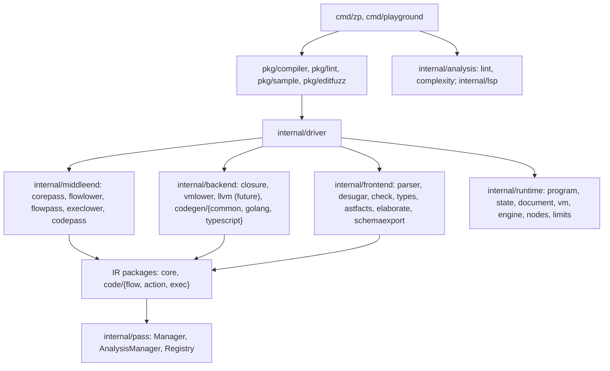

# 072. Release Package Layout

- **Status**: Accepted
- **Author**: @ornew
- **Date**: 2026-11-16

## Summary

ZeroParse is released with one package layout. A public layer `pkg/` is the only Go API, the runtime side of the module
never links the compiler side, and the middle of the pipeline is one Code IR with three dialects. This record fixes that
layout as the **target**. The tree does not have it yet: the repository is being moved to it in stages, listed under
[Implementation Sequence](#implementation-sequence), and until a stage lands the packages of that stage keep their
current names. Documents that describe today's tree describe today's tree; this record describes where it is going and
why.

## Motivation

The packages grew with the features, and four problems follow from how they grew.

- **The public surface is spread over the root.** Public packages sit beside internal ones with no common prefix, so
  neither a reader nor a tool can tell the API from the rest, and a package that carries both runtime and compiler
  vocabulary (one package joins the runtime to the output schema and also compiles) has no single reason to change.
- **The runtime links the compiler.** A parser loaded from a compiled file, or a generated parser, needs only the parts
  that run a parse. Nothing forbids it from importing the grammar checker, so the dependency can grow by accident and
  the size of a loaded parser follows.
- **The middle of the pipeline has grown by accretion.** The Flow and Exec representations and the passes between them
  each define their own structure, printer and verifier, the pass runners are per-pipeline, and facts about rules are
  computed in more than one place.
- **Knowledge has several addresses.** A checked program, the Core IR and the runtime tables each hold part of what a
  rule is, and one idea ("check input without building a tree") has several names across commands, API and documents.

## Goals

- One place for the public Go API, with a stable-in-intent contract, apart from everything internal.
- A runtime that cannot depend on the compiler, enforced mechanically.
- Every piece of knowledge has one home, and each structure has one printer and one verifier. A rule's policy flags and
  site numbers come from Core IR facts. There is no "checked program" layer: its content lives in the semantic model,
  Core IR and the runtime program.
- A pass model that every pipeline shares, so that a pass says what it needs, what it keeps and when it applies.

## Non-Goals

- Changing what a parse does. Parse results, errors, recovery, limits and the output schema keep their behavior; stages
  that move packages leave generated output unchanged, and a stage that changes it measures and explains the change.
- Stability beyond what the release promises. The layout is the shape of the packages, not a promise that every
  exported name inside them is frozen.

The layout does change some names and formats, and these are decided parts of it rather than side effects: the field
`"term"` of the grammar JSON and the syntax symbol of an action expression become `"action"` and `=> expr` (see
[Naming](#naming)); the import paths of generated Go parsers change when the public runtime packages are introduced; a
compiled file becomes the serialization of the runtime program and a closed instruction set; and bytecode is selected
from Code IR at the Flow stage. None of these is kept compatible with the earlier form before the first release.

## Design

### The Public Layer

Everything a user imports lives under `pkg/`; everything else is `internal/` or a command. The packages are cut by the
vocabulary they own, not by the stage that implements them.

- `pkg/grammar`: the grammar AST and its JSON form, loading, formatting and conversion. The AST follows the language,
  which changes slowly, rather than an IR, which changes often, and the front end receives it as the grammar syntax
  tree (GST). A grammar source is a value with a name and a format, made by `FromBytes`, `FromString`, `FromReader` or
  `FromFS` and given an explicit format with `As`. `Load` reads `.zp` and JSON and rejects a compiled file with an
  explicit error; the command line reads grammars through the same constructors. A grammar source is separate from the
  parse input, which has positions, streaming, edits and budgets; the two share only the naming convention of their
  constructors.
- `pkg/compiler`: turning a grammar into something executable. `Compile` returns the parser on the bytecode VM, the
  default backend; `CompileGrammar` takes an AST built by a program; `NewReferenceParser` returns the reference parser
  for differential testing; `Marshal` writes a compiled file; `GenerateGo` and `GenerateTypeScript` write source; and
  `OutputSchema` returns the schema. One `Optimize` setting, with the profiles `Speed`, `Memory` and `Size` and per-pass
  overrides, applies to every backend alike.
- `pkg/lint`, `pkg/sample` and `pkg/editfuzz`: the checks and the complexity classification, input generation, and edit
  fuzzing. Each has its own vocabulary (check names and severities, generation options, a versioned edit-sequence
  format), so each is a small package rather than a part of the compiler.
- `pkg/bytecode`: the instruction set and the compiled-file codec. It is public but marked unstable until release.
- `pkg/runtime` holds the parser interface, options, limits and statistics, and has these subpackages: `input` (position
  units, locations, text edits and change kinds), `value` (nodes, cursors, traversal, JSON, syntax errors), `value/impl`
  (the node representation, package `valueimpl`), `schema` (the output schema, its JSON form, validation and `Compare`),
  `query` (structural queries), `instrument` (trace events, filters, depth and the per-rule profile), `vm` (loading a
  compiled file into a parser) and `golib` (the support declarations that generated Go parsers import; it is not an API
  for direct calls). The node representation sits below the value package because a generated parser copied into a
  user's module imports it, which an internal package cannot allow. The output schema is runtime-side because a parser,
  structural queries and the typed API use it while running.

### The Runtime and Compiler Sides

The module is divided into a **runtime side** (`pkg/runtime/**`, `pkg/bytecode` and `internal/runtime/**`) and a
**compiler side** (everything else). The compiler side may use the runtime side; the runtime side must not reach the
compiler side. The rules, which a test enforces, are these.

1. **Rule 1.** For every non-test package P on the runtime side, every package of the module in the dependencies of P is
   also on the runtime side, and the runtime side imports no third-party package.
2. **Rule 1a (generated parsers).** The generated-parser library `golib` imports only `pkg/runtime`, `input`, `value`,
   `value/impl` and `instrument` (and `schema` where the typed API needs it); it imports neither `vm` nor
   `internal/runtime/**`. A generated parser therefore links neither the VM nor the engine. The embedded copy of the
   library compiles by itself in a temporary module that imitates a user's module, and the test checks parsers generated
   in both library modes (an imported library and an embedded one).
3. **Rule 2 (layers).**
   - `internal/pass` imports no other package of the module.
   - The IR packages (Core IR and Code IR with its dialects) import only IR packages, `internal/pass`, the cancellation
     helper and `pkg/grammar`. Inside them, the Code IR base imports no dialect; the Flow dialect imports the base and Core IR (for immediates) only; the
     Action dialect and the Exec dialect import the base only, and the packages under Exec may also import Exec and
     Action. Only the lowerings of the middle end and the checks that span dialects import more than one dialect.
   - The front end imports no middle end, backend, analysis tool or language server; the middle end imports no backend,
     analysis tool or language server; a backend imports no analysis tool or language server.
   - Only the commands and the repository's test support import `internal/lsp/**`, and only test support imports
     `internal/testing/**` from non-test code.

The consequences are concrete. Loading a compiled file never constructs a grammar AST or runs the type checker, because
the runtime side cannot name them: a compiled file holds a closed instruction set and the runtime program, not a
grammar. The reference parser needs Core IR, so it belongs to the compiler side and is public only as a constructor of
`pkg/compiler`.

The test lists the dependencies of every package under the default tags and under the reference tags, and prints the
shortest import chain of a violation. It carries an allowlist of the violations that remain during the migration; the
list must match the violations exactly, so it can only shrink, and it is empty when the runtime separation lands. A
deliberately wrong edge in the test is a negative control.

### The Internal Tree

The compiler side is a pipeline with a driver on top; the tree names the stages.

`internal/runtime/**` is the runtime side and holds the runtime program (the tables a parse needs, which a compiled file
serializes), the shared parser state, the incremental Document, the VM drivers, the entry points for parse, document
and stream use, and the budget arithmetic. Repository test support lives under `internal/testing`, and the architecture
test lives with it.

### One Code IR with Three Dialects

There are two internal representations, not three.

- **Core IR** holds the meaning of a grammar after desugaring: typed, with explicit facts, and with no knowledge of the
  mode (budgets, Documents, observation) or the target. Rewrites of meaning and the facts about rules, such as which
  rules need memo records or can be inlined, belong here. It is elaborated once from the semantic model, which answers
  every question tied to a source range (hover, lint findings, type errors) and transforms nothing.
- **Code IR** is one structured-code representation (modules, functions, statements, expressions) with a verifier, a
  printer and a reference interpreter, shared by everything below Core. What differs between levels is the table of
  operations, which is data, in three dialects:
  - the **Flow** dialect has the operations of grammar control: matching, marking and restoring for backtracking,
    expectations, captures, rule calls under a policy, charging for budgets and recovery;
  - the **Action** dialect has the operations that evaluate action expressions (value actions, predicate actions and
    bindings), and is valid both at the Flow stage and at the Exec stage;
  - the **Exec** dialect has the operations of the abstract parser machine and the compositions built on them: the call
    protocol, memoization, left-recursion growth, operator rules, Documents and streams.

The terms are fixed. A dialect is a set of operations; a program state is a stage of a Code IR module. Write "Code IR at
the Flow stage" and "Code IR at the Exec stage", or "the Flow stage" and "the Exec stage" once the context is clear, and
do not call either one "Flow IR" or "Exec IR". The pages that use those names for today's separate representations move
to these terms when Code IR is introduced. The abstract machine is what the Exec dialect defines; "the VM" is only the
bytecode interpreter.

A Flow operation states its contract, cost, the features it needs and its laws, and carries a reference expansion into
Exec operations. An Exec operation has a reference model, and a conformance suite compares every implementation with the
reference expansions and models.

Lowering between levels is a separate step with its own invariant, never a pass: `flowlower` takes Core to the Flow
stage in a uniform shape, and the Flow passes choose the shape; `execlower` takes the Flow stage to the Exec stage
completely, and the verifier checks that no Flow operation remains; `vmlower` selects bytecode. The names follow LLVM
and MLIR: lowering between dialects is *lower*, and *legalize* is used only for adjustments inside a target.

**Bytecode comes from the Flow stage.** The instruction set is at the level of grammar control, so instructions can be
chosen from Flow operations almost one for one, with superinstruction selection: a call of a composition is one
instruction and common match patterns fuse into high-level ones. A mark that names a set of state to save maps to the
choice instruction, a sound over-approximation. The compositions are native in the VM and checked by the Exec
conformance suite. The reason is that the VM, Go, TypeScript and a future LLVM backend then all take grammar code from
one Code IR, so charging, options and recovery cannot drift between two lowerings of grammar code. Go and TypeScript are
produced from the Exec stage after language-specific passes that legalize and optimize it for the target, then printed.
The closure backend deliberately does not share this lowering: it is built from Core IR so that a bug in the lowering
shows up as a difference between backends.

### The Pass Model

A pass is a named unit with a declared shape, and a manager runs a list of them.

- **Registration.** A pass declares its name (the same as its flag), its default, its applicability condition (a
  feature such as budgeting, Documents or tracing), the property it must preserve (its obligation), the ordering it
  needs, the analyses it needs and the ones it keeps. The registry is shared; each pipeline (Core, Flow, Exec and each
  target language) registers its own passes, and printers and library controls register under their own kind, so no name
  is declared twice.
- **Analyses.** An analysis is computed when a pass asks for it and cached. What a pass preserves is a set that defaults
  to nothing: forgetting to declare it invalidates everything, which is the safe side. Invalidating an analysis
  invalidates the analyses that used it, transitively; an analysis that depends on itself is an error; a transform that
  returns a different IR value invalidates the whole cache; a failed analysis returns an error and never degrades
  silently. Facts about rules are computed once on Core, through the analysis manager, and read by the generators, the
  engine, the linter and the complexity classifier. Attributes that live on Core nodes (nullability, first sets,
  effects) are invariants that the verifier recomputes, not cached analyses.
- **Verification.** After a pass, the stage's verifier runs on request and names the pass that broke an invariant. The
  Flow verifier checks structure, variables, one runtime per function, the budget invariants and the rules about reading
  input under a Document or a trace. A dump after any stage (`core`, `flow`, `exec`) shows the module as the next stage
  receives it.
- **Decisions.** Control-level decisions (call specialization, inlining, dispatch, the form of a match, removal of
  redundant saves, merging failure paths, where to charge, sharing slots and outlining) are Flow passes with stated
  obligations; target-specific legalization is in the language pipelines; passes that depend only on an operation's
  reads and writes are shared across dialects.
- **Profiles.** A user chooses speed, memory or size. The table from profile to pass flags lives in the driver, and the
  public option carries the profile and the overrides.

### Naming

- **Action expressions.** The grammar AST uses `ActionExpr` and `ActionGroup`, the JSON field is `"action"`, the syntax
  symbol is `=> expr`, and Core IR uses `ActionExpr`: all match the specification's Action Expression.
- **Recognition.** Recognizing input decides, without building a tree, whether the input matches the grammar, and
  returns
  the same success and the same syntax errors (recovered ones included) as a parse. Predicates, and the actions that
  predicates read, run; the runtime errors of other actions and the conversion to typed values are not checked, so a
  recognition can succeed where a parse fails. It is expressed only by `Parser.Recognize` and the command
  `parse -recognize`; there is no option that switches a parse into a recognition, and generated parsers offer the same
  choice. "Validate" and "validation" mean only the structural check of an artifact (a grammar AST, a schema, a module).

## Implementation Sequence

The layout is reached in stages that keep the behavior of the tree. Each stage is checked by the tests of the changed
packages and the import-graph test; stages that touch the engine, generator or runtime also pass the full gate with
generated output and the ready-made parsers. Moving a package is a separate commit from changing behavior. The
numbers give the landing order, except where a stage says it can run in parallel.

1. **Enforce the dependency rule.** Add the import-graph test with the allowlist of today's violations.
2. **Correct the documents** that describe the tree, and record this layout.
3. **Reorganize the front end, analysis and test support.** Regenerate the self-hosted grammar parser under the front
   end; move desugaring, checking, the type model, AST facts and the schema export; move diagnostics, the analysis tools
   (lint, complexity) and the language server; and move test support under one tree with a documented naming
   convention. The part of the compile package that is semantic model only (names, types, scopes, start rules, the type
   declaration table) moves into the checker and the type model.
4. **Reorganize the IR and the passes.** Make the pass infrastructure `internal/pass` with a generic registry that each
   pipeline fills, and move driving into `internal/driver`; make the Exec infrastructure the Code IR base and put the
   operation table, the compositions and the reference models, conformance and printing tests under the Exec dialect;
   move Core passes and facts to `corepass`, the Core-to-Flow lowering to `flowlower` and the shared passes to
   `codepass`; rename the Core IR `Term` to `ActionExpr` and `terms` in the Core IR specification to `actions`; and
   rename the `-print-after` stage `build` to `core`, with no alias. Flow and its lowering stay where they are until the
   dialect stage.
5. **Unify the rule facts.** The generators and the engine read policy flags and site numbers from Core facts, and the
   grammar-AST analysis they duplicated is removed. Its differential tests become unit tests of the Core facts.
6. **Implement the analysis manager** in `internal/pass`, move the Core pipeline onto it, and share facts among lint,
   complexity and the generators. This and the stage of the dialects can run in parallel with the backend, tool and
   runtime stages, since they touch only the IR and the middle end.
7. **Reorganize the backends**: `backend/codegen/{common, golang, typescript}` with a place for language-specific
   passes, `closure`, `vmlower` and the library printer.
8. **Publish the tool packages.** Introduce `pkg/grammar` (source, load, convert), `pkg/lint`, `pkg/sample`,
   `pkg/editfuzz`, `pkg/runtime/schema` and `pkg/runtime/query`; read grammars in the command line through the grammar
   source; and rename the AST, JSON and syntax symbol of action expressions in the same landing. The ready-made parsers
   need no hand-written change.
9. **Separate the runtime.** Introduce the runtime program, lower action expressions at compile time, remove the
   checked-program type, and move the shared state, Document, the VM execution part, node access and the limits under
   `internal/runtime`, with the compile entry in the driver. The allowlist becomes empty, a loaded compiled file creates
   no grammar AST, and the performance of the loaded parser is measured against the previous one, together with its
   binary size.
10. **Make Flow and Action dialects of Code IR.** Fold the Flow types into a dialect operation table with contracts,
    costs, features, laws and reference expansions; put value operations in the Action dialect; lower action expressions
    to Action operations; replace the copying from Flow to Exec with the complete lowering and drive the transitional
    operations to zero; type the immediates; and write the Code IR specification with the dialects as its parts.
11. **Publish the runtime and compiler packages**, together with the recognition term. Split the shared result types
    into
    `pkg/runtime` and its subpackages, add the generated-parser library and its embedded copy, `pkg/bytecode`,
    `pkg/runtime/vm` and `pkg/compiler` (VM-based `Compile`, reference parser, generation and `Marshal` with
    `Optimize` for every backend), and remove the old public packages. Generated parsers must satisfy rule 1a, and the
    ready-made parsers are regenerated and their hand-written tests adjusted with the owner's approval of each landing.
    The recognition term lands with it: `parse -recognize`, `Parser.Recognize` as the only form, and the definition in
    the glossary and the recognition guide.
12. **Move control-level decisions into Flow passes** (terminals, class runs and guarded classes and the lowering
    options
    leave Core; charge merging moves from the printer to the charge pass) and register language-specific legalization
    and optimization in the language pipelines.
13. **Select bytecode from the Flow stage**, and remove the bytecode generation that starts from Core. The switch
    happens
    only when the size of compiled files and the throughput of the VM are within the noise of the previous
    construction (at least twenty interleaved rounds); until then instruction selection is improved.

Stages 3 to 5 and 8 do not change names that the ready-made parsers import; stage 11 changes the import paths of
generated code. Each stage lands with the specification, guides and design pages that it changes, and specifications and
guides describe public names only after the stage that introduces them.

## Alternatives Considered

- **Keep three representations, with Flow and Exec as separate IRs.** Each representation needs its own structure,
  printer, verifier and interpreter, and the shared parts (action evaluation, the call protocol) are written twice. One
  base with dialects states each of these once and lets a verifier check the relation between stages.
- **Make Flow a control-flow graph.** Flow is a structured language over the shared base. A graph is built when a pass
  needs it, as an analysis, so that the representation that is printed and verified stays structured.
- **One public compiler package for every tool.** The linter, the sampler and the edit fuzzer would then share a package
  with options that have nothing in common. Small packages with their own vocabulary are easier to use and to keep
  stable.
- **Enforce the runtime separation by review.** Dependencies grow silently and the loss shows up as binary size. A test
  that fails on the first wrong edge is cheaper and does not depend on who reviews.

## Testing

The import-graph test covers rules 1, 1a and 2 with a negative control. Each stage is checked by a generated-output
comparison against the previous tree, the differential and conformance suites, and the documentation tests. The stage
that selects bytecode from Flow, and the one that separates the runtime, are also measured with interleaved runs against
a copy of the previous tree.

## Limitations and Open Questions

The layout is the target. The tree still has the current public packages, the pass runners per pipeline, and the
violations in the allowlist until the stages above land; this record changes status as they do. The signatures in the
public layer are fixed stage by stage in the package documentation, not here.
