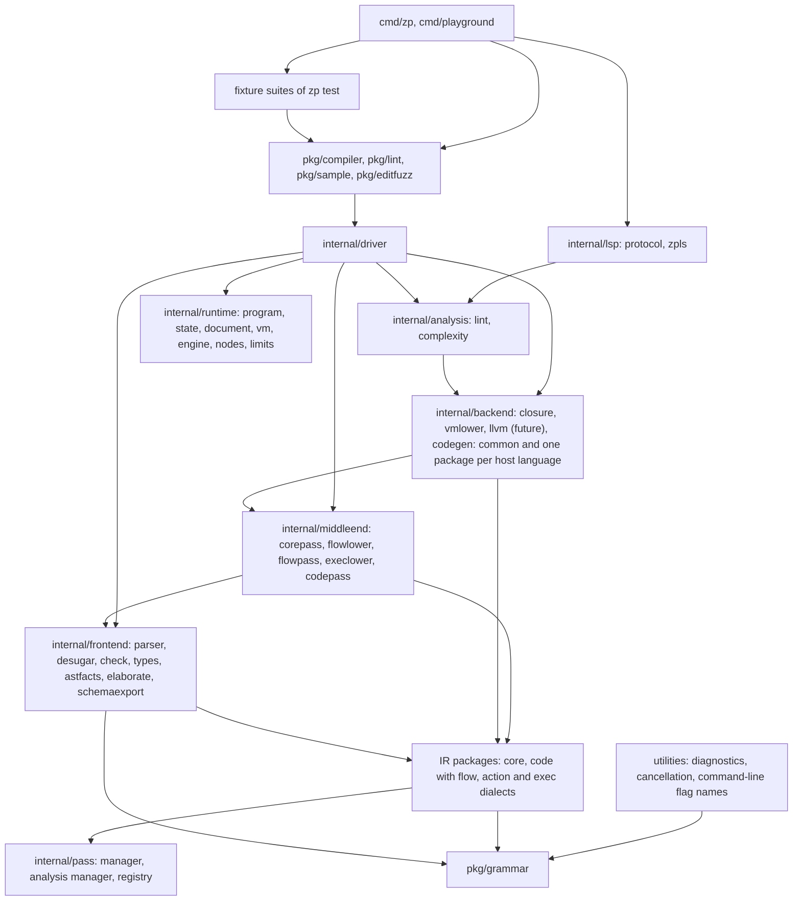

# 072. Release Package Layout

- **Status**: Accepted
- **Author**: @ornew
- **Date**: 2026-11-16

> [!WARNING]
> The code is being migrated to the target this record decides and still differs from it in places.

## Summary

ZeroParse is released with one package layout. A public layer `pkg/` is the only Go API, the runtime side of the module
never links the compiler side, and the middle of the pipeline is one Code IR with three dialects. This record fixes that
layout as the **target** and gives the reasons for it. The complete architecture (the package tree, the public API, the
import rules, the pass infrastructure and the driver) is [Architecture](../architecture.md). This record keeps the
decision: the problems, what was decided, why, and what was rejected. The plan for reaching the layout is kept in the
project's issue tracker, not in this record.

## Motivation

The packages grew with the features, and four problems follow from how they grew.

- **The public surface is spread over the root.** Public packages sit beside internal ones with no common prefix, so
  neither a reader nor a tool can tell the API from the rest, and a package that carries both runtime and compiler
  vocabulary (one package joins the runtime to the output schema and also compiles) has no single reason to change.
- **The runtime links the compiler.** A parser loaded from a compiled file, or a generated parser, needs only the parts
  that run a parse. Nothing forbids it from importing the grammar checker, so the dependency can grow by accident and
  the size of a loaded parser follows.
- **The middle of the pipeline has grown by accretion.** The Flow and Exec representations and the passes between them
  each define their own structure, printer and verifier, the pass runners are per-pipeline, and facts about rules are
  computed in more than one place.
- **Knowledge has several addresses.** A checked program, the Core IR and the runtime tables each hold part of what a
  rule is, and one idea ("check input without building a tree") has several names across commands, API and documents.

## Goals

- One place for the public Go API, with a stable-in-intent contract, apart from everything internal.
- A runtime that cannot depend on the compiler, enforced mechanically.
- Every piece of knowledge has one home, and each structure has one printer and one verifier. A rule's policy flags and
  site numbers come from Core IR facts. There is no "checked program" layer: its content lives in the semantic model,
  Core IR and the runtime program.
- A pass model that every pipeline shares, so that a pass says what it needs, what it keeps and when it applies.

## Non-Goals

- Changing what a parse does. Parse results, errors, recovery, limits and the output schema keep their behavior; a
  change of generated output is measured and explained.
- Stability beyond what the release promises. The layout is the shape of the packages, not a promise that every
  exported name inside them is frozen.

The layout does change some names and formats, and these are decided parts of it rather than side effects: the field
`"term"` of the grammar JSON and the syntax symbol of an action expression become `"action"` and `=> expr` (see
[Naming](#naming)); the import paths of generated Go parsers change when the public runtime packages are introduced; a
compiled file becomes the serialization of the runtime program and a closed instruction set; and bytecode is selected
from Code IR at the Flow stage. None of these is kept compatible with the earlier form before the first release.

## Design

The sections below state each decision with its reason. The full package tree and the public API are in
[Architecture](../architecture.md).

### The Public Layer

Everything a user imports lives under `pkg/`; everything else is `internal/` or a command. The packages are cut by the
vocabulary they own, not by the stage that implements them.

- `pkg/grammar`: the grammar AST and its JSON form, loading, formatting and conversion. The AST follows the language,
  which changes slowly, rather than an IR, which changes often, and the front end receives it as the grammar syntax tree
  (GST). A grammar source is a value with a name and a format, made by one of the constructors (from bytes, a string, a
  reader or a file-system path) and given an explicit format by a method. Loading reads grammar source and JSON and
  rejects a compiled file with an explicit error; the command line reads grammars through the same constructors. A
  grammar source is separate from the parse input, which has positions, streaming, edits and budgets; the two share only
  the naming convention of their constructors.
- `pkg/compiler`: turning a grammar into something executable. It returns the parser on the bytecode VM, the default
  backend; a parser from an AST that a program builds; the reference parser for differential testing; a compiled file;
  parsers in each host language; and the output schema. One optimization setting, with the profiles speed, memory and
  size and per-pass overrides, applies to every backend alike.
- `pkg/lint`, `pkg/sample` and `pkg/editfuzz`: the checks and the complexity classification, input generation, and edit
  fuzzing. Each has its own vocabulary (check names and severities, generation options, a versioned edit-sequence
  format), so each is a small package rather than a part of the compiler.
- `pkg/bytecode`: the instruction set and the compiled-file codec. It is public but marked unstable until release.
- `pkg/runtime` holds the parser interface, options, limits and statistics, and has these subpackages: `input` (position
  units, locations, text edits and change kinds), `value` (nodes, cursors, traversal, JSON, syntax errors), `value/impl`
  (the node representation), `schema` (the output schema, its JSON form, validation and comparison), `query` (structural
  queries), `instrument` (trace events, filters, depth and the per-rule profile), `vm` (loading a compiled file into a
  parser) and `golib` (the support declarations that generated Go parsers import; it is not an API for direct calls). The
  node representation sits below the value package because a generated parser copied into a user's module imports it,
  which an internal package cannot allow. The output schema is runtime-side because a parser, structural queries and the
  typed API use it while running. The support library of generated Go parsers is a package of its own, apart from
  `pkg/runtime`, because it holds many support declarations that the library protocol versions, and keeping them out of
  the user API avoids clashes of names such as the names of parsers and documents.

### The Runtime and Compiler Sides

The module is divided into a **runtime side** (`pkg/runtime/**`, `pkg/bytecode` and `internal/runtime/**`) and a
**compiler side** (everything else). The compiler side may use the runtime side; the runtime side must not reach the
compiler side. The rules, which a test enforces, are these.

1. **Rule 1.** For every non-test package on the runtime side, every package of the module that it depends on is also on
   the runtime side, and the runtime side imports no third-party package.
2. **Rule 1a (generated parsers).** The support library of generated Go parsers imports only `pkg/runtime`, `input`,
   `value`, `value/impl` and `instrument` (and `schema` where the typed API needs it); it imports neither `vm` nor
   `internal/runtime/**`. A generated parser therefore links neither the VM nor the engine. The embedded copy of the
   library compiles by itself in a temporary module that imitates a user's module, and the test checks parsers generated
   in both library modes (an imported library and an embedded one).
3. **Rule 2 (layers).**
   - `internal/pass` imports no other package of the module.
   - The IR packages (Core IR and Code IR with its dialects) import only IR packages, `internal/pass`, the cancellation
     helper and `pkg/grammar`. Inside them, the Code IR base imports no dialect; the Flow dialect imports the base and
     Core IR (for immediates) only; the Action dialect and the Exec dialect import the base only, and the packages under
     Exec may also import Exec and Action. Only the lowerings of the middle end and the checks that span dialects import
     more than one dialect.
   - The front end imports no middle end, backend, analysis tool or language server; the middle end imports no backend,
     analysis tool or language server; a backend imports no analysis tool or language server.
   - The utility packages (diagnostics, cancellation and command-line flag names) may import `pkg/grammar`, because
     diagnostics carry source positions. The fixture suite of `zp test` is not a utility: it is a tool that uses the
     compiler, in the same layer as the public tool packages.
   - Only the commands and the repository's test support import `internal/lsp/**`, and only test support imports
     `internal/testing/**` from non-test code.

The library printer of each host language prints the compositions of the Exec dialect into its runtime library. For Go,
that is the generated-parser library and the shared engine state. That is an edge of generation through the code
generation command, not an import edge, so it does not make the runtime side depend on the printer; a freshness test
keeps the printed files and the embedded copy current.

The consequences are concrete. Loading a compiled file never constructs a grammar AST or runs the type checker, because
the runtime side cannot name them: a compiled file holds a closed instruction set and the runtime program, not a
grammar. The reference parser needs Core IR, so it belongs to the compiler side and is public only through the compiler
package.

The test lists the dependencies of every package under the default tags and under the reference tags, and prints the
shortest import chain of a violation. It has no allowlist: a violation fails it. A deliberately wrong edge in the test
is a negative control.

### The Internal Tree

The compiler side is a pipeline with a driver on top; the tree names the stages. The front end returns the semantic
model and Core IR; the facts about rules are computed by the Core analyses of the middle end, which a pass or a tool
asks for through the analysis manager, and the front end does not return them.

The IR packages hold data, attribute computation, verifiers and printers; the passes that transform and analyze are in
the middle end. A verifier checks that the facts agree with the structure by recomputing the attributes, so it lives
with the attribute computation. The dialects are nested under the Code IR base, so the tree and the import paths say that
they are dialects of one representation, and the lowerings are packages of their own, outside the IR packages and apart
from the passes of each dialect. Names are chosen so that packages that are imported together do not clash: the grammar
language server is not named like the grammar package, and the compositions are not named like Core IR.

`internal/runtime/**` is the runtime side and holds the runtime program (the tables a parse needs, which a compiled file
serializes), the shared parser state, the incremental Document, the VM drivers, the entry points for parse, document
and stream use, and the budget arithmetic. Repository test support lives under `internal/testing`, and the architecture
test lives with it.

### One Code IR with Three Dialects

There are two internal representations, not three.

- **Core IR** holds the meaning of a grammar after desugaring: typed, with explicit facts, and with no knowledge of the
  mode (budgets, Documents, observation) or the target. Rewrites of meaning and the facts about rules, such as which
  rules need memo records or can be inlined, belong here. It is elaborated once from the semantic model, which answers
  every question tied to a source range (hover, lint findings, type errors) and transforms nothing.
- **Code IR** is one structured-code representation (modules, functions, statements, expressions) with a verifier, a
  printer and a reference interpreter, shared by everything below Core. What differs between levels is the table of
  operations, which is data, in three dialects:
  - the **Flow** dialect has the operations of grammar control: matching, marking and restoring for backtracking,
    expectations, captures, rule calls under a policy, charging for budgets and recovery;
  - the **Action** dialect has the operations that evaluate action expressions (value actions, predicate actions and
    bindings), and is valid both at the Flow stage and at the Exec stage;
  - the **Exec** dialect has the operations of the abstract parser machine and the compositions built on them: the call
    protocol, memoization, left-recursion growth, operator rules, Documents and streams.

The terms are fixed. A dialect is a set of operations; a program state is a stage of a Code IR module. Write "Code IR at
the Flow stage" and "Code IR at the Exec stage", or "the Flow stage" and "the Exec stage" once the context is clear, and
do not call either one "Flow IR" or "Exec IR". The abstract machine is what the Exec dialect defines; "the VM" is only the
bytecode interpreter.

A Flow operation states its contract, cost, the features it needs and its laws, and carries a reference expansion into
Exec operations. An Exec operation has a reference model, and a conformance suite compares every implementation with the
reference expansions and models.

Lowering between levels is a separate step with its own invariant, never a pass: lowering from Core takes it to the Flow
stage in a uniform shape, and the Flow passes choose the shape; the conversion from the Flow stage to the Exec stage is
complete, and the verifier checks that no Flow operation remains; instruction selection produces bytecode. Lowering
between dialects is *lower*, and *legalize* is used only for adjustments inside a target.

**Bytecode comes from the Flow stage.** The instruction set is at the level of grammar control, so instructions can be
chosen from Flow operations almost one for one, with superinstruction selection: a call of a composition is one
instruction and common match patterns fuse into high-level ones. A mark that names a set of state to save maps to the
choice instruction, a sound over-approximation. The compositions are native in the VM and checked by the Exec
conformance suite. The reason is that the VM, every host language and a future LLVM backend then all take grammar code
from one Code IR, so charging and option propagation cannot drift between two lowerings of grammar code. Host-language
parsers are produced from the Exec stage after language-specific passes that legalize and optimize it for the target,
then printed, and a printer prints the legalized Exec stage as it is, without carrying transformations as string
processing or regeneration. The closure backend deliberately does not share this lowering: it is built from Core IR so
that a bug in the lowering shows up as a difference between backends.

The complexity classifier works on its own Core IR module, the cost view, derived by normalization laws. The proofs
that the classification is sound speak about the cost view, so it is kept apart from the Core module that the
optimizations rewrite; it reaches users through the lint package.

### The Pass Model

The pass model is described in [the pass pipeline](../pass-pipeline.md). Its decisions are these.

- **Registration.** A pass declares its name (the same as its flag), its default, its applicability condition (a
  feature such as budgeting, Documents or tracing), the property it must preserve (its obligation), the ordering it
  needs, the analyses it needs and the ones it keeps. The registry is shared; each pipeline (Core, Flow, Exec and each
  host language) registers its own passes, and printers and library controls register under their own kind, so no name
  is declared twice.
- **Analyses.** An analysis is computed when a pass asks for it and cached. What a pass preserves is a set that defaults
  to nothing: forgetting to declare it invalidates everything, which is the safe side. An analysis key is registered by
  name, and a second key with the same name is rejected, so two analyses of one name and different result types cannot
  confuse the cache. Invalidating an analysis invalidates the analyses that used it, transitively; an analysis that
  depends on itself is an error; a transform that returns a different IR value invalidates the whole cache; a failed
  analysis returns an error and never degrades silently. Facts about rules are computed once on Core, through the
  analysis manager, and read by the generators, the engine, the linter and the complexity classifier. Attributes that
  live on Core nodes (nullability, first sets, effects) are invariants that the verifier recomputes, not cached analyses.
- **Verification.** After a pass, the stage's verifier runs on request and names the pass that broke an invariant. The
  Flow verifier checks structure, variables, one runtime per function, the budget invariants and the rules about reading
  input under a Document or a trace. A dump after any stage (`core`, `flow`, `exec`) shows the module as the next stage
  receives it.
- **Decisions.** Control-level decisions (call specialization, inlining, dispatch, the form of a match, removal of
  redundant saves, merging failure paths, where to charge, sharing slots and outlining) are Flow passes with stated
  obligations; target-specific legalization is in the host-language pipelines; passes that depend only on an operation's
  reads and writes are dialect-independent passes of Code IR.
- **Profiles.** A user chooses speed, memory or size. The table from profile to pass flags lives in the driver, and the
  public setting carries the profile and the overrides.

### Naming

- **Action expressions.** The grammar AST, the Core IR and the specification use one name for them: Action Expression.
  The JSON field is `"action"` and the syntax symbol is `=> expr`.
- **Recognition.** Recognizing input decides, without building a tree, whether the input matches the grammar, and
  returns the same success and the same syntax errors (recovered ones included) as a parse. Predicates, and the actions
  that predicates read, run; the runtime errors of other actions and the conversion to typed values are not checked, so
  a recognition can succeed where a parse fails. It is expressed only by the parser's recognition method and the
  command-line recognition mode; there is no option that switches a parse into a recognition, and generated parsers offer
  the same choice. "Validate" and "validation" mean only the structural check of an artifact (a grammar AST, a schema, a
  module).

## Testing

The import-graph test covers rules 1, 1a and 2 with a negative control. Generated output is compared against the
previous tree for changes that move packages without changing behavior, and the differential and conformance suites and
the documentation tests cover the rest. Selecting bytecode from the Flow stage is accepted only when compiled-file size
and VM throughput are within the noise of the previous construction, measured in interleaved runs against a copy of it.

## Limitations and Open Questions

The layout is the target; until the migration completes, the code differs from it. The shapes of the grammar source and
of loading, of the compile entry point, of the query and instrument packages and of the pass infrastructure are decided
and given in [Architecture](../architecture.md); the other shapes of the public layer are rough, and are settled in the
package documentation as they are implemented.
